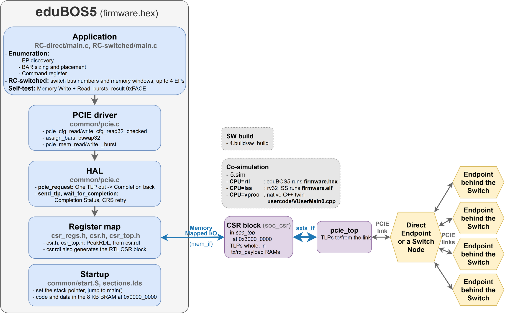

# RISC-V Bare-Metal PCIE Driver

The **open-source driver** of the RISC-V Root Complex: C sources, startup assembly and linker script. It enumerates the link and runs memory transactions as the PCIE host. Build it in [`4.build/sw_build`](../4.build/sw_build) (`make`, or `make VARIANT=switched`).

<div align="center"></div>

Diagram source: [`0.doc/3.sw/sw-structure.drawio`](../0.doc/3.sw/sw-structure.drawio).

## File Structure

| Directory | Contents |
| :--- | :--- |
| [`common/`](common) | `pcie.c` / `pcie.h`, `start.S`, `sections.lds` - used by both |
| [`RC-direct/`](RC-direct) | `main.c` for one Endpoint, straight RC-to-EP link |
| [`RC-switched/`](RC-switched) | `main.c` for the ASM1184e switch with up to 4 Endpoints behind it - see the [RC-switched README](../2.rtl/3.Bonus--RC-switched.opensource/README.md#2-firmware-the-bring-up-sequence) |
| [`tests/`](tests) | `soc_tx`, `soc_rx`, `soc_cpl`: firmware for the SOC-alone bench, [`5.sim/soc`](../5.sim/soc/run-soc.sh) |

| File | Does |
| :--- | :--- |
| `common/pcie.c`, `common/pcie.h` | HAL and driver: register access, TLP send, Completion wait (with Completion Status and CRS retry), Memory bursts, config read/write helpers, BAR sizing |
| `main.c` | **enumeration** (discovery, BAR placement, Command Register; `RC-switched` also the switch's bus numbers and windows) and the **app**: Memory Write, Memory Read, data check |
| `common/start.S` | zeroes `.bss`, sets the stack pointer, jumps to `main()` |
| `common/sections.lds` | maps code and data to the 8 KB BRAM at `0x00000000` |

The API and register map are common to both; the enumeration below is `RC-direct`'s.

### Code and data size

RV32IM without C (`MUL=1`, the default; no compressed instructions), `-Os -flto` (since 2026-11-26; `-O0` before: 2,548 B and 3,532 B of code), riscv-none-elf-gcc 15.2; `riscv-none-elf-size -A` on the board build. Code, data and stack share the 8 KB SOC RAM; the stack starts at its top (`_stack_top` from `sections.lds`).

| Firmware | Code (`.text`) | Read-only data | Data (`.data` + `.bss`) | Stack, worst case | Of the 8 KB RAM |
| :--- | ---: | ---: | ---: | ---: | ---: |
| `RC-direct` | 1,464 B | 0 B | 4 B | 144 B | 20% |
| `RC-switched` | 2,516 B | 0 B | 4 B | 224 B | 33% |

Board build (`PIO_BURST=0`), 2026-11-27. The leaf `request()` (below) took about 130 B off each; the `0xBAD00005` hang guard added about 60 B, and `RC-switched` grew with the bridge-window and link checks. Data lives on the stack. The globals, in `.bss` (`start.S` zeroes it), are `tx_tag` (`common/pcie.c`), the next non-posted request's tag, and, where the batch API is used (`PIO_BURST=1`), the batch's `tx_pos` / `tx_tlps`. `sections.lds` keeps at least 1 KB free for the stack. Worst-case stack is the deepest call chain, from the disassembly (each function's `addi sp,sp,-N`, followed along its calls; `-fcallgraph-info` writes nothing with `-flto`): LTO inlines most of the chain into `main`, which leaves `main` → `cfg_read32_checked` → `request` (`RC-direct`) and `main` → `cfg_read32_checked` → `cfg_read32` → `request` (`RC-switched`). No recursion, no variable-size frames.

**Fast on eduBOS5 means few saved registers.** A call costs little; restoring a register the callee saved is a 5-cycle load. So every non-posted request goes through one leaf, `request()`: the CRS retry, the send and the Completion wait, all inlined (`wait_tx_ready`, `wait_cycles` and `wait_for_completion` are `always_inline`). `-fno-move-loop-invariants` on it keeps `-Os` from hoisting a dozen constants into saved registers. A 1-DW write has its own four stores. Against the first `-Os` build: a third fewer cycles, about 10% less code.

---

## API Reference

Six functions hide TLP construction and handshakes:

| Function | Does | Returns |
| :--- | :--- | :--- |
| `uint32_t pcie_cfg_read(uint32_t bus, uint32_t dev, uint32_t func, uint32_t reg, uint32_t *val);` | Configuration Read: IDs, status, BARs. `*val` gets the raw (byte-swapped) value, only on success | Completion Status: `CPL_STAT_SC` (0), `_UR` (1), `_CRS` (2, after 100 retries), `_CA` (4), or `CPL_TIMEOUT` (8) |
| `uint32_t pcie_cfg_write(uint32_t bus, uint32_t dev, uint32_t func, uint32_t reg, uint32_t val);` | Configuration Write: BARs, Command register. A CRS answer is re-issued, as for reads | Completion Status, as above |
| `void pcie_mem_write(uint32_t addr, uint32_t val);` | Memory Write to BAR space, `addr` 4-byte aligned. Posted: returns at once, no Completion | - |
| `uint32_t pcie_mem_read(uint32_t addr, uint32_t *val);` | Memory Read from BAR space. `*val` written only on success | Completion Status, as above |
| `void pcie_mem_write_burst(uint32_t addr, const uint32_t *data, uint32_t n);` | Memory Write of `n` DW (1 to 32, Max_Payload_Size) in one TLP, within one 4 KB page | - |
| `uint32_t pcie_mem_read_burst(uint32_t addr, uint32_t *data, uint32_t n);` | Memory Read of `n` DW in one TLP; the CplDs it comes back in (the completer may split at its 64-byte Read Completion Boundary) are gathered in address order | Completion Status, as above |

`bus, dev, func` is usually `1, 0, 0` on a direct link. The configuration calls share `pcie_request()`; they pick Type 0 for bus 1 and Type 1 beyond it. `main()` uses the wrappers `cfg_read32()` / `cfg_write32()`, which add `bswap32()`; `cfg_write32()` and `cfg_read32_checked()` stop with `0xBAD00002` on failure. Memory data is not swapped: it travels in TLP byte order, byte 0 in bits `[31:24]`.

```c
if (pcie_cfg_read(1, 0, 0, 0x00, &id) == CPL_STAT_SC) ...   // Vendor ID
status = pcie_cfg_write(1, 0, 0, 0x10, 0xFFFFFFFF);         // size BAR0
pcie_mem_write(0x80000000, 0x00000006);
if (pcie_mem_read(0x80000000, &data) == CPL_STAT_SC) ...
```

---

## Hardware Abstraction Layer (HAL)

The driver talks to the PCIE bridge RTL through memory-mapped registers.

### Register Map
`common/pcie.h` takes these from `csr.h` (generated from `csr.rdl`) through `csr_regs.h`; see [4.build/README.md](../4.build/README.md#the-register-map).

The same layout as openCologne-PCIE's EP firmware sees.

| Register Name | Address | R/W | Description |
| :--- | :--- | :--- | :--- |
| `PCIE_TX_SEND` | `0x3000000C` | W | **Send:** the number of TLPs in `tx_payload`, written last; starts the transfer. |
| `PCIE_RX_VALID` | `0x30000020` | RW | 1 while a TLP waits in `rx_payload`; writing 1 frees it, and the next in the ring takes its place. |
| `PCIE_ERR_STATUS` | `0x30000024` | RW1C | **Error Status:** a flag for a received fatal-error Message (bit 16). The `PCIE_2_1` hard block does not export its PCI Status register, so bits [15:0] read 0. |
| `PCIE_PHY_STATUS` | `0x30000028` | R | `tx_busy` (bit 0) and the number of free hard-macro Tx buffers (bits [13:8]) - polled before every send (`wait_tx_ready()`). |
| `PCIE_RESULT` | `0x3000002C` | RW | **Result marker** the firmware writes when it stops (table below). Sends nothing; drives the PASS LED and an ILA probe. |
| `PCIE_RX_PAYLOAD(i)` | `0x30001000` + 4i | R | DW i of the TLP at the head of the RX ring, header first (1024 entries). |
| `PCIE_TX_PAYLOAD(i)` | `0x30002000` + 4i | W | DW i of the TLPs to send, back to back from entry 0, header first (1024 entries). |

---

## Driver Logic & Features

### 1. Robust TLP Transmission
A TLP goes out as its header and payload in `tx_payload`, then `PCIE_TX_SEND` (`send_tlp()`). Several go as one batch: `tx_add()` or `tx_mem_write()` for each, back to back in `tx_payload`, then `tx_go()` writes their number to `PCIE_TX_SEND`. A full batch goes out by itself.

**Tags only where a Completion comes back.** The RC has 32 tags (no Extended Tag). A posted write gets no Completion, so its tag means nothing: it sends tag 0 and leaves the counter alone. All 32 tags then go to reads and config requests, so a tag comes round again only after 32 of those, not after any 32 TLPs.

Every non-posted request checks the **Completion Status** (SC / UR / CRS / CA) or reports a timeout, and returns read data separately, so a genuine `0xFFFFFFFF` is never taken for an error. `wait_for_completion()` takes the TLPs from the RX ring one by one: a Completion with its tag is used, anything else (a stale Completion, a Message) is freed unread. A **CRS** answer (Configuration Retry Status) to a config request, read or write, is re-issued with a fresh tag up to 100 times. A config request that fails after the device was found stops the firmware with `0xBAD00002`.

### 2. Enumeration Sequence (in `main`)
1.  **Wait** for the link to settle.
2.  **Discovery:** read the `Device ID` on bus 1.
3.  **BAR sizing:** with memory decoding off, write `0xFFFFFFFF` to each of the six BARs and read back. `0` = not implemented; bit 0 = I/O BAR (left unassigned: this RC has no I/O space); bits `[2:1] = 10` = 64-bit BAR, the next BAR is its upper half. Size = `~(readback & ~0xF) + 1`.
4.  **Assignment:** place each memory BAR, aligned to its size, in `0x80000000 - 0xFFFFFFFF` (`RC-switched`: the 1 MB window of the endpoint's switch port). BAR0 lands at the base: `0x80000000` for the AMD EP's 2 KB BAR0. A BAR that does not fit is parked (64-bit above 4 GB, 32-bit at 0); if it is BAR0, the firmware stops with `0xBAD00003`.
5.  **Enable:** set **Memory Space** in the Command Register. **Bus Master** stays off: the RC answers no request from a device (it frees it unread), so no device may send one.

Configuration payloads are big-endian on this RC (register byte 0 in bits `[31:24]`), so config data goes through `bswap32()` and source values read as the spec prints them.

### 3. Self-Test & Debug Codes
With `make PIO_BURST=1` (the [co-simulation](../5.sim/README.md)'s default; the board build is 0, as the AMD PIO endpoint answers only 1-DW requests) the self-test adds a **burst check**: 32 DW written in one Memory Write and read back in one Memory Read. RC-direct then runs the **throughput test** below.

The driver ends by writing a marker to `PCIE_RESULT`. Unlike `PCIE_TX_SEND`, this sends no TLP. On the board, PASS lights `led_link_up[3]`, and an ILA can watch every marker ([RTL Debug with ILA](../2.rtl/README.md#rtl-debug-with-ila)).

| Magic Number | Meaning |
| :--- | :--- |
| **`0x0000FACE`** | **PASS:** Data `0x6` was written and successfully read back. |
| **`0x0000DEAD`** | **FAIL:** Readback data did not match the written value, or the memory read was not completed with SC. |
| **`0xBAD00000`** | **ERROR:** Device ID read failed: no device at bus 1, or no Completion. (Not a link down: the SOC is held in reset until the link is up.) In `RC-switched`: the switch upstream port did not answer. |
| **`0xBAD00001`** | **ERROR** (`RC-switched` only): the switch is up, but no Endpoint was found behind it. |
| **`0xBAD00002`** | **ERROR:** A config request to a device that had answered failed (UR, CA, timeout, or CRS after 100 retries). |
| **`0xBAD00003`** | **ERROR:** The Endpoint's BAR0 is not implemented, is an I/O BAR, or does not fit the window. |
| **`0xBAD00004`** | **ERROR** (`PIO_BURST=1`): a burst, or the throughput test, read back other data, or no SC. |
| **`0xBAD00005`** | **ERROR:** the Tx side stayed busy, or no hard-macro transmit buffer came free, for longer than the Completion timeout (`wait_tx_ready()`). |

### 4. PIO throughput: bursts against 1-DW requests
`pcie_perf_test()` (`PIO_BURST=1`, RC-direct) moves the same 32 DW (128 bytes) as 32 one-DW requests, as one batch of them, and as one 32-DW burst, written, then read back. Each phase is timed with `rdcycle` from its first CSR access until its last TLP has left (writes) or its last Completion is read (reads): loading `tx_payload`, polling, reading `rx_payload`. The five counts go to the endpoint in a report TLP (BAR0 + `0x300`); the co-simulation prints them and fails a run above its ceilings (`PERF_MAX` in [5.sim/Makefile](../5.sim/Makefile)). x1 Gen2, eduBOS5 2-stage at 62.5 MHz, firmware `-Os -flto`, pcieVHost endpoint (2026-11-27):

| 32 DW, 128 bytes | 1-DW requests | One batch (one `tx.send`) | One 32-DW burst | Burst gain |
| :--- | ---: | ---: | ---: | ---: |
| Memory Write | 2,082 cycles, 3.8 MB/s | 2,070 cycles, 3.9 MB/s | 592 cycles, 13.5 MB/s | **3.5x** |
| Memory Read | 9,960 cycles, 0.8 MB/s | | 1,312 cycles, 6.1 MB/s | **7.6x** |

A 1-DW write costs about 65 cycles: four `tx_payload` stores, `tx.send` and a status poll (with its `0xBAD00005` hang-guard counter), for 4 bytes. A burst pays that once, then one store per DW. The batch saves the polls but not the stores, so on this core it is no faster; it matters where TLPs must leave back to back. A read waits a round trip for each Completion, so it gains the most. The 32-DW read came back as two 16-DW CplDs (the endpoint's 64-byte Read Completion Boundary).


----------------
#### End-of-Document
