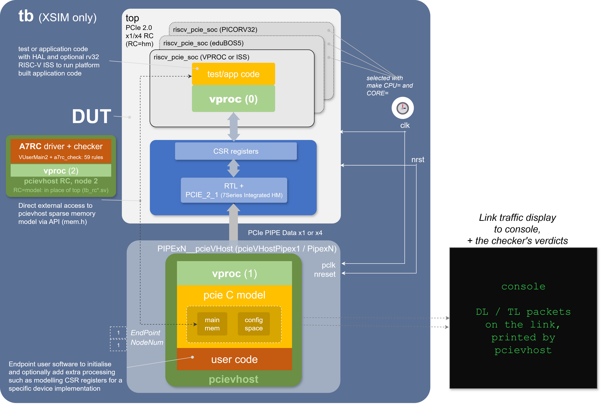

# openPCIE Simulation Top Level Test Bench

## Table of Contents

* [Introduction](#introduction)
* [Test Bench Structure](#test-bench-structure)
  * [The PIPE PHY model](#the-pipe-phy-model)
  * [Endpoint feature limitations](#endpoint-feature-limitations)
  * [Prerequisites](#prerequisites)
  * [Model and viewer versions](#model-and-viewer-versions)
  * [What the simulation does](#what-the-simulation-does)
  * [Building and running](#building-and-running)
  * [RC-switched: a switch behind the link](#rc-switched-a-switch-behind-the-link)
  * [WaveCrux decoders](#wavecrux-decoders)
  * [Viewing the TLPs in WaveCrux](#viewing-the-tlps-in-wavecrux)
  * [PCIe through a switch: a hands-on tutorial](#pcie-through-a-switch-a-hands-on-tutorial)
  * [Viewing the PIPE in WaveCrux](#viewing-the-pipe-in-wavecrux)
  * [The x4 link in WaveCrux](#the-x4-link-in-wavecrux)
  * [Every layer at the Endpoint: transaction taps](#every-layer-at-the-endpoint-transaction-taps)
  * [How long a TLP spends in the hard macro](#how-long-a-tlp-spends-in-the-hard-macro)
* [The three CPU options](#the-three-cpu-options)
  * [What they cost](#what-they-cost)
* [_VProc_ Software](#vproc-software)
  * [Other Software Use Cases](#other-software-use-cases)
    * [Natively Compiled Application](#natively-compiled-application)
    * [RISC-V Compiled Application](#risc-v-compiled-application)
* [Building and Running Code](#building-and-running-code)
  * [Configuring ISS timing model](#configuring-iss-timing-model)
  * [Running ISS code](#running-iss-code)
    * [The openPCIE configuration](#the-openpcie-configuration)
* [Debugging Code](#debugging-code)
  * [Natively Compiled Code](#natively-compiled-code)
  * [ISS Software](#iss-software)
* [The mem_model Co-Simulation Sparse Memory Model](#the-mem_model-co-simulation-sparse-memory-model)
* [Driving the PCIE Link](#driving-the-pcie-link)
  * [Three ways to attach pcieVHost](#three-ways-to-attach-pcievhost)
* [HAL](#hal)
* [Our Local VIP Improvements](#our-local-vip-improvements)
* [Open-source PCIE Validation Stacks](#open-source-pcie-validation-stacks)
* [Our TB jig as a foundation for an accurate RC model](#our-tb-jig-as-a-foundation-for-an-accurate-rc-model)
  * [Steps](#steps)
  * [What the Artix-7 RC does](#what-the-artix-7-rc-does)
  * [Profile: Artix-7 RC against pcieVHost](#profile-artix-7-rc-against-pcievhost)
  * [The RC model](#the-rc-model)
    * [Drive and check](#drive-and-check)
    * [On the serial line](#on-the-serial-line)
    * [Driving another project's EP](#driving-another-projects-ep)
  * [Fault tests: the firmware's error paths](#fault-tests-the-firmwares-error-paths)
  * [Example: the Gen2 speed change](#example-the-gen2-speed-change)
  * [What this showed about pcieVHost](#what-this-showed-about-pcievhost)
  * [The hard macro under Data Link faults and in Recovery](#the-hard-macro-under-data-link-faults-and-in-recovery)
  * [Still to measure](#still-to-measure)
* [Simulation issues](#simulation-issues)
  * [pcieVHost: what we added or removed](#pcievhost-what-we-added-or-removed)
* [References](#references)


## Introduction

The test bench runs the real Root Complex RTL against [*pcievhost*](https://github.com/wyvernSemi/pcievhost), a PCIE 1.1/2.0 model written in C. The C model runs on [*VProc*](https://github.com/wyvernSemi/vproc), a virtual processor that runs a natively compiled program as if it were an HDL component. A Bus Functional Model (BFM) wrapper maps the PCIE ports into _VProc_'s memory-mapped bus, so software drives and reads them.

<p align=center>

</p>

_pcievhost_ is a root complex model; a parameter turns it into the endpoint here, in our wrapper `PIPExN__pcieVHost.sv`: upstream's `pcieVHostPipex1.v` at x1, our `pcieVHostPipexN.sv` at x4. Its user code, [`usercode/VUserMain1.cpp`](usercode/VUserMain1.cpp), builds a Type 0 config space with PCIE, MSI and Power Management capabilities, calls `initFc()` to bring up flow control, and can generate traffic. The model answers every request that needs a completion by itself, and prints the traffic both ways to the console, as set in `ContDisps.hex`. Its endpoint features are [limited](#endpoint-feature-limitations).

## Test Bench Structure

`tb.sv` instantiates `RC_opensource` from `2.rtl/0.common.opensource`: the same top level as both bitstreams, RC-direct and RC-switched, with the whole design:

```
tb.sv
 |
 +- RC_opensource                                   2.rtl/0.common.opensource/src/
      |
      +- pcie_top                                real RTL
      |    +- clk_rst_gen       MMCM                  real RTL
      |    +- pcie_core                            real RTL
      |    |    `- PCIE_2_1                     Xilinx hard macro (secureip)
      |    `- phy_top    <-- REPLACED -->      5.sim/models/phy_top.EP-PIPE-BFM.sv
      |                                                +- PIPE PHY model
      |                                                `- PIPExN__pcieVHost (endpoint,
      |                                                   VProc node 1, VUserMain1.cpp;
      |                                                   pcieVHostPipex1 / PipexN at x4)
      `- riscv_pcie_soc                             real RTL
           +- eduBOS5 (or picorv32)                 real RTL, runs firmware.hex
           `- soc_csr -> csr                        PeakRDL-generated CSR
```

One RTL file is swapped, and one file copied in:

| Item | Why |
|---|---|
| `phy_top.sv` becomes `models/phy_top.EP-PIPE-BFM.sv` | the 7-series GTP transceiver turns PIPE symbols into a 5 GT/s serial stream. _pcievhost_ models the link at PIPE symbol level, so the transceiver has to go |
| `firmware.hex` copied into `5.sim/` | `riscv_pcie_soc.sv` reads it with `$readmemh` and a bare file name |

Everything else is what goes into the FPGA: hard macro, transaction layer, CPU, CSR and firmware. The swap needs no `ifdef`: module name and ports match, so the file list (`tb.prj`) just picks the other file. The CPU swap for `CPU=vproc` / `CPU=iss` is an `` `ifdef SOC_CPU_VPROC `` in `riscv_pcie_soc.sv` ([The three CPU options](#the-three-cpu-options)).

Three simulation-only defines, set only by `5.sim/Makefile`, never by a synthesis flow:

| Define | Effect | Why |
|---|---|---|
| `SIM_FAST_TRAIN` | `PL_FAST_TRAIN = "TRUE"` on the hard macro (`pcie_core.sv`) | shortens the LTSSM training timers, a simulation feature of the macro. With the real 12/24 ms timers, link training outlasts any practical run |
| `SIM_GEN1_ONLY` | `PCIE_GEN = 1` (`link_pkg.sv`) | `make SIM_GEN=1`, the x4 default: pins the run to Gen1. The x1 default, `SIM_GEN=2`, drops it, and the RC takes the link to Gen2 ([the Gen2 speed change](#example-the-gen2-speed-change)) |
| `SIM_PIPE_CODING` | `DISABLE_SCRAMBLING = "TRUE"` on the hard macro (`pcie_core.sv`) | matches how the endpoint VIP is configured over PIPE |

### The PIPE PHY model

`models/phy_top.EP-PIPE-BFM.sv` replaces the transceiver, with the link partner behind it. It gives the `PCIE_2_1` LTSSM what it needs from a PHY:

* **PHYSTATUS pulses** on exit from PIPE reset, and on every power-state and rate change
* **Receiver detection**: a PHYSTATUS pulse with `RXSTATUS = 3'b011` in answer to `TXDETECTRX`, so the LTSSM can leave Detect
* **RXVALID / RXELECIDLE** from the first K character the partner sends, standing in for a squelch detector

It also makes the clocks. `TXOUTCLK` is a behavioural 100 MHz oscillator; everything after it is the real `clk_rst_gen` MMCM. PCLK runs at 125 MHz (Gen1) or 250 MHz (Gen2), USERCLK1/2 at 62.5 MHz (x1), 125 MHz (x4 Gen1) or 250 MHz (x4 Gen2).

**The 100 MHz matters.** `clk_rst_gen` is set for `CLKIN1_PERIOD = 10 ns` and `CLKFBOUT_MULT_F = 10`. Another input frequency scales every clock, and the PIPE over- or under-samples the partner: at 125 MHz, PCLK becomes 156.25 MHz and repeats one symbol in five.

Trace options: [Building and running](#building-and-running).

### Endpoint feature limitations

The endpoint side of _pcievhost_ is a parameter, `EndPoint = 1`, set where `models/phy_top.EP-PIPE-BFM.sv` instantiates the model. It trains a link and answers Configuration and Memory requests: what testing a root complex needs, but not a device model.

**What it provides**

* A config space, built by [`usercode/VUserMain1.cpp`](usercode/VUserMain1.cpp) with `writeConfigSpace()` / `writeConfigSpaceMask()`: a Type 0 header (vendor `0x14fc`, device `0x0002`) and PCIE, MSI and Power Management capabilities. The mask calls make read-only bits read-only.
* Automatic completions for Configuration and Memory requests; Memory traffic lands in the [sparse memory model](#the-mem_model-co-simulation-sparse-memory-model).
* A full LTSSM, flow control initialisation and DLLP handling.

**What it does not**

* **No device behaviour behind the BARs.** A write is stored and a read returns it: no DMA, no interrupts, no application logic.
* **Little error injection.** `make SIM_FAULT=crs|nocpl|late|linkdown` covers CRS, a lost Completion, a late endpoint and a link drop ([Fault tests](#fault-tests-the-firmwares-error-paths)). Malformed TLPs, Nak and replay take an edit of the model.
* **x1 upstream, x4 here.** Upstream's `pcieVHostPipex1` is x1 with a 16-bit PIPE; our `pcieVHostPipexN` runs the same model at x4 (`make SIM_LANES=4`), Gen1 and Gen2.
* **The endpoint LTSSM paths were the least exercised.** Three turned out wrong once real silicon drove them. The fixes are in `models/pcievhost/ltssm/ltssm.c`, the original beside it as `ltssm.c.orig`.

For a partner with real device behaviour, use the RTL endpoint [`2.rtl/1.EP.opensource`](../2.rtl/1.EP.opensource). It lacks this model's decoded protocol log and controllability: the two complement each other.

### Prerequisites

Linux or WSL, once:

- **Vivado 2026.1 for Linux** (`xvlog`, `xelab`, `xsim`; needs a license file, even for `xsim`). Windows `xsim` starts from WSL too, but loads the C/C++ models (`-sv_lib`) only as a Windows DLL, not the Linux `.so` built here.
- **GCC 10+** (C++20) and `make`: `sudo apt install build-essential`
- **RISC-V GCC** (xPack `riscv-none-elf-`) for the firmware: [4.build](../4.build/README.md)

Then, from the repo root:

```sh
source 4.build/set-env.sh     # tcsh: source 4.build/set-env.csh
```

It finds Vivado (`/tools/Xilinx/<version>/Vivado`, `~/Xilinx/<version>/Vivado`, or `XILINX_VIVADO`) and the compilers, and lists what is missing. `peakrdl` is needed only to edit `csr.rdl` ([4.build](../4.build/README.md#csr-hal-compilation)).

### Model and viewer versions

| Component | In use | Latest upstream (Oct 2026) | Source |
|---|---|---|---|
| VProc | 1.13.4 | 1.13.4 | [wyvernSemi/vproc](https://github.com/wyvernSemi/vproc) |
| pcievhost **(modified: DLL and TL access points besides the PIPE, x4; see below)** | 1.9.3 | 1.9.3 (without our changes) | [wyvernSemi/pcievhost](https://github.com/wyvernSemi/pcievhost) |
| mem_model **(modified, see below)** | `main` c7b9c62 (1.0.1 + one fix) | same | [wyvernSemi/mem_model](https://github.com/wyvernSemi/mem_model) |
| rv32 ISS **(modified, see below)** | 1.3.3 | 1.3.3 | [wyvernSemi/rv32](https://github.com/wyvernSemi/rv32) |
| Vivado simulator (`xsim`) | 2026.1 | 2026.1 | [AMD Vivado](https://www.amd.com/en/products/software/adaptive-socs-and-fpgas/vivado.html) |
| WaveCrux Pro | 1.1.1 | 1.1.1 | [Ferrite-Engineering/wavecrux](https://github.com/Ferrite-Engineering/wavecrux) |
| TLP decoder plugin (ours) | `wcx-pcie-tlp` pcie-tlp-v0.1.1 | pcie-tlp-v0.1.1 | [Ferrite-Engineering/wavecrux-decoders](https://github.com/Ferrite-Engineering/wavecrux-decoders/tree/main/decoders/pcie-tlp) |
| PIPE, DLL and serial-line decoder plugin | `wcx-pcie` pcie-v0.2.0 | pcie-v0.2.0 | [Ferrite-Engineering/wavecrux-decoders](https://github.com/Ferrite-Engineering/wavecrux-decoders) |
| RISC-V instruction-trace decoder | built into WaveCrux | -- | [Ferrite-Engineering/wavecrux](https://github.com/Ferrite-Engineering/wavecrux) |

#### Why XSIM and not Verilator?

Our RTL is 100% SystemVerilog and passes Verilator lint (`run-lint.sh`); the co-simulation models (VProc, pcievhost, mem_model, rv32) ship Verilator flows upstream. The blocker is the `PCIE_2_1` hard macro: its model is AMD's `secureip` library, encrypted (IEEE 1735). Only vendor simulators run it, and no open model exists. The Xilinx primitives in the design:

| Primitive | Simulation model | In Verilator |
|---|---|---|
| `PCIE_2_1` | encrypted `secureip` core | no -- the blocker |
| `GTPE2_CHANNEL`, `GTPE2_COMMON` | encrypted `secureip` cores | not needed: co-sim replaces the GTP with [the PIPE PHY model](#the-pipe-phy-model) |
| `MMCME2_ADV` | plain Verilog, `real` arithmetic and `#` delays | not tried |
| `BUFG`, `BUFGCTRL`, `IBUFDS_GTE2`, `RAMB36E1`, `FDCE` | plain Verilog | expected to work |

Verilator would also need `--timing` for the whole test bench: `tb.sv` and the PIPE model make clocks with `#` delays, and VProc waits a delta cycle for each `UpdateResponse`. VProc's `-GDISABLE_DELTA` drops that wait, but would not save `--timing`, and changes the handshake pcievhost runs its link on.

#### Why VCD and not FST?

XSIM writes only VCD (`$dumpfile`/`$dumpvars`) and its own `.wdb`; FST is GTKWave's format (Verilator and Icarus write it). With `DUMP_VCD`, `make run` converts the VCD with [`tools/vcd2fst.sh`](tools/vcd2fst.sh) (GTKWave's `vcd2fst -Z`); `make fst` does only that. The FSTs are tracked, `tb.vcd` is not (`tb.x1g1.direct.fst`: 11.6 MB VCD -> 86 KB, 134x smaller). Only `CPU=rtl CORE=edubos5` writes the tracked names; another CPU or core adds its name (`tb.x1g1.direct.vproc.fst`, not tracked).

The ready-made `.wavecrux` sessions open the tracked FSTs, named like the bitstreams, so they work from a fresh clone. The walkthroughs below use the Gen1 dumps (`SIM_GEN=1`): `tb.x1g1.direct.fst`, `tb.x1g1.switched.fst`, `tb.x4g1.direct.fst`. The x1 Gen2 default has the same views in `tb.x1g2.direct.fst`, `tb.x1g2.switched.fst` and `tb.x1g2.*.wavecrux`. Sessions bind signals by their number in the file, which differs between VCD and FST ([rebinding](#viewing-the-tlps-in-wavecrux)).

#### Local changes

| File | Change | Why |
|---|---|---|
| `models/cosim/mem_model.sv` | wraps upstream `mem_model.v` (kept as `f_mem_model.v`) in Verilator `lint_off` pragmas | keeps third-party code out of our lint |
| `models/rv32/src/rv32csr_cpu.cpp` (in `rv32-openpcie.patch`) | the timer-compare check in `process_interrupts()` no longer charges cycles | it added 2 cycles to every instruction |
| `models/rv32/src/rv32i_cpu.cpp` (in `rv32-openpcie.patch`) | `sw`, `sh` add the store extra cycles | upstream adds the load ones |
| `models/rv32/usercode/rv32_timing_config.h` | PicoRV32, eduBOS5 2-/3-stage tables measured on the RTL in this SOC | see [Our Local VIP Improvements](#our-local-vip-improvements) |
| `models/rv32/usercode/VUserMain0.cpp` | no fetch/load wait states; bus credit; waits for reset release, restarts on reset; RV32I-only fetch filter | see [Our Local VIP Improvements](#our-local-vip-improvements) |
| `models/soc_cpu.VPROC.native.sv` | 2-clock picorv32 handshake; `!resetn` on VProc interrupt bit 3 | see [Our Local VIP Improvements](#our-local-vip-improvements) |

pcievhost:

| File | Change | Why |
|---|---|---|
| `ltssm/ltssm.c` | As upstream port: send Link and Lane = PAD until the partner assigns them; stay in Configuration.Lanenum for at least 16 TS1 | real PCIE_2_1 downstream port deadlocked or timed out against the model's endpoint LTSSM ([Endpoint feature limitations](#endpoint-feature-limitations)) |
| `ltssm/ltssm.c`, `ltssm.h` | Recovery with the speed change (RcvrLock, RcvrCfg, Speed, Idle; timeouts fall back to the old rate, or go to Detect); no random N_FTS in Recovery. `LinkIdle()` follows the partner from L0 into Recovery, and looks for TS1 and TS2 before each idle it sends; `ChangeLinkSpeed()` starts a change to Gen1 or Gen2 from this side; `GetLinkSpeed()`. Recovery.Speed writes `GEN2_CLK`, so `PcieVhostSerial`'s own clocks follow (`IFACE=serial`) | upstream has no Recovery.Speed: the model could not follow the RC to Gen2 ([the Gen2 speed change](#example-the-gen2-speed-change)) |
| `ltssm/ltssm.c`, `ltssm.h` | `SetLinkProfile()`, `GetLinkProfile()`: `LTSSM_PROFILE_ARTIX7_RC` takes the root port's Configuration path with the Artix-7 TS counts, the Autonomous Change bit, a fixed Detect time (first TS1 3.035 µs after PERST#), and one more TS1 in Linkwidth.Accept and Lanenum.Accept and TS2 in Configuration.Complete than upstream. In a speed change it sends the Artix-7 TS1 counts in RcvrLock, holding the Speed Change bit for its first 1 (its own change) or 8 (the partner's), times its Recovery.Speed idle, and sets the rate (`GEN2_CLK`) once its EIOS is out. `GetLinkTimeNs()`: ns from the symbol clock ticks at each rate, for the RC model's firmware timing; `GetLinkRecoveryNs()`: the part spent in Recovery, for its checker's L0-only timers. `LTSSM_PROFILE_EP`, the default, is the path above | the [RC model](#the-rc-model) |
| `src/pcie.c` (in `lib/libpcielnx.a`) | `SendTsGen()` keeps the Speed Change and Autonomous Change bits of its rate argument; `SetTxDisabled()` holds TLPs, DLLPs, Acks and Naks, sending logical idle; a received Nak is an Ack up to its sequence number, then a replay from the next TLP. SKPs keep their interval in training (issues 45, 46), a due Ack or Nak goes before the next TLP ([issue 18](#simulation-issues)), an UpdateFC right after the packet on the wire ([issue 23](#simulation-issues)); both queue purges compare modulo 4096 ([issue 27](#simulation-issues)). `SetPktMonitor()` (declared in `pcie.h`, its pointer in `pcie_utils.h`): a monitor called with every TLP and DLLP sent (`SendPacket()`) and received (`ProcessInput()`, `pcie_utils.c`), before processing. In [`pcievhost-speed.patch`](models/pcievhost/pcievhost-speed.patch) | a TS could not carry the Speed Change bit; upstream sets the TX-disabled flag but never reads it, so DLLPs went out during Recovery; on a Nak, upstream skipped forward while seq > Nak and ran off the end of its queue (segfault) |
| `src/pci_express.h`, `src/displink.c` (in `lib/libpcielnx.a`) | The PCIe Capability union holds 15 DWs, the capability's size ([issue 28](#simulation-issues)). The packet display shifts bytes as unsigned ([issue 29](#simulation-issues)) | undefined behaviour, found by UBSan: it made `-O0` and `-O2` builds differ |
| `models/cosim`: `VSched.c`, `VUser.c`, `VProc.h` (in `lib/libcosimlnx.a`, `include/VProc.h`) | The user code runs as a coroutine on the simulator's thread: `VSched()` and `VExch()` switch stacks (`VCoSwap`, x86-64 assembly), 16 MB per node with a guard page. `VPROC_THREADS` keeps the threads | [about 22 times faster](#our-local-vip-improvements): the thread handover was the cost. `vproc-coroutine.patch`, applied by `tools/vip-upgrade.sh` |
| `src/mem.c`, `src/mem.h` (in `lib/libpcielnx.a`) | The config space tables are cleared entry by entry ([issue 20](#simulation-issues)). `WriteConfigSpaceW1c()` marks RW1C bits: a Configuration write of 1 clears them ([issue 21](#simulation-issues)). `ReadRamByteBlock()` takes a read that ends at a 4 KB boundary ([issue 24](#simulation-issues)) | upstream: [issues 20, 21 and 24](#simulation-issues) |
| `src/pcie_utils.c` (in `lib/libpcielnx.a`), `src/ltssm.h` | `TxFcInitInt()` waits between InitFC rounds with `LinkIdle()`, not `SendIdle()`. Endpoint fixes: UR for a Type 0 Configuration Request to a function other than 0 ([issue 14](#simulation-issues)), the Extended Register Number masked to 4 bits ([issue 16](#simulation-issues)), Completions of at most 128 bytes ([issue 17](#simulation-issues)), accesses that end at a BAR's end ([issue 22](#simulation-issues)), an Ack or Nak on the wire finishes before a packet queued meanwhile ([issue 31](#simulation-issues)). `ltssm.h` declares `LinkIdle()`, `ChangeLinkSpeed()`, `GetLinkSpeed()`, `GetLinkProfile()`, `GetLinkTimeNs()` and `GetLinkRecoveryNs()`. With `LTSSM_PROFILE_ARTIX7_RC`, InitFC and UpdateFC go as on that root port: one InitFC DLLP every 64 ns, done after 4 InitFC2 rounds once it has the partner's; UpdateFC every 32.77 µs at either rate, timed from the end of InitFC, not just because nothing else waits. FC_INIT2 completes on the partner's first InitFC2 or UpdateFC, as the spec has it (upstream waits for all three InitFC types again, and hangs on a partner that sends one set of each). In `pcievhost-speed.patch` | the EP sent InitFC2 and UpdateFC for 370 ns (x4) after the RC entered Recovery.RcvrLock: `initFc()` did not look for TS1 |
| `verilog/pcieVHost/pcieVHost.v` | VProc `BE` and `Burst` ports, left open | we build VProc with `VPROC_BYTE_ENABLE` |
| `src/displink.c` (in `lib/libpcielnx.a`), `include/pcie_vhost_map.h`, `verilog/headers/pcie_vhost_map.v`, `verilog/pcieVHost/pcieVHost.v`, `pcieVHostPipex1.v` | transaction taps: TLP and DLLP ports, in [`pcievhost-taps.patch`](models/pcievhost/pcievhost-taps.patch) | the decoders need the TLPs and DLLPs; the model keeps them in C ([transaction taps](#every-layer-at-the-endpoint-transaction-taps)) |
| `verilog/headers/test_defs.v` | `` `fatal`` calls `tb.Fatal` | our test bench top is `tb` |
| `src/pcie_utils.c`, `src/pcie_utils.h`, `src/pci_express.h` (in `pcievhost-speed.patch`) | Lane polarity inversion: a TS identifier received inverted (D21.5, D26.5) inverts the lane from then on | 4.2.4.4 ([issue 52](#simulation-issues)) |
| `verilog/pcieVHost/pcieVHostPipex1.v` (in `pcievhost-speed.patch`), `models/pcieVHostPipexN.sv` | Electrical idle is `NOSIG` per symbol, both ways; the line is idle in reset; RX sampled on the falling edge, the core's TX symbol taken on it too; state `bit`, registers `always_ff` with an asynchronous reset on `nreset` (no `initial`), unused lanes tied to 0 | the partner's idle was never seen on 4-state simulators, X and Z left the wrapper at start-up, and the read raced the sample ([issues 53, 55, 56](#simulation-issues)) |
| `verilog/pcieVHost/pcieVHost.v`, `verilog/headers/pciexpress_header.v`, `verilog/lib/clkmux.v` (in `pcievhost-speed.patch`) | The core's `ElecIdleIn`/`ElecIdleOut` ports on every simulator; an idle lane sends constant 0; no X or Z flags; `` `NOSIG `` defined with the K codes; state `bit`/`int`, registers `always_ff` with an asynchronous reset on `notReset`; `PcieVhostSerial`'s `generate` `else` gets its `begin`/`end` (issue 58) | one idle rule on every simulator ([what we added or removed](#pcievhost-what-we-added-or-removed)) |
| `verilog/lib/Serialiser.v` (in `pcievhost-speed.patch`) | Each lane syncs on its own; its receiver counts each symbol from the comma it re-syncs on, and drops sync at the first symbol of ten equal bits, on every simulator; it tells the core, per lane, when it is not synced | `IFACE=serial`: after electrical idle every symbol was cut at the old bit offset, and the last symbol before it was lost ([issues 49, 50](#simulation-issues)) |

The unmodified `ltssm.c` is kept as `ltssm.c.orig`, our fixes as `ltssm/ltssm-openpcie.patch`. [`tools/vip-upgrade.sh`](tools/vip-upgrade.sh) rebuilds all four models from upstream and re-applies these changes; it stops if the LTSSM, taps, speed or rv32 patch no longer applies. rv32 is built here from its sources (`models/rv32/src`, upstream `774d84fa`).

### What the simulation does

A full run takes the design from power-up to a verified memory transaction, and ends 10 µs after the firmware reports its result. `RUN_US` (default 2000) is only the time limit:

```
                   0  TB     run length 2000 us
             1000000  TB     PERST# released
             1257001  LTSSM  0xxx -> 0x00 DETECT_QUIET
             3607000  LTSSM  0x00 -> 0x02 POLLING_ACTIVE
             3847000  LTSSM  0x02 -> 0x04 POLLING_CONFIGURATION
             5079000  LTSSM  0x04 -> 0x05 CONFIG_LINKWIDTH_START
            70711000  LTSSM  0x05 -> 0x26      <- link number assigned
            71655000  LTSSM  0x2a -> 0x2b      <- lane number assigned
            72559000  LTSSM  0x2c -> 0x11      <- Configuration complete
            74103001  TB     pl_phy_lnk_up = 1  <- physical layer up
            74479000  LTSSM  0x15 -> 0x16 L0  (linkup)
            75287001  TB     trn_link_up   = 1  <- data link layer up, flow control done
            75287001  TB     ===> PCIe LINK UP -- SOC released from reset
            75303000  TB     core_rst_n   = 1  <- core reset released (TRN, SOC)
           390695000  TB     ===> FIRMWARE RESULT 0x0000face  (PASS)
           400695000  TB     *** run ends 10 us after the firmware result ***
--------------------------------------------------------
 openpcie2-rc co-simulation summary
--------------------------------------------------------
  PCIe link up ............ YES
  LTSSM final state ....... 0x16
  TLPs sent by firmware ... 21
  Payload written to EP ... 0x00000006  (Memory Write TLP)
  Payload read back ....... 0x00000006  (match)
  FIRMWARE RESULT ......... PASS (0x0000face)
--------------------------------------------------------
```

The last three lines are the real result. `0x0000FACE` is only the firmware's verdict; the two lines above it are the dword that crossed the link: written to the endpoint at `0x8000_0000` by a Memory Write TLP, then fetched back by a Memory Read and its completion. Any result other than PASS, including a run that hits `RUN_US`, ends with `$fatal`, so `make run` fails and a script can tell pass from fail.

The real firmware enumerates the endpoint model as on the board. The endpoint's decode:

```
RC -> EP   Config read  type 0  Reg=00   ID                    TAG=00
EP -> RC   Completion with data              Device 0002, Vendor 14FC
RC -> EP   Config write type 0  Reg=01   Command = 0           memory decode off
RC -> EP   Config write type 0  Reg=04   BAR0 = 0xFFFFFFFF     size it ...
RC -> EP   Config read  type 0  Reg=04   BAR0
EP -> RC   Completion with data              0xFFFFF008            4 KB, 32-bit, prefetchable
RC -> EP   Config write type 0  Reg=04   BAR0 = 0x80000000     ... and place it
           ... the same for BAR1 (1 KB -> 0x80001000), BAR2/3 (64-bit, 8 GB:
           parked above 4 GB), BAR4/5 (read back 0: not implemented) ...
RC -> EP   Config write type 0  Reg=01   Command = 6           memory space + bus master
RC -> EP   Mem write req  Addr=80000000  data 0x00000006
RC -> EP   Mem read  req  Addr=80000000  TAG=14
EP -> RC   Completion with data              0x00000006            TAG=14
```

The firmware checks the Completion Status of every request and re-issues one answered with CRS. All 21 TLPs are enumeration and test; the result marker goes to `status.result`, which sends no TLP. The same traffic at TLP level: [Viewing the TLPs in WaveCrux](#viewing-the-tlps-in-wavecrux). The CSR side, as the firmware sees it:

```
CSR RD [0x20] = 0000001e     status.phy -- Tx FSM idle, 30 buffers free
CSR WR [0x00] = 04000001     tx.header0 -- CfgRd0, length 1
CSR WR [0x04] = 10ee000f     tx.header1 -- requester 0x10EE, tag 0, BE 0xF
CSR WR [0x08] = 01000000     tx.header2 -- bus 1, device 0, function 0, register 0
CSR WR [0x0c] = 00000000     tx.data    -- the write strobe starts the transfer
CSR RD [0x18] = ...          rx.header_info -- polled until the completion lands
...
CSR WR [0x24] = 0000face     status.result -- the pass marker, sends no TLP
```

### Building and running

After the [Prerequisites](#prerequisites), including `set-env`:

```
cd 5.sim
make                                # firmware + VProc.so + xvlog + xelab
make run                            # -> the summary above
make gui                            # same, with waveforms
```

`make` always rebuilds the firmware, into `obj/fw`, with `SIM=1`. That cuts the firmware's 100 ms start-up wait (PCIe asks it of a Root Port) to 75 µs, the Completion wait to 2.18 ms and the CRS retry wait to 374 µs ([`4.build/sw_build`](../4.build/sw_build/README.md#timing-the-waits)); a run then fits in about 0.4 ms (0.66 ms with `CORE=picorv32`). The tracked `4.build/sw_build/firmware.hex` stays the board build; no simulation touches it.

`COUNTERS=1` (default) gives the CPU its cycle counter, and the firmware times its waits with `rdcycle` (with `CPU=iss`, the ISS's cycle count, from its timing model). `COUNTERS=0` builds neither, and the waits count loops (HM direct: 369.127 µs).

Make options (`make help` lists them too):

| Switch | Values | Selects |
|---|---|---|
| `RC` | `hm` (default), `model` | the RC: the RC_opensource DUT with the hard macro (`tb.sv`), or the [Artix-7 RC model](#the-rc-model) (`tb_rc.sv`; `VARIANT=direct`, x1 or x4) |
| `IFACE` | `pipe` (default), `serial` | with `RC=model`: where the model meets the endpoint, the PIPE or the serial line, 8b/10b and scrambling on ([`tb_rc_serial.sv`](#on-the-serial-line)) |
| `A7RC` | `0` (default), `1` | with `RC=model`: the tester, which also sweeps the config space and sends back-to-back requests, or literal, only what the lab RC sends ([drive and check](#drive-and-check)) |
| `SEED` | `1` (default), any | with `RC=model`: the seed of the tester's random stimulus, read at run time (no rebuild) |
| `SEEDS` | `10` (default) | `make regress RC=model`: seeds 1 to `SEEDS` |
| `REGRESS_S`, `REGRESS_TRIES` | `900`, `3` (default) | the time limit of a seed in seconds, and how often a seed with no result runs again |
| `REGRESS_DUMP` | `none` (default), `fail` | after `make regress`: every failing seed run again with its waveform |
| `WCX_OPEN` | `1` (default), `0` | `make wavecrux RC=model SEED=N`: that seed with its waveform, opened in WaveCrux at the checker's first violation ([`tools/wavecrux.py`](tools/wavecrux.py); WaveCrux started with `--wcp-port 54321`); `0`: the waveform only |
| `REGRESS_JOBS` | `1` (default), any | seeds run side by side, each in `obj/regress/<seed>/` with its own copy of the snapshot ([`tools/regress.sh`](tools/regress.sh)) |
| `REGRESS_QUIET` | `1` (default), `0` | the packet display off in `regress` (`0`: as `hex/ContDisps.hex`) |
| `MUTANT_JOBS` | `3` (default), any | `make mutants`: the checker against broken endpoints, side by side, each in `obj/mutants/<name>/`; each must fail the rule it breaks ([`tools/mutants.py`](tools/mutants.py)) |
| `OPTFLAG` | `-O2 -g` (default) | our user code and `ltssm.c` (the VIP libraries are built `-O2 -g` by `tools/vip-upgrade.sh`); `-O0` and `-O2` must give the same result ([issue 28](#simulation-issues)) |
| `VARIANT` | `direct` (default), `switched` | one endpoint, or a switch with endpoints behind it ([below](#rc-switched-a-switch-behind-the-link)) |
| `SIM_LANES` | `1` (default), `4` | the link width |
| `SIM_GEN` | `2` (default; x4: `1`), `1` | the fastest rate; at 2 the RC takes the link to Gen2 after L0 |
| `SIM_POLARITY` | `0` (default), `1` | with `RC=model IFACE=serial`: both lines with D+ and D- swapped; each receiver must invert its lane in Polling (4.2.4.4) |
| `SIM_LANE_REVERSE` | `0` (default), `1` | with `SIM_LANES=4`: the lanes wired reversed, lane l to lane 3-l, both ways (4.2.4.9.1) |
| `SIM_LANE_REV` | `ep` (default), `none`, `rc`, `both` | the port that may reverse its lanes in Configuration; `rc` and `both` need `RC=model` (the hard macro does not reverse: a reversed link forms only with an endpoint that does) |
| `SIM_RC_GEN` | `SIM_GEN` (default), `1`, `2` | with `RC=model`: the rates the RC advertises; `SIM_RC_GEN=1 SIM_GEN=2` is a Gen1 RC and a Gen2 endpoint |
| `SIM_SPEED_TEST` | `0` (default), `1` | with `SIM_GEN=2`: the endpoint then changes the link to Gen1 and back to Gen2 (a Gen1 RC keeps it at Gen1) |
| `SIM_FAULT` | `none` (default), `crs`, `nocpl`, `late`, `linkdown` | the endpoint misbehaves, for the firmware's error paths ([fault tests](#fault-tests-the-firmwares-error-paths)) |
| `CPU` | `rtl` (default), `vproc`, `iss` | the SOC CPU on node 0: RTL, the firmware compiled for the host, or the rv32 ISS ([the three CPU options](#the-three-cpu-options)) |
| `COUNTERS` | `1` (default), `0` | the CPU's cycle counter, and the firmware's waits time themselves with it (`rdcycle`); `0`: neither, the waits count loops ([firmware](../4.build/sw_build/README.md#timing-the-waits)) |
| `HM_PROBE` | `0` (default), `1` | the endpoint puts Data Link faults to the RC, then retrains the link and changes its speed, and measures it: the hard macro (`RC=hm`) or the RC model (`RC=model`); direct, x1; [results](#the-hard-macro-under-data-link-faults-and-in-recovery) |
| `FW_OPT` | none (default), e.g. `-O2` | the firmware's optimisation level, for `CPU=rtl` and `iss` (`CPU=vproc` takes `OPTFLAG`); the result must not depend on it |
| `CORE` | `edubos5` (default; x4 Gen2: `edubos5_3stg`), `edubos5_3stg`, `picorv32` | the RTL core, or the ISS timing model |
| `RUN_US` | `2000` (default) | the time limit in microseconds |
| `USRSIMOPTS` | none (default) | extra analysis flags, such as the defines below |

There is no endpoint switch: the endpoint is always the pcieVHost EP model; only the RC side changes.

Trace and time-limit switches:

```
make run RUN_US=10000                        # higher time limit; read at time 0 from run_us.cfg
make USRSIMOPTS="--define CPU_TRACE"         # CPU bus activity and every CSR access
make USRSIMOPTS="--define PIPE_OS_TRACE"     # ordered sets both ways, with link/lane numbers
make USRSIMOPTS="--define PIPE_RAW_DUMP"     # raw PIPE symbols
```

Always printed, with no define: the LTSSM state on every transition, `pl_phy_lnk_up`, `core_rst_n` and `trn_link_up` as they change, and the firmware's result marker.

### RC-switched: a switch behind the link

`make run VARIANT=switched` runs the RC-switched firmware ([`3.sw/RC-switched/main.c`](../3.sw/RC-switched/main.c)) on the same RTL. pcieVHost stays the link partner, and [`usercode/pcie_switch.cpp`](usercode/pcie_switch.cpp) answers its requests as a switch with endpoints behind it:

| Bus | Device | Answers |
|---|---|---|
| 1 | 0 | the switch upstream port (Type 0) |
| 2 | 1, 3, 5, 7 | the four downstream ports, as on the ASM1184e |
| 3, 5 | 0 | an endpoint on ports 1 and 3, with the RC-direct endpoint's IDs, class and BAR0-3 |
| 4, 6 | 0 | nobody: ports 2 and 4 are empty slots and answer Unsupported Request |

Routing follows what the firmware programs, as in hardware: Type 1 by the bus numbers, memory by the base/limit windows and Memory Space Enable, endpoint memory by BAR0 and BAR1. Each endpoint has its own memory, so a request routed to the wrong slot fails the readback. The model prints what it routes:

```
pcie_switch: CfgRd1 bus 4 dev 0 reg 0x000: Unsupported Request
pcie_switch: CfgRd1 bus 6 dev 0 reg 0x000: Unsupported Request
pcie_switch: MWr 0x10000000 -> endpoint on port 1
pcie_switch: MRd 0x10000000 <- endpoint on port 1
pcie_switch: MWr 0x10200000 -> endpoint on port 3
pcie_switch: MRd 0x10200000 <- endpoint on port 3
  FIRMWARE RESULT ......... PASS (0x0000face)
```

With eduBOS5 the run ends at 0.86 ms of simulated time, in about 3 minutes. x1 only, as the board.

### WaveCrux decoders

Three sets of decoders, one per layer. They complement each other:

| Decoders | Show | Where |
|---|---|---|
| Ferrite's PIPE, Data Link Layer and serial-line decoders (free) | ordered sets, DLLPs, Ack/Nak, flow control, LCRC, TLP framing | [wavecrux-decoders `decoders/pcie`](https://github.com/Ferrite-Engineering/wavecrux-decoders/tree/main/decoders/pcie) |
| Our TLP decoder (free), contributed to Ferrite's wavecrux-decoders | every TLP named, each completion paired with its request | [wavecrux-decoders `decoders/pcie-tlp`](https://github.com/Ferrite-Engineering/wavecrux-decoders/tree/main/decoders/pcie-tlp) |
| WaveCrux Pro PCIe TLP analysis | latency, timeouts, Base Spec rule checks, bus statistics | [WaveCrux docs](https://github.com/Ferrite-Engineering/wavecrux/blob/main/docs-site/docs/protocol-decoders.md#pcie-tlp-analysis) |

Setting them up on this test bench: [TLPs](#viewing-the-tlps-in-wavecrux) and [PIPE](#viewing-the-pipe-in-wavecrux) below.

### Viewing the TLPs in WaveCrux

All pictures in this section, [the PIPE section](#viewing-the-pipe-in-wavecrux) and [the x4 section](#the-x4-link-in-wavecrux) are from the **RC-direct** run: one Root Complex, one Endpoint, no switch.

`make gui` opens XSIM's own `.wdb`. For a view at *TLP level* in [WaveCrux](https://wavecrux.app), with every packet named and every completion paired with its request, write a VCD:

```
make run SIM_GEN=1 USRSIMOPTS="--define DUMP_VCD --define DUMP_SOC_CPU"   # -> 5.sim/tb.vcd (not tracked) + tb.x1g1.direct.fst (tracked)
```

The tracked `tb.x1g1.direct.fst` comes from this command. `DUMP_SOC_CPU` adds the CPU's RVFI trace for [`tb.x1g1.direct.RISCV-ISA.wavecrux`](tb.x1g1.direct.RISCV-ISA.wavecrux); without it, that session is empty.

Then, once per machine:
1. Get the TLP decoder from its [release page](https://github.com/Ferrite-Engineering/wavecrux-decoders/releases/tag/pcie-tlp-v0.1.1) (Windows: `wcx-pcie-tlp-0.1.1-windows-x64.zip`; check it against `SHA256SUMS`). Unzip it to a folder of its own.
2. In WaveCrux (1.0.1 or later): **Settings -> Extensions -> Decoder Plugins**, accept the safety notice, **Add directory...** that folder, **Reload plugins**.
3. Add Ferrite's PIPE and Data Link Layer plugin the same way ([Viewing the PIPE in WaveCrux](#viewing-the-pipe-in-wavecrux)).

Then open [`tb.x1g1.direct.TLP-DLL-PIPE.wavecrux`](tb.x1g1.direct.TLP-DLL-PIPE.wavecrux) (File -> Open, or `wavecrux_pro tb.x1g1.direct.TLP-DLL-PIPE.wavecrux`). It loads `tb.x1g1.direct.fst` from the same directory, with all decoders bound. The decoder's source, signals and parameters: [wavecrux-decoders `decoders/pcie-tlp`](https://github.com/Ferrite-Engineering/wavecrux-decoders/tree/main/decoders/pcie-tlp).

**TLP Downstream** is Root Complex -> Endpoint (`tx_`), **TLP Upstream** is Endpoint -> Root Complex (`rx_`); they decode the `tx_`/`rx_` signal rows, one DW per clock. The rows below them: [Viewing the PIPE in WaveCrux](#viewing-the-pipe-in-wavecrux). At this zoom the Data Link Layer and PIPE rows show thin ticks. Besides each TLP's own frame and Ack, they are:
- SKP ordered sets: the Root Complex sends one every 5.9 µs, the Endpoint every 4.7 µs (1474 and 1180 symbol times). Each receiver uses them to make up for the clock difference between the two ends.
- UpdateFC DLLPs: each side re-sends its posted credits about every 30 µs, unchanged, even with no posted TLP in flight.

**BAR0 sizing.** The firmware writes all ones to BAR0 and reads back `0xFFFFF008`: a 4 KB, 32-bit, prefetchable BAR. Then it places it at `0x80000000`:

<p align="center">

</p>

**A 64-bit BAR that does not fit.** BAR2 has read back `0x0000000C` (64-bit, prefetchable); BAR3, the upper half, reads back `0xFFFFFFFE`: 8 GB. That cannot fit below 4 GB, and this Root Complex sends only 32-bit addresses, so the firmware parks it at `0x2_0000_0000`:

<p align="center">

</p>

**The self-test.** Memory Space and Bus Master on, then a posted Memory Write of `6` to `0x80000000`, and a Memory Read whose completion brings the `6` back: the `PASS (0x0000face)` of the summary. The write has no completion: it is *posted*, fire and forget, which makes writes cheap. Reads and Configuration requests are *non-posted*, and each waits for its completion:

<p align="center">

</p>

The firmware then writes `PASS` to `status.result`, a register that sends nothing, so this read is the last TLP of the run. (Writing `tx.data` launches a TLP, hence a separate result register.)

**The firmware sets the pace.** A Configuration request and its Completion take about 1 µs ([How long a TLP spends in the hard macro](#how-long-a-tlp-spends-in-the-hard-macro)), but the requests leave about 10 µs apart: the link mostly waits for the SOC's next request.

How the test bench feeds the decoder:

* [`models/tlp_dw_monitor.sv`](models/tlp_dw_monitor.sv) re-times the SOC's 64-bit AXI-Stream into one DW per clock with SOP/EOP flags, onto a [`tlp_dw_if`](models/tlp_dw_if.sv); one instance per direction.
* [`models/tlp_wavecrux_view.sv`](models/tlp_wavecrux_view.sv) presents both directions as `tb.tlp_view.tx_*` and `rx_*`, named after the decoder's inputs, so WaveCrux's auto-bind finds them and its prefix drop-down picks `tx_` or `rx_`.

**Empty decoder rows?** The session stores the bindings as positions in the FST, the same for every run of this test bench. If another simulator version orders the dump differently, or a change to `tb.sv` dumps other signals, rebind the session to the new dump (needs `fst2vcd`, from GTKWave):

```
python3 tools/wavecrux-rebind.py tb.x1g1.direct.TLP-DLL-PIPE.wavecrux tb.x1g1.direct.fst <old FST>
```

Or remove the rows and add them again with **Ctrl+Shift+D**: auto-bind fills in all nine inputs.

### PCIe through a switch: a hands-on tutorial

Most real systems have a switch between Root Complex and Endpoint. This section walks the [RC-switched run](#rc-switched-a-switch-behind-the-link) step by step: what the firmware asks, what the switch answers, and the PCIe rule behind each answer.

```
make run SIM_GEN=1 VARIANT=switched USRSIMOPTS="--define DUMP_VCD --define DUMP_SOC_CPU"   # -> tb.x1g1.switched.fst
```

Then open [`tb.x1g1.switched.TLP-DLL-PIPE.wavecrux`](tb.x1g1.switched.TLP-DLL-PIPE.wavecrux), with the same decoders as above.

**The picture to keep in mind.** To software, a switch is a set of PCI-to-PCI bridges: an upstream port facing the Root Complex, one downstream port per slot, and an internal bus between them. Each bridge has a Type 1 configuration header with three bus numbers (primary, secondary, subordinate) and a memory window (base, limit). Enumerating a switch fills these in:

```
RC -- bus 1 -- upstream port -- bus 2 (internal) --+-- dev 1: port 1 -- bus 3 -- endpoint
                                                   +-- dev 3: port 2 -- bus 4 -- (empty slot)
                                                   +-- dev 5: port 3 -- bus 5 -- endpoint
                                                   +-- dev 7: port 4 -- bus 6 -- (empty slot)
```

The switch is a model ([`usercode/pcie_switch.cpp`](usercode/pcie_switch.cpp)); the waveforms show the one real link.

**1. Who is there?** As in RC-direct, a Type 0 Configuration Read of register 0, at bus 1, device 0. The answer is `0x11841B21`: vendor `0x1B21` (ASMedia), device `0x1184`, the switch. Type 0 means "the device at the other end of this link", here the switch's upstream port:

<p align="center">

</p>

**2. The upstream port gets its bus numbers and its window.** Register `0x18` = `0x00060201`: primary bus 1 (towards the Root Complex), secondary bus 2 (the internal bus), subordinate bus 6 (the highest bus behind it). Register `0x20` = `0x10301000`: memory base `0x1000_0000`, limit `0x103F_FFFF`, in 1 MB steps. Then Command = `0x0006`: Memory Space and Bus Master on. From now on the port forwards only Type 1 requests for buses 2 to 6 and memory requests inside its window. The decoder names registers by the Endpoint (Type 0) layout: in a bridge header, `0x18` is Bus Numbers, not BAR2, and `0x20` is Memory Base/Limit, not BAR4:

<p align="center">

</p>

**3. Type 1: past the first bridge.** The downstream ports sit on bus 2, one bus beyond the link. The firmware sends the same Configuration Write as before, but the Root Complex sends it as Type 1 (`CfgWr1 02:01.0`), as the bus number is not 1 ([`riscv_pcie_soc.sv`](../2.rtl/0.common.opensource/src/riscv_pcie_soc.sv) picks the type from the bus number). The upstream port sees its own secondary bus and passes the request on as Type 0. Port 1 (device 1) gets bus 3 and the first 1 MB of the window, `0x1000_0000`. The Completer ID says who answered: `0x0208` = bus 2, device 1. Ports 2 to 4 follow the same way:

<p align="center">

</p>

**4. The Endpoint behind port 1.** Bus 3 is port 1's secondary bus: the request crosses two bridges and becomes Type 0 at the last one. The Endpoint answers `0x000214FC`, and BAR0 sizing works as in RC-direct: all ones, read back `0xFFFFF008` (4 KB), then placed at `0x1000_0000`, the base of port 1's window. A BAR outside its port's window could never be reached: the bridge would not forward requests to it:

<p align="center">

</p>

**5. An empty slot.** Bus 4 belongs to port 2, which has no card. Port 2 answers the read itself with Unsupported Request, in red (Completer ID `0x0218`: bus 2, device 3). The firmware takes UR as "no device" and moves on to bus 5, where the second Endpoint answers:

<p align="center">

</p>

**6. Memory goes by address, not by bus number.** A Memory request carries no bus number; the switch routes it by the windows of steps 2 and 3. `0x1000_0000` is in port 1's window and reaches the Endpoint on bus 3; `0x1020_0000` is in port 3's window and reaches bus 5. Each Memory Write is posted (no completion), and each Memory Read brings back the `6` just written, from its own Endpoint:

<p align="center">

</p>

**Try it yourself:**
- Fill slot 2: set `port_has_ep` in [`usercode/pcie_switch.cpp`](usercode/pcie_switch.cpp) to `{true, true, true, false}`. The firmware finds three Endpoints, and bus 4 now answers.
- Empty all four slots (`{false, false, false, false}`). The switch is still found, and the run ends with `0xBAD00001`: switch up, no Endpoint behind it.
- Leave out the `bridge_set_window()` call for the downstream ports in [`3.sw/RC-switched/main.c`](../3.sw/RC-switched/main.c). Enumeration still passes, as it uses bus numbers only. The memory test should then fail with `0x0000DEAD`: with no window, the switch has no route for the address.

### Viewing the PIPE in WaveCrux

The same dump carries the 16-bit PIPE between the Root Complex's PCIE_2_1 hard macro and the pcieVHost endpoint, one level below the TLPs: the symbols before 8b/10b. All signals are under `tb.dut.u_pcie.u_phy_top.u_pcie_ep`:

| Signal | Direction |
|---|---|
| `pclk` | PIPE clock, one 16-bit word (two symbols) per rising edge |
| `RxData` / `RxDataK` | Root Complex -> Endpoint |
| `TxData` / `TxDataK` | Endpoint -> Root Complex |

These are the inputs of Ferrite's [PCIe PIPE and Data Link Layer decoders](https://github.com/Ferrite-Engineering/wavecrux-decoders) (Apache-2.0). Get the plugin from their [release page](https://github.com/Ferrite-Engineering/wavecrux-decoders/releases/tag/pcie-v0.2.0) (Windows: `wcx-pcie-0.2.0-windows-x64.zip`; check it against `SHA256SUMS`), unzip it to a folder of its own, and add that folder under **Settings -> Extensions -> Decoder Plugins**, as above. [`tb.x1g1.direct.TLP-DLL-PIPE.wavecrux`](tb.x1g1.direct.TLP-DLL-PIPE.wavecrux) then loads `tb.x1g1.direct.fst` with the TLP and PIPE rows and all six decoders bound, at the first TLP (a CfgRd0 at 155 µs).

To set it up by hand instead:
- Add **PCIe PIPE (16-bit)** and **PCIe Data Link Layer (16-bit)** with **Ctrl+Shift+D**, once per direction: prefix `Rx`, then `Tx`, each time **Apply confirmed only**.
- Take the 16-bit variants. Each decoder comes in 8, 16, 32 and 64 bits, and only the one matching the bus binds.
- Leave `scrambling` at `auto`. The simulation link runs unscrambled, and the decoder locks to that by itself.
- Optionally bind `u_phy_top.rx_active` to `rxvalid` by hand on the `Tx` instances. It gates what the Root Complex receives.

The rows follow the protocol stack, top to bottom: the LTSSM state, the TLP view (`tx_`/`rx_`), then the PIPE, `RxData`/`RxDataK` in blue (Root Complex -> Endpoint) and `TxData`/`TxDataK` in orange (Endpoint -> Root Complex). Below them, the decoder rows in the same order: TLP Downstream and Upstream, Data Link Layer `Rx` and `Tx`, PIPE `Rx` and `Tx`. The link comes up from the bottom: first training ordered sets on the PIPE, then flow-control DLLPs, then TLPs. So the TLP rows are empty in the first two pictures, the Data Link Layer rows in the first.

**Link training.** Both sides have been sending TS2s with PAD for link and lane number (Polling). In Configuration, the Root Complex proposes link 0 in TS1s (`link=0 lane=PAD`) and the Endpoint echoes it; then lane 0 (`link=0 lane=0`). TS2s with both numbers close Configuration. Each side also advertises how many FTS ordered sets it needs to leave L0s: 255 for the Root Complex, 4 for the Endpoint. No DLLP goes out before the link is up. The Root Complex's LTSSM reaches L0 at 74.5 µs, just after this view:

<p align="center">

</p>

**Flow-control initialisation.** Once the link is up, each side advertises its receive buffer credits, in header (`H`) and data (`D`) units, for Posted (`P`), Non-Posted (`NP`) and Completion (`Cpl`) traffic: first in InitFC1 DLLPs, then in InitFC2 to confirm. No TLP goes before this is done. Each side repeats its set of three InitFC1s until it has the other's; the Endpoint sends four rounds, as the Root Complex starts 0.2 µs later. This 115 ns view catches them one step apart:
- The Endpoint already sends InitFC2 (Data Link Layer `Tx` row): 32 posted headers with 1008 data credits, and 32 non-posted headers.
- The Root Complex still sends InitFC1 (Data Link Layer `Rx` row): 32 posted headers with 437 data credits.

A data credit is 16 bytes (4 DW): room for 16 KB of posted data at the Endpoint, 7 KB at the Root Complex. For non-posted requests, the Root Complex grants 12 headers (in its InitFC1-NP, outside this view), the Endpoint 32. `H=0 D=0` means infinite, not zero: both ends advertise infinite Completion credits, as the spec requires of an Endpoint, and of a Root Complex without peer-to-peer traffic between its ports. On the PIPE, each DLLP is framed SDP (`5c`) ... END (`fd`), both K symbols:

<p align="center">

</p>

**The first TLP on the wire.** At 155.1 µs the firmware's first Configuration Read leaves the Root Complex as `TLP seq=0 CfgRd0`, framed STP ... END. The Endpoint answers with `TLP seq=0 CplD` (each direction numbers its own TLPs), then `Ack seq=0` for the read, so the Root Complex can drop it from its replay buffer, and `UpdateFC-NP`, returning the non-posted credit the read used. The Root Complex Acks the Completion at 155.73 µs, just outside this view: after 0.44 µs, where the Endpoint model took 0.13 µs. `Ack seq=N` acknowledges every TLP up to N, so a receiver may wait and Ack several at once; here the TLPs are too far apart, and each gets its own Ack.

<p align="center">

</p>

**Why `UpdateFC-NP` says `H=33`, not `H=1`.** An UpdateFC carries the running total of credits granted since flow-control initialisation: the 32 of InitFC plus the 1 the read returned. It counts up by one header per non-posted TLP: 34, 35, 36, ... Its data credits go up only after a Configuration Write, which carries a DW of data. A total, not a delta, because DLLPs are never acknowledged or replayed: a lost one is repaired by the next. That is also why UpdateFCs repeat every 30 µs with unchanged values ([Viewing the TLPs](#viewing-the-tlps-in-wavecrux)).

**The Data Link Layer: its traffic is shown, its internals are not.** On this Root Complex the Data Link Layer is inside the PCIE_2_1 hard macro, and none of its internals reach the VCD: the replay buffer, the sequence counters, the Ack/Nak latency and replay timers, the flow-control credit counters. What it *puts on the wire* does, as it crosses the PIPE. From the PIPE symbols alone, Ferrite's Data Link Layer decoder (`ferrite.pcie_dll_w16`) names:

* every DLLP: `Ack seq=0`, `Nak`, `InitFC1-P` / `InitFC2-NP` / `UpdateFC-Cpl` with their header and data credits, and the PM DLLPs, each with its CRC-16 checked
* every TLP with its sequence number and LCRC check, the TLP type (`CfgRd0`, `CplD`, `MWr32`, ...), Length, TC, TD and EP
* replays, sequence-number errors and nullified TLPs

So the pictures show the protocol between the two ends, not how the hard macro reached its decisions. For that, take an open-source Data Link Layer in RTL, where every internal signal can be dumped: [openCologne-PCIE `2.rtl/4.dll`](https://github.com/chili-chips-ba/openCologne-PCIE/tree/main/2.rtl/4.dll).

**A clean bill of health.** Checks you can run on any PCIE dump; this run passes all four:
- **No replay.** The Root Complex sent 21 TLPs, seq 0 to 20, the Endpoint 20, seq 0 to 19: no gap and no repeat.
- **No error.** No Nak, and no TLP ended in EDB (nullified): every frame passed its CRC check.
- **Nothing left unacknowledged.** Every TLP in both directions got its Ack.
- **Every request answered.** 21 requests, one of them the posted Memory Write: 20 completions, one per non-posted request.

### The x4 link in WaveCrux

`make run SIM_LANES=4 USRSIMOPTS="--define DUMP_VCD"` runs the same firmware over an x4 Gen1 link (`SIM_GEN=2`: x4 Gen2). The tracked dump is `tb.x4g1.direct.fst`, and [`tb.x4g1.direct.PIPE-DLL.wavecrux`](tb.x4g1.direct.PIPE-DLL.wavecrux) opens it with all four lanes in each direction. Decoding them needs Ferrite's multi-lane PIPE and Data Link Layer decoders, [wavecrux-decoders PR #18](https://github.com/Ferrite-Engineering/wavecrux-decoders/pull/18) (not released yet).

**Training on four lanes.** Configuration numbers the lanes: TS1 `link=0 lanes=PAD,PAD,PAD,PAD`, then `lanes=0,1,2,3`, then TS2 with both numbers. The decoder deskews the lanes on these ordered sets and reports `Link width x4` and `Lanes aligned x4 (offsets 0,0,0,0)` at 73.97 µs. In each direction, the four lanes switch from training to data together, and the LTSSM reaches L0 (`16`) at 74.5 µs:

<p align="center">

</p>

**The first TLP, striped.** The firmware's first Configuration Read leaves at 114.6 µs, earlier than at x1 because the SOC runs on the 125 MHz `user_clk`. Its 18 symbols are spread over the four lanes, starting with STP (`fb`) on lane 0, so they take 3 PIPE clocks instead of 9. The Endpoint answers with `CplD` (22 symbols), `Ack seq=0` and `UpdateFC-NP`, as at x1:

<p align="center">

</p>

### Every layer at the Endpoint: transaction taps

The PIPE shows the link as symbols. The Endpoint model also reports each TLP and DLLP it sends and receives, through transaction taps we added to pcieVHost. Our wrapper [`models/PIPExN__pcieVHost.sv`](models/PIPExN__pcieVHost.sv) puts them on one decoder page, `tb.dut.u_pcie.u_phy_top.u_pcie_ep`, next to its PIPE link, under the names WaveCrux auto-binds (dn = RC -> EP, up = EP -> RC):

| Layer | Signals | For |
|---|---|---|
| PIPE | `pipe_dn_*`, `pipe_up_*` (`pclk`, `data`, `datak`) | the PIPE and Data Link Layer decoders |
| Data Link | `dllp_dn_*`, `dllp_up_*`: every DLLP, one word each | DLLP rows |
| Data Link | `dll_rx_*`: RC -> EP TLPs and DLLPs, as an Endpoint's DLL hands them to its TL | driving a TL under test |
| Transaction | `tx_*` (RC -> EP), `rx_*` (EP -> RC) | the TLP decoder |

So the dump now has two TLP views, one at each end of the link: `tb.tlp_view` at the Root Complex's AXI-Stream, `u_pcie_ep` at the Endpoint. Same TLPs (21 down, 20 up), the hard macro and the link apart. The run also shows 67 DLLPs down and 92 up.

The C side is [`models/pcievhost/pcievhost-taps.patch`](models/pcievhost/pcievhost-taps.patch), applied by [`tools/vip-upgrade.sh`](tools/vip-upgrade.sh). The wrapper is the one [openCologne-PCIE](https://github.com/chili-chips-ba/openCologne-PCIE/tree/main/5.sim#transaction-taps-a-test-platform-at-every-layer) uses for its host and its Endpoint model; [how it works](https://github.com/chili-chips-ba/openCologne-PCIE/blob/main/0.doc/5.sim/pcievhost-taps.drawio.png).

### How long a TLP spends in the hard macro

With all three layers in one view, you can time a request through the PCIE_2_1 hard macro. Open [`tb.x1g1.direct.TLP-DLL-PIPE.wavecrux`](tb.x1g1.direct.TLP-DLL-PIPE.wavecrux) (both plugins): the TLP view of the SOC's AXI-Stream at the top, the PIPE below, the decoders at the bottom. Here is the firmware's first Configuration Read and its Completion; the markers show where the TLP crosses from one layer to the next:

<p align="center">

</p>

| Marker | What happens |
|---|---|
| **a** | The CPU's request leaves the SOC on the AXI-Stream |
| **b** | About 0.4 µs later, it appears on the PIPE, on its way to the Endpoint |
| **c** | The Endpoint's Completion has fully arrived on the PIPE |
| **d** | About 0.4 µs later, the Completion reaches the SOC |

The Endpoint model answers almost at once, so nearly all of the 1 µs round trip is spent in the hard macro, about 0.4 µs each way. On the way back, the clock starts only once the whole TLP has arrived (**c**): the hard macro holds each TLP until its LCRC checks out, and only then hands it to the SOC. Every TLP in the run is the same, give or take one clock. Against real hardware:

* These are Gen1 numbers (`make SIM_GEN=1`, `SIM_GEN1_ONLY` above). At Gen2, the x1 default, it is about 0.3 µs each way, and 0.7 µs in all ([`tb.x1g2.direct.TLP-DLL-PIPE.wavecrux`](tb.x1g2.direct.TLP-DLL-PIPE.wavecrux)).
* The PIPE PHY model is ideal. On the board, the GTP transceiver adds its own latency on both sides of the link.


## The three CPU options

`CPU=` picks what issues the SOC's bus accesses. The rest of the DUT (CSR, PCIE stack, top level) and the test stay the same. `CORE=` picks the RISC-V core: [`edubos5`](../2.rtl/0.common.opensource/src/CPU.eduBOS5) (default, 2-stage), `edubos5_3stg` or `picorv32`.

| `CPU=` | What sits on VProc node 0 | Executes |
|---|---|---|
| `rtl` (default) | nothing -- the real RTL core: `CORE=edubos5` (default), `edubos5_3stg` or `picorv32` | `firmware.hex`, the same image that goes into the bitstream |
| `vproc` | VProc | the same firmware (`3.sw/common/pcie.c`, `3.sw/RC-<VARIANT>/main.c`), compiled for the host; [`usercode/VUserMain0.cpp`](usercode/VUserMain0.cpp) calls its `main` |
| `iss` | VProc + the [rv32](models/rv32) instruction set simulator, with `CORE`'s timing model | `firmware.elf`, interpreted -- real RISC-V instructions, no RTL core |

```sh
make run                               # CPU=rtl CORE=edubos5, the default
make run CORE=picorv32
make run CPU=vproc
make run CPU=iss                       # -V EDUBOS5STG2 (CORE=edubos5, the default)
make run CPU=iss CORE=picorv32         # -V PICORV32
```

The swap happens in [`riscv_pcie_soc.sv`](../2.rtl/0.common.opensource/src/riscv_pcie_soc.sv): eduBOS5 by default, `` `ifdef SOC_CPU_PICORV32 `` for PicoRV32, `` `ifdef SOC_CPU_VPROC `` for the two VProc builds. Those use [`models/soc_cpu.VPROC.native.sv`](models/soc_cpu.VPROC.native.sv): VProc as the CPU, on the SOC's *native* memory bus (picorv32's `mem_valid`/`mem_ready` bus, which eduBOS5 drives too). The file list is [`tb.prj`](tb.prj). The inherited `models/soc_cpu.VPROC.sv` is kept for reference only: it speaks the `soc_if` bus of the sibling Chili.CHIPS SOC infrastructure, which this design does not have.

All three run one firmware source. With `CPU=vproc`, register accesses become _VProc_ bus cycles ([HAL](#hal)); with `CPU=iss`, [`vusermain.cfg`](vusermain.cfg) configures the ISS ([The openPCIE configuration](#the-openpcie-configuration)).

### What they cost

Vivado XSIM 2026.1, x1 Gen1 runs, simulated time, which is exact. Every run gives the same result: link up, LTSSM `0x16`, 21 TLPs, `PASS (0x0000face)`.

| `CPU=` | Core | Result at (simulated) | Run time, wall clock, relative |
|---|---|---|---|
| `rtl` | PicoRV32 | 667.2 µs | 1.3x |
| `rtl` | eduBOS5 2-stage | **390.2 µs** | 1.0x |
| `rtl` | eduBOS5 3-stage | 481.2 µs | 1.1x |
| `iss` | PicoRV32 timing | 663.1 µs (-0.6%) | 1.4x |
| `iss` | eduBOS5 2-stage timing | 389.6 µs (0.0%) | 1.4x |
| `iss` | eduBOS5 3-stage timing | 481.1 µs (0.0%) | 1.4x |
| `vproc` | native C++, the real firmware | **122.4 µs** | **0.9x** |

The 3-stage results include its jump refetch (1 cycle more per jump or taken branch). Run times are for information only: one batch of single runs (Ryzen 9 6900HX, WSL2, `rtl` eduBOS5 = about 55 s). Wall-clock time varies with host load: two identical `rtl` eduBOS5 runs with `DUMP_VCD` took 54 s and 197 s on the same machine, the same day.

Use the right mode for the job:

| `CPU=` | Use it for |
|---|---|
| `vproc` | iterating on the PCIE logic: the least simulated time, as the native program skips the firmware's start-up delay and polls the CSR with no instructions in between. Its timing is not the firmware's |
| `iss` | debugging the real firmware binary in a native process: gdb (`-g` in `vusermain.cfg`), instruction trace, disassembly. Timing within 0.6% of the RTL core it models ([Our Local VIP Improvements](#our-local-vip-improvements)) |
| `rtl` | the reference: the cycle-accurate core that goes into the bitstream |

eduBOS5 against PicoRV32 (IPC, Fmax, area): [eduBOS5 README](../2.rtl/0.common.opensource/src/CPU.eduBOS5/README.md#cpu-options-compared-the-soc-only). `USRSIMOPTS="--define SOC_IPC"` prints a core's IPC at the firmware result: retired instructions (RVFI) per `user_clk` cycle since SOC reset release.

## VProc Software

The _VProc_ software is DPI-C code that keeps in step with the simulation, with a C or a C++ API on top for the running code. The _VProc_ `soc_cpu` is node 0, so user software starts at `VUserMain0`, not `main`. `VUserMain0` must have C linkage: the _VProc_ code that calls it is C, as are all the programming logic interfaces, DPI-C included. The libraries are in `5.sim/models/cosim/lib`, the headers in `5.sim/models/cosim/include` ([details](models/cosim/README.md); the [_VProc_ manual](https://github.com/wyvernSemi/vproc/blob/master/doc/VProc.pdf)).

The C++ API is the class `VProc` (`VProcClass.h`); its constructor creates an API object for one node:

```c++
VProc (const uint32_t node);
```

Two basic word access methods:

```c++
    int  write (const unsigned   addr, const unsigned    data, const int delta=0);
    int  read  (const unsigned   addr,       unsigned   *data, const int delta=0);
```

Addresses are **byte addresses** in _openPCIE_. `delta` is unused here: leave it at its default. `tick` advances simulation time without a bus access, in cycles of the clock the _VProc_ HDL is connected to:

```c++
int  tick (const unsigned ticks);
```

For finer access control:

```c++
    int  writeByte    (const unsigned   byteaddr, const unsigned    data, const int delta=0);
    int  writeHword   (const unsigned   byteaddr, const unsigned    data, const int delta=0);
    int  writeWord    (const unsigned   byteaddr, const unsigned    data, const int delta=0);
    int  readByte     (const unsigned   byteaddr,       unsigned   *data, const int delta=0);
    int  readHword    (const unsigned   byteaddr,       unsigned   *data, const int delta=0);
    int  readWord     (const unsigned   byteaddr,       unsigned   *data, const int delta=0);

```

_openPCIE_ uses no other method of this class yet. A basic program, slightly shortened from `5.sim/usercode`:

```c++
#include "VProcClass.h"
extern "C" {
#include "mem.h"
}

static const int node    = 0;

extern "C" void VUserMain0(void)
{
    // Create VProc access object for this node
    VProc* vp0 = new VProc(node);

    // Wait a bit
    vp0->tick(100);

    uint32_t addr  = 0x10001000;
    uint32_t wdata = 0x900dc0de;

    vp0->write(addr, wdata);
    VPrint("Written   0x%08x  to  addr 0x%08x\n", wdata, addr);

    vp0->tick(3);

    uint32_t rdata;
    vp0->read(addr, &rdata);

    if (rdata == wdata)
    {
        VPrint("Read back 0x%08x from addr 0x%08x\n", rdata, addr);
    }
    else
    {   VPrint("***ERROR: data mis-match at addr = 0x%08x. Got 0x%08x, expected 0x%08x\n", addr, rdata, wdata);
    }

    // Sleep forever
    while(true)
        vp0->tick(GO_TO_SLEEP);
}
```

Software can also call the sparse memory model API directly, part of the _pcievhost_ model: include `mem.h` (in C++, as `extern "C"`). The functions relevant here:

```c++
void     WriteRamByte  (const uint64_t addr, const uint32_t data, const uint32_t node);
void     WriteRamHWord (const uint64_t addr, const uint32_t data, const int little_endian, const uint32_t node);
void     WriteRamWord  (const uint64_t addr, const uint32_t data, const int little_endian, const uint32_t node);
uint32_t ReadRamByte   (const uint64_t addr, const uint32_t node);
uint32_t ReadRamHWord  (const uint64_t addr, const int little_endian, const uint32_t node);
uint32_t ReadRamWord   (const uint64_t addr, const int little_endian, const uint32_t node);
```

C has no default parameters, so pass `little_endian` (non-zero: little endian) and `node` every time. This `node` is **not** _VProc_'s: it selects one of several separate memory spaces, and is always 0 here. Every `mem_model` instance in the HDL reaches the same space through the DPI, so the simulation and the running code, such as the RISC-V programs, can exchange data.

Code compiled for the host or for the `rv32` ISS adds the [HAL](#hal) on top of these APIs. The software layers on the _VProc_ `soc_cpu`; "Native test code", top left, is the case above, and can use the HAL too:

<p align="center">

</p>

### Other Software Use Cases

#### Natively Compiled Application

The `CPU=vproc` build. The Makefile compiles `3.sw/common/pcie.c` and `3.sw/RC-<VARIANT>/main.c` as C++, with `main` renamed `fw_main`, and [`usercode/VUserMain0.cpp`](usercode/VUserMain0.cpp) calls it. Register accesses become _VProc_ bus cycles instead of loads and stores ([HAL](#hal)), on picorv32's native memory interface ([The three CPU options](#the-three-cpu-options)); the rest of the firmware never notices.

#### RISC-V Compiled Application

The `CPU=iss` build. `VUserMain0`, in `5.sim/models/rv32/usercode`, creates an `rv32` ISS object and ties it to _VProc_. The ISS's external memory callback sends each load and store to the PCIE memory model, to the _VProc_ API as a simulation transaction, or back to the ISS. The make file builds the ISS library from `5.sim/models/rv32/src` ([integration details](models/rv32/README.md)). The ISS supports interrupts; _openPCIE_ does not use them yet.

At run time the integration software reads `5.sim/vusermain.cfg`, if present: a command line for the `VUserMain` program, `vusermain0 [options]`; `vusermain0 -h` lists the options.

The model loads an ELF or a raw binary straight into memory, stops on the conditions you set, and can disassemble and dump registers on exit. Details: the `rv32` [ISS manual](https://github.com/wyvernSemi/rv32/blob/main/iss/doc/iss_manual.pdf). Added for _openPCIE_:
- `-x` / `-X`: the address region where loads and stores become simulation transactions instead of internal memory or peripherals. That reaches the CSRs in the HDL, while the sparse C memory model holds all of memory.
- `-I`: the cache model. `-l` sets the line size (4, 8 or 16 bytes), `-w` the ways (1 or 2), `-s` the sets (128, 256, 512 or 1024).
- `-B`: load a raw binary instead of an ELF (`-t` still names the file); `-L` moves the load address from 0.
- `-V`: a pre-configured timing model: DEFAULT, PICORV32, EDUBOS5STG2, EDUBOS5STG3, IBEXMULSGL, IBEXMULFAST or IBEXMULSLOW ([Configuring ISS timing model](#configuring-iss-timing-model)).

## Building and Running Code

The `Makefile` in `5.sim/` compiles the user _VProc_ software, for both the `soc_cpu` and _pcieVHost_ components, and builds and runs the test bench. Node 1 (_pcieVHost_) runs `usercode/VUserMain1.cpp`, named in `PCIE_C`, always compiled, with `pcie_switch.cpp` next to it when `VARIANT=switched`. Node 0 depends on `CPU`:
- `CPU=rtl`: nothing
- `CPU=vproc`: `usercode/VUserMain0.cpp`, plus the firmware itself (`3.sw/common/pcie.c` and `3.sw/RC-<VARIANT>/main.c`) compiled for the host
- `CPU=iss`: the ISS integration code in `models/rv32/usercode`

To change what is compiled, list C++ files in `USER_C` (`soc_cpu`) or `PCIE_C` (the PCIE component), found in `USRCODEDIR`. On the command line, e.g.:

```
make USER_C="VUserMain0.cpp MyTest1Class.cpp"
```

For many build variants, wrap these calls in scripts or make files that set the variables and call this one. The user software goes into `libuser.a`, linked with the precompiled _VProc_ library `libcosimlnx.a` (`5.sim/models/cosim/lib`) into `VProc.so`, which the simulator loads (`xelab -sv_lib`). The models' HDL is in `5.sim/models/cosim`.

`make help` prints:

```
make help          Display this message
make               Build C/C++ and HDL code without running simulation
make run           Build and run batch simulation
make regress       RC=model: run the tester over seeds 1 to SEEDS
make mutants       the checker against broken endpoints: each must fail its rule (MUTANT_JOBS at a time, default 3)
make wavecrux      RC=model SEED=N: that seed with its waveform, in WaveCrux at the first violation (--wcp-port 54321)
make rungui/gui    Build and run GUI simulation
make fst           Convert tb.vcd into tb.<link>.<variant>.fst, e.g. tb.x1g2.direct.fst (run does it when USRSIMOPTS has DUMP_VCD)
make clean         clean previous build artefacts

Command line configurable variables:
  USER_C:       list of user source code files for VProc (default ltssm.c; CPU=vproc/iss add VUserMain0.cpp)
  PCIE_C:       list of user source code files for pcievhost modules (default VUserMain1.cpp, plus pcie_switch.cpp with VARIANT=switched)
  USRCODEDIR:   directory containing user source code (default $(CURDIR)/usercode)
  OPTFLAG:      Optimisation flag for user VProc code (default -O2 -g)
  USRSIMOPTS:   additional simulator analysis flags, such as setting defines (default blank)
  CPU:          CPU model on VProc node 0 (default rtl)
     rtl    the RTL core (CORE), executing firmware.hex
     vproc  the 3.sw firmware, compiled for the host (usercode/VUserMain0.cpp)
     iss    the rv32 ISS, executing firmware.elf
  CORE:         edubos5, edubos5_3stg or picorv32: the RTL core, or the ISS timing model (default edubos5, at x4 Gen2 edubos5_3stg)
  RC:           hm (the RC_opensource DUT, tb.sv) or model (the Artix-7 RC model, tb_rc.sv; direct) (default hm)
  IFACE:        with RC=model: pipe, or serial (the serial line, 8b/10b and scrambling on; tb_rc_serial.sv) (default pipe)
  A7RC:         1 with RC=model: literal, only what the lab RC sends; 0 (default): the tester, also back-to-back requests
  SEED:         with RC=model: the seed of the tester's random stimulus, no rebuild (default 1)
  SEEDS:        make regress RC=model: seeds 1 to SEEDS, REGRESS_S seconds each (default 10, 900)
  REGRESS_JOBS: seeds run side by side (default 1); REGRESS_QUIET=0 keeps the packet display (default 1: off)
  REGRESS_DUMP: fail: dump every failing seed after make regress (default none)
  VARIANT:      direct (one endpoint) or switched (a switch, endpoints behind it); firmware built with SIM=1 into obj/fw (default direct)
  SIM_LANES:    link width, 1 or 4 (default 1)
  SIM_GEN:      fastest link rate, 1 or 2; 2 lets the RC change the link to Gen2 after L0 (default 2, at x4 1)
  SIM_RC_GEN:   with RC=model: the rates the RC advertises, 1 or 2; SIM_RC_GEN=1 SIM_GEN=2: a Gen1 RC, a Gen2 endpoint (default SIM_GEN)
  SIM_POLARITY: 1 with RC=model IFACE=serial: both lines with D+ and D- swapped; each receiver inverts its lane (default 0)
  SIM_LANE_REVERSE: 1 with SIM_LANES=4: the lanes wired reversed (default 0)
  SIM_LANE_REV: none, ep, rc or both: the port that may reverse its lanes; rc and both need RC=model (default ep)
  SIM_SPEED_TEST: 1 with SIM_GEN=2: the endpoint then changes the link to Gen1 and back to Gen2 (default 0)
  SIM_FAULT:    crs, nocpl, late or linkdown: the endpoint misbehaves, for the firmware's error paths (default none)
  RUN_US:       time limit in microseconds; a run ends 10 us after the firmware result (default 2000)
```

Override any variable with `make VAR=NewVal`; quote values with spaces. `CPU` is the one to reach for: it sets everything else to match (`CPU=iss` puts the ISS integration source in place of `USER_C` and `USRCODEDIR`). `BUILD` follows `CPU` and cannot be set on its own. _VProc_ code is compiled `-g`; `OPTFLAG` changes that. Extra simulator options go in `USRSIMOPTS`.

```
make run                                                   # Build and run with the RTL eduBOS5 (the default)
make                                                       # Build but don't run
make run CPU=vproc                                         # the 3.sw firmware, compiled for the host
make run CPU=iss                                           # rv32 ISS on the real firmware.elf
make CPU=iss gui                                           # Build and run ISS simulation and show waves
make run RUN_US=3000                                       # Higher time limit
make USER_C="test1.cpp subfuncs.cpp" USRCODEDIR=test1 CPU=vproc run
make clean                                                 # Clean all intermediate files
```

### Configuring ISS timing model

`pre_run_setup()` in `VUserMain0.cpp` creates an `rv32_timing_config` object (`rv32_time_cfg`). Its `update_timing` method takes the ISS object and the core timing, `rv32_timing_config::risc_v_core_e::`

| Value | Timing |
|---|---|
| `DEFAULT` | default values |
| `PICORV32` | picoRV32 |
| `EDUBOS5STG2` | 2-stage [eduBOS5](../2.rtl/0.common.opensource/src/CPU.eduBOS5) |
| `EDUBOS5STG3` | 3-stage [eduBOS5](../2.rtl/0.common.opensource/src/CPU.eduBOS5) |
| `IBEXMULSGL` | IBEX, single-cycle multiplier |
| `IBEXMULFAST` | IBEX, fast multi-cycle multiplier |
| `IBEXMULSLOW` | IBEX, slow multi-cycle multiplier |

Or pick it with `-V` in `vusermain.cfg` ([RISC-V Compiled Application](#risc-v-compiled-application)).

### Running ISS code

The application runs on the ISS itself, compiled with the normal RISC-V GNU toolchain. `vusermain.cfg` picks the binary (`-t`) and sets when the ISS halts, if ever. Simon's stand-alone example, `5.sim/models/rv32/riscvtest/main.s` (precompiled `main.bin`), writes to memory, reads back and compares, like the `VUserMain0.cpp` example above. Build it (MAFDC extensions: multiply, atomic, float, double, compressed):

```
riscv-none-elf-as -fpic -march=rv32imafdc -aghlms=main.list -o main.o main.s
riscv-none-elf-ld main.o -Ttext 0 -Tdata 1000 -melf32lriscv -o main.bin
```

Then set `vusermain.cfg` to:

```
vusermain0 -x 0x10000000 -X 0x20000000 -rEHRca -t ./models/rv32/riscvtest/main.bin
```

Accesses from 0x10000000 to 0x1FFFFFFF go to the HDL `soc_cpu` bus; all others use the memory model's API directly, with no simulation transactions. `-r` disassembles at run time, `-E` / `-H` stop on `ebreak` / an unimplemented instruction, `-R` / `-c` dump the registers / CSRs, `-a` uses ABI names; the output flags (`-rRca`) are optional. `make CPU=iss run` in `5.sim/` then prints the disassembly, the registers and the CSRs.

In the disassembly, a `'` after the hex value marks a compressed 16-bit instruction, in the lower 16 bits. A RISC-V change needs no test bench rebuild unless the HDL changed: recompile the RISC-V code, or point `vusermain.cfg` at another binary, and run.

#### The openPCIE configuration

The example's line stays in [`vusermain.cfg`](vusermain.cfg), commented out, for checking the ISS on its own. What the file really selects is the real firmware:

```
vusermain0 -V EDUBOS5STG2 -H -x 0x30000000 -X 0x3FFFFFFF -t obj/fw/firmware.elf
```

`-x`/`-X` put **only** the CSR window on the simulated bus. Code and data at `0x0000_0000` stay in the ISS's own memory, so instruction fetch costs no simulation time. `-V` makes the ISS count cycles as the RTL core does, within 0.6% ([What they cost](#what-they-cost)). The make file copies the file to `iss.cfg`, with `-V` set from `CORE`. `obj/fw/firmware.elf` is the `make` build, with the short co-simulation start-up delay.

## Debugging Code

All three software cases can be debugged with `gdb`: the host's, or the RISC-V toolchain's.

### Natively Compiled Code

Native code built with `-g` ([make options](#building-and-running-code)) is debugged inside the running simulation process:

1. Start XSIM and halt it at time 0.
2. Find the xsim process ID: `ps -e | grep xsim` gives e.g. `3200 pts/0 00:00:00 xsim`, so the PID is 3200.
3. From the directory with VProc.so: `gdb -p <PID>` (Linux may need root). Warnings about missing debug symbols in system libraries are fine, as long as none is about `VProc.so`.
4. List code (`list VUserMain0`), set breakpoints (`b 66`), then `continue`: `gdb` has paused the simulation.
5. Run the simulator (e.g. `run all`): it runs to a breakpoint in the C/C++ code, or to the end.

At a breakpoint, `gdb` has its prompt back, and the paused simulator ignores its command line and buttons. If the simulation stops on its own (e.g. after `run 100 µs`), `gdb` keeps waiting for a breakpoint and takes no new commands.

### ISS Software

With `-g` in `vusermain.cfg`, the ISS opens a TCP socket for remote `gdb` and prints its port (e.g. `RV32GDB: Using TCP port number: 49152`). Start the RISC-V `gdb` and connect:

 ```
 (gdb) target remote :49152
 ```

Nothing before the colon means local host; a host name debugs from another machine, given the access rights. Load the program over this connection, if nothing else has, and debug as usual. The [ISS manual](https://github.com/wyvernSemi/rv32/blob/main/iss/doc/iss_manual.pdf) has more, including an Eclipse IDE setup through `gdb`.

## The mem_model Co-Simulation Sparse Memory Model

The [mem_model](https://github.com/wyvernSemi/mem_model) HDL component fronts a sparse memory model in C, part of the _pcieVHost_ software. It maps a 64-bit address space and allocates pages on demand, so it uses only the memory it needs. Instantiate it as often as you like: every instance, and any _VProc_ code through the API, sees the same memory.

The `soc_cpu.VPROC.native` wrapper used here has no `mem_model` (the inherited `soc_cpu.VPROC` has one, for program writes via a UART). The software on its _VProc_ still reaches the memory through the API, as does the software on the [_pcievhost_](#driving-the-pcie-link)'s _VProc_. HDL details: [`models/cosim/README.md`](models/cosim/README.md).

## Driving the PCIE Link

The _openPCIE_ logic has one PCIE PIPE downstream port, x1 or x4, Gen1 and Gen2. The test bench drives it with `pcieVHostPipex1` (x1) or our `pcieVHostPipexN` (x4), built on the _pcieVHost_ VIP. Configuring and driving the model: [`models/pcievhost/README.md`](models/pcievhost/README.md).

<p align=center>

</p>

### Three ways to attach pcieVHost

One model (the same core, C model and patches) with an adapter for what it talks to, so a fix or a calibration holds for all three:

| Adapter | The model plays | It talks to | Files | PIPE |
|---|---|---|---|---|
| **Line** | a whole node on the wire | another model | `pcieVHostPipex1.v`, `pcieVHostPipexN.sv`; `Serialiser.v` with `IFACE=serial` | not PIPE: it models the line. Idle is `NOSIG` ([special values](models/pcievhost/README.md#special-values-on-the-line)). The fastest with `IFACE=pipe`: a symbol per clock, no 8b/10b, no scrambling; the regression runs on it. `IFACE=serial` steps every bit, 8b/10b and scrambling on, so it is slower |
| **PIPE-PHY** | the PHY and the far node | an RTL MAC directly, with no SerDes | `models/phy_top.EP-PIPE-BFM.sv` (the hard macro's MAC); in openCologne-PCIE `phy_vproc_rc.sv` (its EP's MAC) | the PHY side of PIPE: TxElecIdle in, RxElecIdle and RxValid out. Shortcuts: a receiver is always present, a rate change takes effect at once |
| **PIPE-MAC** (planned) | the MAC | a PIPE PHY: the Artix-7 GTP socket, the GateMate PHY with the SerDes BFM | none yet | the MAC side of PIPE, with its handshakes: receiver detection, rate change, power states |

The SerDes BFM stays below all three, at the level of the GateMate silicon.

## HAL

One HAL, [`csr_regs.h`](../4.build/csr_build/csr_regs.h), serves the firmware everywhere: on the RISC-V core (eduBOS5 or PicoRV32) and compiled for the host in co-simulation. Only its back end changes: the lines under `#ifdef VPROC`. The register layout comes from the PeakRDL-generated `csr.h` ([4.build](../4.build/README.md#csr-hal-compilation)), out of the same [`csr.rdl`](../4.build/csr_build/csr.rdl) as the register RTL, so hardware, firmware and co-simulation cannot drift apart.

The accessors are `CSR_REG32()` for a whole register, and `CSR_GET()`, `CSR_SET()` and `CSR_RMW()` for one field:

| Build | An access is |
|---|---|
| RISC-V core | a load or store: `lw`, and `sb`, `sh` or `sw` as wide as the field's bytes |
| `CPU=vproc` (host, C++, `VPROC` defined) | a _VProc_ bus cycle: `VRead`, `VWrite`, or `VWriteBE` with the byte enables of the core's store, then `CSR_VP_GAP` (8) idle SOC cycles |

Every access shows up in the waveform and the `CPU_TRACE` output like the RTL core's.

> **Why `CSR_VP_GAP`.** The host runs the firmware in zero simulated time between two accesses. Without the gap, accesses come back to back, faster than any core issues them, and a polling loop costs one _VProc_ round trip (a switch between simulator and C code) per bus cycle: `CPU=vproc` took 84 s of wall-clock time against 28 s for the RTL core (before the [coroutines](#our-local-vip-improvements)). 8 cycles is about what a core spends on the instructions between two accesses. To change it: `make clean`, then `make CPU=vproc OPTFLAG="-g -DCSR_VP_GAP=<n>" run`.

The build handles three more host differences, so the firmware source has no co-simulation code but the halt loop:

- **Entry point:** every _VProc_ node starts at `VUserMain<n>`, and the simulator has its own `main()`. So the firmware is compiled with `-Dmain=fw_main`, and [`usercode/VUserMain0.cpp`](usercode/VUserMain0.cpp) calls it.
- **Halt:** `halt()` in [`3.sw/common/pcie.c`](../3.sw/common/pcie.c) ends in an endless loop. Under `VPROC` the loop ticks the _VProc_ node, so the simulation runs on to its end.
- **Delays:** `wait_cycles()`, a loop of `nop`s, takes no simulated time on the host. None is needed there: `send_tlp()` waits for `tx_buf_avail`, which stays zero until the link is up.

## Our Local VIP Improvements

How our co-simulation models differ from upstream, beyond [Local changes](#local-changes). The pcieVHost fixes and features: [Simulation issues](#simulation-issues), [pcieVHost: what we added or removed](#pcievhost-what-we-added-or-removed).

- **VProc: the user code as a coroutine, about 22 times faster, and deterministic.** Upstream runs each node's user code in a thread of its own, and hands over through two semaphores on every access: two system calls and a scheduler wake-up, millions of times per run. Ours runs it on the simulator's own thread, on its own stack; an access switches stacks in 21 instructions of x86-64 assembly, no kernel ([`models/cosim/vproc-coroutine.patch`](models/cosim/vproc-coroutine.patch)). The results are identical, the HM run to the picosecond:

  | openCologne-PCIE EP model, Verilator, seed 1 | run 1 | run 2 | run 3 | run 4 | run 5 |
  |---|---|---|---|---|---|
  | threads, upstream | 17.7 s | 17.8 s | 17.2 s | 18.1 s | 17.9 s |
  | coroutines, ours | 0.8 s | 0.8 s | 0.8 s | 0.8 s | 0.8 s |

  Under XSIM the simulator's own kernel weighs more: `RC=model` 32.5 s to 9.5 s (3.4 times), the HM run with its RTL CPU 65.9 s to 52.6 s.

  With one thread and no operating system scheduler in the handover, every run takes the same wall time. Threads had an intermittent slow mode (3 to 80 times slower, in 4 of 9 runs one evening, in none of 10 another), with the handover its prime suspect; 100 seeds under coroutines all took the same time. At 0.8 s a seed, 1000 seeds take about 13 minutes (under 2 with `REGRESS_JOBS=8`), where it took 5 hours before. Measured: 100 seeds of the EP model in openCologne-PCIE, 8 at a time, in 14 s, all PASS. On other CPUs, on Windows, and with `-DVPROC_THREADS` (for sanitizer runs: they do not follow stack switches), VProc keeps the threads, now retrying a wait a signal interrupts. A `VUserMain<n>()` that returns idles its node with an error message; upstream left the simulator waiting forever.
- **pcievhost: Data Link and Transaction access points, besides the PIPE.** Upstream, the link is visible only as PIPE symbols; TLPs and DLLPs stay inside the C model. Our transaction taps bring every TLP and DLLP sent and received out to ports, and `PIPExN__pcieVHost` offers them at the Data Link Layer (`dllp_*`, `dll_rx_*`) and the Transaction Layer (`tx_*`, `rx_*`) ([transaction taps](#every-layer-at-the-endpoint-transaction-taps)).
- **pcievhost: x4 PIPE.** Upstream's PIPE wrapper `pcieVHostPipex1` is x1 only. Ours, `pcieVHostPipexN`, runs the same model over any number of lanes; the test bench uses x1 and x4 (`make SIM_LANES=4`: Gen1, `user_clk` 125 MHz; `SIM_GEN=2`: Gen2, 250 MHz), and all pass ([the x4 link in WaveCrux](#the-x4-link-in-wavecrux)).
- **pcievhost: Gen2 speed changes.** Upstream's LTSSM helper stops at L0 and has no Recovery.Speed. Ours follows the RC from L0 into Recovery and through a speed change, and can start one itself, Gen1 to Gen2 and Gen2 to Gen1 (`make` at x1, `SIM_SPEED_TEST=1`). All pass against the hard macro ([the Gen2 speed change](#example-the-gen2-speed-change)).
- **rv32 ISS built from source.** `models/rv32/src` holds the ISS sources at upstream `774d84fa`; the make file builds the library. Two fixes in `rv32-openpcie.patch`: the timer-compare check no longer adds 2 cycles to every instruction, and `sw`/`sh` take store timing, not load.
- **Timing measured on our RTL.** `rv32_timing_config.h` holds cycles per instruction class measured in this SOC, so they include its memory latency (fetch included, no wait states):

  | Core | linear | jump | load | store |
  |---|---|---|---|---|
  | PicoRV32 (`BARREL_SHIFTER=0`) | 4 | 4 | 8 | 7 |
  | eduBOS5 2-stage | 2 | 2 | 5 | 2 |
  | eduBOS5 3-stage | 3 | 4 | 6 | 3 |

  jump: `jal`, `jalr` and a taken branch. eduBOS5 is exact. PicoRV32 is a fit: it prefetches, and its shifts take 1 cycle per 4 bits or per bit.
- **Bus credit.** A load or store to the simulation takes real clocks on the VProc bus, but the timing table already counts them. So the ISS takes those clocks (2 per access) off its next synchronisation, and an access costs only its table cycles. No double billing.
- **2-clock bus.** `soc_cpu.VPROC.native.sv` runs picorv32's handshake: `mem_valid` with the request, `mem_ready` as the ack, one idle cycle after. Was 4 clocks.
- **Reset input.** `!resetn` drives VProc interrupt bit 3. The ISS starts at reset release, as the RTL core does, and restarts at the reset vector on a new reset.
- **RV32I only.** The ISS decodes every extension it was built with, but our cores are plain RV32I. For `-V` EDUBOS5STG2, EDUBOS5STG3 and PICORV32, a fetched word outside RV32I (M/A/F/D/C/Zb*, CSR instructions such as `rdcycle`, `fence.i`) becomes an illegal instruction; with `COUNTERS=1` (the default) the counter reads (`rdcycle`, `rdinstret`) are allowed: the ISS reports it and, with `-H`, halts. So firmware built with the wrong `-march` fails in the ISS too, not only on the RTL core. PicoRV32 traps it as well; eduBOS5 halts on an unknown opcode, but runs an unknown variant of a known one as an RV32I operation (a `mul` as an `add`): kept so for a small decoder ([eduBOS5 README](../2.rtl/0.common.opensource/src/CPU.eduBOS5/README.md#bonus-goodies-from-fv)).

Result: the ISS lands within 0.6% of the RTL core it models ([What they cost](#what-they-cost)).

## Open-source PCIE Validation Stacks

What exists in the open (Oct 2026), dynamic and static:

| Stack | Technique | Level | Checks the protocol? |
|---|---|---|---|
| [pcievhost](https://github.com/wyvernSemi/pcievhost) | co-simulation model, C | PIPE lanes up to TLP: LTSSM, DLL, TLP | not as a checker: a link partner, the Endpoint here |
| [cocotbext-pcie](https://github.com/alexforencich/cocotbext-pcie) | cocotb model, Python | TLP: Root Complex, switches, Endpoints, config space, BARs, MSI, DMA | not as a checker: a link partner; Xilinx models are UltraScale(+) device only, no 7-series `PCIE_2_1` |
| WaveCrux plugins: [our TLP decoder](https://github.com/Ferrite-Engineering/wavecrux-decoders/tree/main/decoders/pcie-tlp), [Ferrite's PCIe decoders](https://github.com/Ferrite-Engineering/wavecrux-decoders) | post-simulation, on the waveform | TLP; PIPE, DLL and serial line | partly: CRC, sequence numbers, 8b/10b and disparity |
| [ngscopeclient](https://www.ngscopeclient.org/) (scopehal, BSD-3) | post-capture, on scope or imported VCD waveforms | serial lane up: 8b/10b, 128b/130b, link training, 1-32 lane logical layer, DLL, TLP | partly: flags bad symbols and malformed packets; starts from the serial line, so it does not read our PIPE dump; no FST import yet: requested in [scopehal #1121](https://github.com/ngscopeclient/scopehal/issues/1121), details in [#38](https://github.com/chili-chips-ba/openPCIE/issues/38) |
| [openpcie-uvm](https://github.com/Sandeep-bhardwaj/openpcie-uvm) (third party, MIT) | UVM, Vivado xsim | our `riscv_pcie_soc` above the hard block: AXI4-Stream TLP port, bridge registers | not PCIE: the SoC bridge (scoreboard, AXI4-Stream assertions); its [findings](../README.md#community-involvement) |
| [SymbiYosys](https://github.com/YosysHQ/sby) | formal | any, with your own SVA | only what you write: no open PCIE property set found |

> [!IMPORTANT]
> **The gap.** To our knowledge (survey of Oct 2026), there is:
> - **no open-source, rule-based PCIe protocol checker, at any layer;**
> - **no open SVA or formal property set for the Data Link Layer, flow control or the LTSSM;**
> - **no open compliance suite.**
>
> The open models are link partners: they talk PCIE, they do not judge it. Only commercial verification IP checks the rules: flow-control credits, Ack/Nak and replay timing, ordering, completion matching and timeout, TLP format. Our answer is the RC model's [drive and check](#drive-and-check): rules by layer, each with its spec section, that fail the run.

The WaveCrux decoders already parse every layer these rules are about, from the serial line up to TLPs, on the dump of any simulator. We asked Ferrite to turn them into a protocol checker ([WaveCrux discussion #55](https://github.com/Ferrite-Engineering/wavecrux/discussions/55)).

## Our TB jig as a foundation for an accurate RC model

This test bench is the only open place where a real Artix-7 RC, the `PCIE_2_1` hard macro, drives a PCIE link we can see symbol by symbol, with the pcieVHost EP on the other end as a probe. We use it to build an **Artix-7 RC model**: C++ user code for pcieVHost that sends what the Artix-7 RC sends, when it sends it, and checks that the EP's answers are valid. It then drives any EP in simulation, before the board. The method is that of the [ISS timing models](#our-local-vip-improvements): measure the real thing here, put the numbers in a profile, make the model follow it, check it against the real thing.

Two levels:

1. **Serial SerDes line, the most usable.** pcieVHost does its own 8b/10b and scrambling and drives the serial lanes, so the EP's PHY is in the loop. [openCologne-PCIE](https://github.com/chili-chips-ba/openCologne-PCIE/tree/main/5.sim) runs it this way (`PHY=rtl`), against an open-source BFM of the GateMate SerDes.
2. **PIPE**, the faster one, for EPs tested without their PHY.

The model, its profile and its documentation live here; other projects point to it.

### Steps

| # | Step | Where |
|---|---|---|
| 1 | **Measure** what the RC puts on the wire, from this test bench: PIPE, transaction taps, `pl_ltssm_state` | done for x1 Gen1 and Gen2, with speed changes both ways ([below](#what-the-artix-7-rc-does)) |
| 2 | **Profile**: one table, Artix-7 value against pcieVHost value | done for x1 ([below](#profile-artix-7-rc-against-pcievhost)) |
| 3 | **Model**: RC-only changes to pcieVHost's LTSSM helper (`ltssm.c`) and RC user code, picked by a profile switch; checks on every EP response | PIPE level: x1 Gen1 and Gen2, with the speed changes and the firmware's requests and pacing, `make run RC=model` ([below](#the-rc-model)). Serial line: the same, `IFACE=serial` ([below](#on-the-serial-line)) |
| 4 | **Check**: the same pcieVHost EP, against the model and against the hard macro, must log the same link training and DLLP sequence | to do |
| 5 | **Use**: drive EPs with it, at the serial line or the PIPE | started: openCologne-PCIE's GateMate EP, `HOST=a7rc` ([below](#driving-another-projects-ep)) |

### What the Artix-7 RC does

x1, `VARIANT=direct`, RC Gen1 or Gen2-capable, with real training timers and with `SIM_FAST_TRAIN`. LTSSM state names are AMD's, from the pcie_7x IP's debugger script.

**Link training**, RC transmit:

| RC state | Time | RC sends |
|---|---|---|
| Detect.Quiet, Detect.Active | 3.6 µs, 240 ns by its state register, which counts from before PERST#; on the wire, the first TS1 3.035 µs after PERST# | electrical idle |
| Polling.Active | 65.9 µs | 1025 TS1, Link = Lane = PAD |
| Polling.Configuration | 1.07 µs | 16 TS2 |
| Configuration.Linkwidth (RC states 0-2, Accept 0-1) | 0.95 µs | 1 TS2, then TS1 **Link = 0, Lane = PAD** at once |
| Configuration.Linknum.Wait | 392 ns | TS1 **Link = 0, Lane = 0** |
| Configuration.Linknum.Accept | 512 ns | 8 TS1 |
| Configuration.Complete | 1.54 µs | 1 TS1, 23 TS2 |
| Configuration.Idle | 0.36 µs | 1 TS2, idle data, 1 SKP |
| L0 | from 74.6 µs | |

Every RC TS carries N_FTS = 255, and data rate Gen1, or Gen1 + Gen2 on a Gen2 RC. TS2s in Configuration.Complete set the Autonomous Change bit. The Disable Scrambling bit is a simulation artefact (`SIM_PIPE_CODING`): the board scrambles, so the model must not copy it.

**Physical and data link layer in L0:**

| Item | Artix-7 RC | pcieVHost (as EP) |
|---|---|---|
| SKP interval | 1470-1478 symbols | 1167-1181 symbols |
| InitFC start | about 285 ns after L0 | |
| InitFC1 / InitFC2 | P, NP, Cpl triplet 5 times / 4 times, one DLLP every 64 ns | |
| Credits | P 32/437, NP 12/24, Cpl infinite (header/data) | P 32/1008, NP 32/1, Cpl infinite |
| DL_Active (`trn_link_up`) | about 0.8 µs after L0 | |
| UpdateFC | P and NP every 32.77 µs, without traffic; no Cpl | |
| Ack | one per TLP, 408-456 ns after the TLP's END symbol | |

**Gen2 speed change**, with both sides advertising 5 GT/s:

- autonomous: the RTL never asks for it (`PLDIRECTEDLINKCHANGE` = 0)
- 1.95 µs after L0, right after InitFC2, before any TLP, the RC goes from L0 straight to Recovery.RcvrLock, without EIOS
- there it sends TS1 Link = 0, Lane = 0, Gen1 + Gen2, with the Speed Change bit
- if the EP does not follow: timeout (98.3 µs with `SIM_FAST_TRAIN`), 9 EIOS, Detect, and then Polling timeouts in a loop

**Speed changes**, `make SIM_GEN=2 SIM_SPEED_TEST=1` (`SIM_FAST_TRAIN`). The RC takes the link up; then the EP takes it down and back up. RC time per state, and what it sends:

| RC state | Gen1→Gen2, RC starts | Gen2→Gen1, EP starts | Gen1→Gen2, EP starts |
|---|---|---|---|
| L0 → Recovery.RcvrLock | 1.95 µs after L0 | on the EP's TS1 | on the EP's TS1 |
| Recovery.RcvrLock | 808 ns: 1 TS1, then 11 with Speed Change | 524 ns: 8 TS1, then 7 with Speed Change | 1.05 µs: 9 TS1, then 7 with Speed Change |
| Recovery.RcvrCfg | 2.04 µs: 31 TS2, Speed Change | 1.09 µs: 33 TS2, Speed Change | 2.18 µs: 33 TS2, Speed Change |
| Recovery.Speed (AMD states 0, 1) | 176 + 872 ns, EIOS, idle | 44 + 1168 ns | 72 + 872 ns |
| Recovery.RcvrLock, new rate | 460 ns, 13 TS1 | 488 ns, 7 TS1 | 496 ns, 14 TS1 |
| Recovery.RcvrCfg, new rate | 556 ns, 17 TS2 | 1.22 µs, 19 TS2 | 560 ns, 17 TS2 |
| Recovery.Idle | 104 ns | 184 ns | 100 ns |
| L0 to L0 | 5.0 µs | 4.7 µs | 5.3 µs |

- The RC always advertises Gen1 + Gen2. The new rate follows the EP's: Gen1 when the EP drops Gen2.
- It never sets the Autonomous Change bit in Recovery.
- After the EP takes the link to Gen1, the RC stays there: it does not start a change back up.
- The EP starts its changes when the RC's firmware writes BAR0, then BAR1 (`VUserMain1.cpp`), so they meet traffic whatever the RC's timing. The first catches the EP's Completion for the BAR0 write unacknowledged: the RC holds its Ack through Recovery and sends it 5.894 µs after the Completion, at the new rate.
- EIOS in Recovery.Speed: the hard macro sends the least, 2 at Gen2 and 1 at Gen1, as the RC model ([measured](#the-hard-macro-under-data-link-faults-and-in-recovery); the PIPE PHY model keeps the line idle under TxElecIdle since [issue 54](#simulation-issues)).

**`SIM_FAST_TRAIN`**, in a passing Gen1 run, changes only Polling.Active: 17 TS1 instead of 1025. Its timeouts are 98.3 µs.

### Profile: Artix-7 RC against pcieVHost

What the RC model must send, against what pcieVHost sends, and how to close the gap. x1, from the default run (`make run`, Gen2). pcieVHost values are measured on its EP side in the same run, where the code is the same for both roles; Configuration is from the code of upstream's path, the one an RC takes. A symbol time is 4 ns at Gen1, 2 ns at Gen2.

**Link training**

| Item | Artix-7 RC | pcieVHost | To match |
|---|---|---|---|
| Detect | electrical idle; the first TS1 3.035 µs after PERST# | leaves Detect when the partner's receivers leave electrical idle, or after its quiet timeout | done: the profile in `ltssm.c` |
| Polling.Active | 1025 TS1, Link = Lane = PAD | 1024 TS1 after the first one received, and 8 received | `CONFIG_LTSSM_POLL_ACTIVE_TX_COUNT` 1025 |
| Polling.Configuration | 16 TS2 | 16 sent after the first received, and 8 received | matches |
| Configuration.Linkwidth | 1 TS2, then 14 TS1 Link = 0, Lane = PAD | TS1 Link = 0, Lane = PAD until 2 come back with Link = 0 | new: counts, RC role only |
| Configuration.Linknum | Wait: 6 TS1, Lane = 0 from the 2nd; Accept: 8 TS1 | TS1 Lane = 0 until 2 come back, twice | new: counts |
| Configuration.Complete | 1 TS1, then 23 TS2 with Autonomous Change | TS2 until 8 received and 16 sent; no Autonomous Change | new: counts; the Autonomous Change bit |
| Configuration.Idle | 1 TS2, idle data, 1 SKP: 0.36 µs | idle until 8 received and 16 sent | close |
| N_FTS | 255 | 4 | `CONFIG_LTSSM_N_FTS` 255 |
| Data rate | Gen1, or Gen1 + Gen2 | as `InitLinkGen()` sets it | matches |

**Data link layer in L0**

| Item | Artix-7 RC | pcieVHost | To match |
|---|---|---|---|
| SKP interval | 1470-1478 symbols at Gen1, 1474 at Gen2 | 1166-1196 (default 1180) | `CONFIG_ENABLE_SKIPS` 1474 |
| InitFC start | 285 ns after L0 | as soon as the user code calls `initFc()` | RC user code: wait 78 symbol times, 657 ns after the last training TS as on the Artix-7 RC |
| InitFC rounds | P, NP, Cpl: 5 InitFC1 and 4 InitFC2 rounds, one DLLP every 64 ns (192 ns a round) | back to back, then 20 symbols idle (176 ns a round at Gen1); InitFC2 until 4 more after the partner's | done: the profile in `pcie_utils.c` |
| Credits (header/data) | P 32/437, NP 12/24, Cpl infinite | P 32/1008, NP 32/1, Cpl infinite | `CONFIG_POST_HDR_CR` to `CONFIG_CPL_DATA_CR` |
| UpdateFC without traffic | P and NP every 32.77 µs, at Gen1 and Gen2: a time, not a symbol count | P and NP every 7500 symbol times: 30 µs at Gen1, 15 µs at Gen2 | done: the profile in `pcie_utils.c` |
| Ack | one per TLP, 408-456 ns (Gen1) or 204-228 ns (Gen2) after the TLP's END: 106 symbol times (median) | 12-82 ns at Gen2 (`AckRate` 1) | done: `CONFIG_ENABLE_ACK` 100, plus 6 symbol times of receive. `AckRate` counts symbol times too |

**Speed change** (Artix-7 RC starts it, Gen1 to Gen2)

| Item | Artix-7 RC | pcieVHost | To match |
|---|---|---|---|
| Start | on its own, 1.95 µs after L0, after InitFC2, before any TLP | `ChangeLinkSpeed()` from user code | RC user code: `ChangeLinkSpeed(2)` once `initFc()` returns |
| L0 to Recovery.RcvrLock | TS1 at once, no EIOS | TS1 at once, no EIOS | matches |
| Recovery.RcvrLock | 1 TS1, then 11 with Speed Change | 1 TS1, then 7 with Speed Change, then TS2 (following) | check in step 4, starting |
| Recovery.RcvrCfg | 31 TS2, Speed Change | 32 TS2 | close |
| Recovery.Speed | EIOS, then electrical idle: 176 + 872 ns | 1 EIOS (2 at Gen2), idle for at least 800 ns | the same: 2 EIOS at Gen2, 1 at Gen1 |
| New rate | RcvrLock 13 TS1, RcvrCfg 17 TS2, Idle 104 ns | 8 TS1 then 3 TS2, 17 TS2 | close |
| Autonomous Change in Recovery | never | never | matches |

**What the gaps need:**
1. **Config only** (`ConfigurePcie()` in the RC user code): Polling count, N_FTS, SKP interval, credits, Ack delay.
2. **RC user code**: InitFC start, the speed change and when it starts.
3. **RC-only changes to `ltssm.c` and `pcie_utils.c`**: Detect time, Configuration counts, the Autonomous Change bit, InitFC spacing, UpdateFC timer. Our `ltssm.c` fixes play the upstream port, so the RC needs upstream's Configuration path back, behind a role switch ([What this showed](#what-this-showed-about-pcievhost)).

Not measured yet: x4, Gen2 TLP traffic timing, L0s/L1 ([Still to measure](#still-to-measure)); Nak and replay: [measured](#the-hard-macro-under-data-link-faults-and-in-recovery).

### The RC model

```bash
make run RC=model USRSIMOPTS="--define DUMP_VCD"   # -> RC MODEL RESULT: PASS, tb.x1g2.model.fst
make run RC=model SIM_SPEED_TEST=1                 # the endpoint also takes the link to Gen1 and back
make run RC=model SIM_GEN=1                        # Gen1 only
make run RC=model IFACE=serial                     # on the serial line, 8b/10b and scrambling on
make run RC=model A7RC=1                           # literal: only what the lab RC sends
```

#### Drive and check

The model drives the endpoint and judges what comes back, which no open-source project does yet ([the gap](#open-source-pcie-validation-stacks)). The drivers are in [`usercode/VUserMain2.cpp`](usercode/VUserMain2.cpp). The checkers, in [`usercode/a7rc_check.cpp`](usercode/a7rc_check.cpp), see every TLP and DLLP on the link through our packet monitor in pcieVHost (`SetPktMonitor()`).

- **Two modes.** The default is the tester: the lab RC's sequence, then what its firmware never sends but the spec allows. `A7RC=1` is literal: only what the lab RC sends, with its timing. Up to the firmware's result both match the hard macro, as below. The checkers run in both. An `A7RC=1` dump is named `tb.x1g2.model.a7rc.fst`.
- **Rules.** Each has an ID, prefixed by layer, and a section of the PCIe Base Specification 2.1. At the end the model prints checks and violations per rule; any violation fails the run. A FAIL, or no result by `RUN_US`, ends the sim with `$fatal`, so `make run` exits non-zero.
- **An error-free line.** Nothing corrupts symbols in simulation, so a Nak or a replay is the endpoint's fault, not noise.
- **Self-check.** The model checks its own TLPs too: framing, Length within MPS and MRRS, no 4 KB crossing. A violation there is a model error, and fails the run as well.
- **Seeds.** One seed drives the tester's random stimulus: `make run SEED=N` (default 1, no rebuild), `make regress SEEDS=N` for seeds 1 to N. With the [coroutine VProc](#our-local-vip-improvements) a seed takes under a second under Verilator. The model prints how often each kind of stimulus ran, so a seed that hits nothing shows; `make regress` ends with the rules no seed checked.
- **Mutants.** `make mutants` breaks the endpoint one way at a time (no SKP, a reserved Training Control bit, one EIOS at 5.0 GT/s, a short electrical idle, Recovery.Speed at 2.5 GT/s without a faster common rate) and checks that each fails the rule it breaks: the checker's own regression.
- **Stuck Recovery.** A Recovery that runs 50 µs prints `---> Recovery for 50 us, still in RcvrLock ...` with the substate and rate, long before the run's time limit (expected after a failed speed change, or with `SIM_FAULT=linkdown`).

**Drivers**

| Driver | Mode | What it sends | Status |
|---|---|---|---|
| Lab RC sequence | both | link training with the Artix-7 TS counts and timing, FC init, then the RC firmware: ID read, BAR sizing and placement, Command, a write and a read at BAR0, with its think times | done |
| `CfgSweep()` | tester | every DW of 00h-FFh and the extended capability chain; all ones to read-only registers, ones to the RW1C status bits, each read back; a read of function 1 | done |
| `Stress()` | tester | 8 writes and 8 reads to BAR0 back to back (the spec sets no gap; only flow control limits the sender), the data checked | done |
| `Mix()`: request mix | tester | each BAR filled, then 64 writes and reads at random: 1 byte to MPS (writes) or MRRS (reads), any byte address, so partial Byte Enables; some end at a 4 KB boundary, none crosses one. `TL.ORDER` checks the data | done |
| `Mix()`: pacing | tester | back to back, a random gap, or a burst of 4-12; random free tags, up to 32 reads outstanding | done |
| `Unsupported()` | tester | IO read and write, MRdLk, a read and a write outside the BARs, a Type 1 Configuration Read, Vendor-Defined Messages Type 0 (UR) and Type 1 (dropped silently); Device Status cleared first, then checked after each group: set after a UR, kept by a 0, cleared by a 1, still clear after the Type 1 message; then an ordinary read | done |
| `Odd()` | tester | a write and a read with ECRC (TD 1); a poisoned write, then its read; a poisoned Configuration Write (UR, Interrupt Line unchanged); the error status; reads with Traffic Class 1-7 and Relaxed Ordering / No Snoop | done |
| `Faults()` | tester | Data Link faults from the RC, each around reads whose Completions must arrive once: a Nak of a good Completion, Acks held past the endpoint's replay timer, a TLP with a bad LCRC, a TLP sent again after its Ack (a duplicate), a DLLP with a bad CRC (`InjectFault()`, `SendDuplicate()`, our pcieVHost hooks; the stored copy stays good, so the replay is); then Device Status, Correctable Error Detected | done |
| `Speed()` | tester | link speed changes the RC directs (`ChangeLinkSpeed()`), with 4 reads outstanding: to Gen1 and back to Gen2; the Completions may come before, in or after the Recovery (Gen2 links only) | done |
| `Retrain()` | tester | Recovery at 8 random points (`RetrainLink()`, or `ChangeLinkSpeed()` to a random rate when both sides advertise Gen2): 1 to 4 reads and some writes, then a random gap of up to 400 symbol clocks, so the endpoint's Completions and Acks are on the wire, queued or not yet due | done |
| `Dma()` | tester | the endpoint's own requests: the RC writes a trigger to Interrupt Line, and the endpoint program ([`usercode/ep_dma.h`](usercode/ep_dma.h)) writes 48 blocks of 64 bytes to the RC's memory and reads them back, the data compared; the RC holds its UpdateFCs for 10 µs (`HoldFc()`), so the endpoint runs out of posted credits and must wait | done |
| Credit starvation | tester | late UpdateFCs: done (`Dma()` holds the RC's for 10 us); minimum credits: planned | partly |
| Training varied | tester | from the seed (`SetLtssmVary()`): up to 8 more TS1/TS2 and idle symbols in Configuration and Recovery than the least, 0 to 2 more EIOS, up to 128 ns more idle in Recovery.Speed | done |
| Lane polarity | `SIM_POLARITY=1` | both serial lines inverted: each receiver inverts its lane | done |
| Lane reversal | `SIM_LANES=4 SIM_LANE_REVERSE=1` | the x4 lanes wired reversed; the endpoint (`SIM_LANE_REV=ep`), the RC model (`rc`, tester only) or both may reverse; Recovery at random points: `Retrain()`; a Gen1-only RC: `SIM_RC_GEN=1` | done |
| `SEED=N` | tester | one reproducible seed for all random stimulus; `make regress SEEDS=N`, each seed with a time limit and retries | done |

**Checkers** (the endpoint's side of the link)

| Rule | PCIe 2.1 | Checks |
|---|---|---|
| `TL.FMT-TYPE` | 2.2.1, 1.3.2.2 | Fmt/Type defined; Message routing an endpoint may use; no I/O request from a PCI Express Endpoint (a Legacy Endpoint may) |
| `TL.RSVD` | 2.2.1 | reserved header bits 0; TH, IDO, AT 0 (not enabled) |
| `TL.LENGTH` | 2.2.2, 2.2.7 | Length matches the payload; payload <= MPS (128 B), read <= MRRS (512 B) |
| `TL.ECRC` | 2.7.1 | no ECRC from the endpoint: without AER its generation is off, also on Completions to requests with ECRC |
| `TL.POISON` | 2.7.2.2 | EP 1 only on a TLP with data (poisoning data is legal) |
| `TL.REQ-ID` | 2.2.6.2 | the endpoint's requests carry its captured bus/device |
| `TL.REQ-ADDR` | 2.2.4.1 | address bits 1:0 0; 64-bit format only above 4 GB |
| `TL.REQ-4KB` | 2.2.7 | no request crosses 4 KB |
| `TL.REQ-BE` | 2.2.5 | First/Last DW Byte Enables legal for the Length |
| `TL.REQ-BME` | 7.5.1.1 | the endpoint's memory and I/O requests only with Bus Master Enable set |
| `TL.CPL-MATCH` | 2.3.2 | a Completion for an outstanding request: Requester ID, Tag |
| `TL.CPL-ID` | 2.2.9 | Completer ID: the bus/device captured from the Type 0 CfgWr |
| `TL.CPL-STATUS` | 2.2.9 | status defined; CRS only for Cfg; data only with SC, for reads |
| `TL.CPL-FIELDS` | 2.2.9, 2.3.1.1 | Byte Count, Lower Address, Length, BCM 0; a split ends on the completer's RCB, 128 bytes (the Link Control RCB bit is the Root Port's) |
| `TL.CPL-TC-ATTR` | 2.2.9 | TC and Attr as the request's |
| `TL.CPL-ALL` | 2.3.1 | every non-posted request completed |
| `TL.ORDER` | 2.4.1 | a read returns what the RC wrote before it, or after it (a posted write may pass a read); enabled bytes only |
| `DL.DLLP-CRC` | 3.4.1 | DLLP CRC good |
| `DL.DLLP-TYPE` | 3.4.1 | DLLP type defined, VC0 only |
| `DL.NAK` | 3.5.3.1 | no Nak, but after a TLP the RC sent with a bad LCRC |
| `DL.LCRC` | 3.5.2.1 | LCRC good, or inverted with EDB |
| `DL.SEQ` | 3.5.2.1 | sequence numbers from 0, one up per new TLP |
| `DL.REPLAY` | 3.5.2.1 | a replay only after a Nak from the RC, or once the replay timer ran out: timed from the oldest unAcked TLP's transmission or the last Ack that advanced, the TLPs after it in the same replay with it; and an unAcked TLP sent again within twice the timer (+100%) |
| `DL.ACK-SEQ` | 3.5.2.2 | an Ack or Nak names a TLP sent, never an older one |
| `DL.ACK-LAT` | 3.5.3.1 | each TLP Acked within the Ack latency limit, in L0 time: the table value (no tolerance, unlike the replay timer), plus a TLP in progress, the Ack itself and the link |
| `DL.DLLP-RSVD` | 3.4.1 | DLLP reserved fields 0 |
| `DL.REPLAY-ORDER` | 3.5.2.1 | a replay starts at the oldest unAcked TLP (after a Nak, the one after its) and goes in order, before any new TLP |
| `DL.BAD-TLP` | 3.5.3.1 | a TLP with a bad LCRC is Naked with the last good sequence number, and dropped |
| `DL.DUPLICATE` | 3.5.3.1 | a duplicate TLP (sent again after its Ack) is Acked within the Ack latency limit, not Naked, and dropped (no Completion: `TL.CPL-MATCH`) |
| `FC.INIT-ORDER` | 3.3.1 | InitFC1, then InitFC2 (FI1 may end an InitFC1 set early), then UpdateFC once FC_INIT2 can be done; each set P, NP, Cpl in order |
| `FC.INIT-SAME` | 2.6.1.2 | InitFC2 credits equal InitFC1 |
| `FC.INFINITE` | 2.6.1 | an UpdateFC of an infinite type carries 0 |
| `FC.FORWARD` | 2.6.1.2 | a credit limit never moves back |
| `FC.RANGE` | 2.6.1 | at most 127 header and 2047 data credits ahead |
| `FC.UPDATE-PERIOD` | 2.6.1.2 | an UpdateFC of each finite type at most 30 µs +50% apart |
| `FC.TLP-EARLY` | 3.3.1 | no TLP before the endpoint can have left FC_INIT2: its own InitFC2 sent, or the RC's sent |
| `FC.EP-CREDITS` | 2.6.1.1 | the endpoint's TLPs fit the RC's credits |
| `FC.INIT-MIN` | 2.6.1 | initial data credits: Posted and Completion at least Max_Payload_Size Supported, Non-Posted at least 1, or infinite |
| `FC.CPL-INF` | 2.6.1 | an endpoint advertises infinite Completion credits |
| `FC.RETURN` | 2.6.1.2 | by the end, UpdateFCs returned every credit the RC's TLPs used (an expectation, not a spec rule: the run idles 45 µs first) |
| `CFG.ID` | 7.5.1 | Vendor ID neither FFFFh nor 0000h |
| `CFG.HEADER` | 7.5.1.2 | Header Type 0, Latency Timer 0, Capabilities List 1, Capabilities Pointer >= 40h; reserved bits 0 |
| `CFG.CAP-LIST` | 7.6 | the capability chain ends, no loop; PM and PCIe Capabilities present |
| `CFG.PCIE-CAP` | 7.8.2, 7.8.3 | PCIe Capability version 2 (2.1 hardwires 2h; 1 accepted for a 1.x device at 2.5 GT/s), Endpoint, no slot; MPS Supported defined; Role-Based Error Reporting set, as by every function of PCIe 1.1 on |
| `CFG.LINK` | 7.8.6, 7.8.8 | Link Capabilities speed and width defined; Link Status = the trained link |
| `CFG.EXT-CAPS` | 7.9.1 | the extended capability chain from 100h ends (all 0 if none) |
| `CFG.BAR` | 7.5.2.1 | a BAR read after all ones: type defined, size mask contiguous |
| `CFG.RO` | 7.4 | read-only bits keep their value across a write |
| `CFG.RW1C` | 7.4 | RW1C bits that were 1 read 0 after a write of 1, and stay 1 after a write of 0 |
| `CFG.FN` | 7.3.3 | a request to a function a single-function device lacks gets UR |
| `PL.FRAMING` | 4.2.2 | no K symbol inside a packet; a DLLP is 8 symbols and ends in END |
| `PL.L0-ONLY` | 4.2.6.4 | no TLP or DLLP from the endpoint's first TS1/TS2 of a training or Recovery until it can be in L0: the RC back in L0, or 16 symbol times and a DLLP after the RC began Configuration.Idle or Recovery.Idle |
| `PL.SPEED` | 4.2.6.4.3 | a speed change up only in a Recovery whose TS2s from the endpoint carried speed_change, to a rate they advertised (down to 2.5 GT/s: also the fallback, 4.2.6.4.2) |
| `PL.TS-FIELDS` | 4.2.4.1 | TS1/TS2: Data Rate bit 1 set, bits 0 and 3-5 0, speed_change not in Polling or Configuration, the same rates there; Training Control 0 but Disable Scrambling (bits 5-7 reserved; the RC directs no Hot Reset, Disable, Loopback or Compliance Receive); after Configuration, the Link and Lane Numbers it set |
| `PL.SKP` | 4.2.7.1 | SKP Ordered Sets: in Polling, Configuration and L0 never more than 1538 + Max_Payload_Size + 28 Symbol Times apart (4.2.7.2); in L0 one per 1180 to 1538 (give or take one per L0 period) |
| `PL.EIOS` | 4.2.4.2 | EIOS from the endpoint, lane 0: only in Recovery, on the way to Recovery.Speed (after TS2s with speed_change, at 2.5 GT/s with 5.0 GT/s on both sides; or, at 5.0 GT/s or back from a changed rate, after RcvrLock timed out with TS1 only, 4.2.6.4.1, or in RcvrCfg, after its TS2, once the RC sent EIOS, 4.2.6.4.3); one at 2.5 GT/s, two in a row at 5.0 GT/s; at least 32 TS2s with speed_change before (counted from its first); then electrically idle until the RC is, and for at least 800 ns after the later EIOS, 6 µs without speed_change (4.2.6.4.2) |
| `TL.UR` | 2.3.1 | an unsupported non-posted request gets UR, a supported one never |
| `TL.CRS` | 2.3.1 | CRS only until the first successful Configuration Completion |
| `CFG.ERR-STATUS` | 6.2.5, 6.2.3.2.4, 7.8.5, 7.5.1.2 | Device Status by Figure 6-2 (no AER): a posted request's UR sets UR Detected and Non-Fatal Error Detected; a non-posted one's with Role-Based Error Reporting is Advisory: no severity bit, UR Detected set or clear accepted (the figure and 7.8.5 differ); a poisoned posted request: Non-Fatal, or none as Advisory; Bad TLP, Bad DLLP, Replay Timer Timeout: Correctable Error Detected; Fatal never; Status Detected Parity Error on every poisoned request |

The `PL.` rules see the ordered sets on lane 0 of an x1 link (the RC model's), and the RC's LTSSM state, not the endpoint's; `PL.SPEED` judges the speed at each return to L0.

**Results.** Against the pcieVHost endpoint here and the EP model in openCologne-PCIE, all 59 rules pass in both modes, at the PIPE, on the serial line and through the speed changes; in openCologne-PCIE under Verilator and Icarus, and over 100 seeds. The first runs found three deviations in the EP model and a bug in pcieVHost's Configuration Requests ([issues 14 to 16](#simulation-issues)). The request mix, the unsupported requests, `-O0`/`-O2` builds with UBSan and valgrind, the odd requests (ECRC, poisoned, TC 1-7), the Data Link faults and independent reviews of the code found forty-three more in pcieVHost: Completions over Max_Payload_Size, Acks and UpdateFCs held behind queued TLPs, accesses refused at a BAR's end or a 4 KB boundary, no RW1C bits, no UR Detected, MRdLk completed by an endpoint, an array one word short, an uninitialised counter in link training, poisoned TLPs taken as good, Completions without the request's TC and attributes, ECRC on by default, no replay timer, no duplicate detection, a Nak with the wrong sequence number, SKP Ordered Sets held back by a busy queue or through training, a serial receiver that lost its symbol alignment after electrical idle, no lane polarity inversion, electrical idle hidden at the PIPE, X on the line at start-up, a race one symbol wide between simulators, and Configuration that checked lane 0 only at any width ([issues 17 to 66](#simulation-issues), 38, 47, 51, 54, 62, 65 and 66 ours). All are fixed or worked around but two: one limitation we keep, one with no stimulus yet (a bad ECRC). `TL.CRS` is exercised only with `SIM_FAULT=crs`. The faults and the DMA print what they did: one Nak from the RC, 16 TLPs sent again in 3 replays, 96 endpoint requests with its posted header credits down to 0.

**How it runs.** [`tb_rc.sv`](tb_rc.sv) puts the model in place of the RC_opensource DUT, against the same pcieVHost endpoint (`VUserMain1.cpp`), on a 16-bit x1 PIPE. Resets as in `tb.sv`: PERST# at 1 µs, the endpoint 487 ns later. No RTL, no CPU: the run takes seconds.

- [`usercode/VUserMain2.cpp`](usercode/VUserMain2.cpp): the model, pcieVHost on node 2. It sets the profile's values, trains the link, starts flow control, then runs our RC firmware ([`3.sw/RC-direct`](../3.sw/RC-direct)) ported to C++: the ID read, `assign_bars()` (Command off, size each BAR, place it in the window from 0x80000000 or park it), Command on, then the self-test write and read at BAR0. Same Requester ID (0x10EE), bus 1, tags, CRS retry and result markers (`0x0000FACE`: pass).
- Firmware time: each request leaves the hard macro's measured time after the endpoint's last TLP (8.996-14.46 µs, by the firmware's code path), plus about 1 µs at Gen1. The first one 80.958 µs after the model's own L0: the SOC leaves reset at DL_Active, so a late endpoint delays it ([Fault tests](#fault-tests-the-firmwares-error-paths)). The Completion timeout (2.18 ms) and the CRS retry (374 µs) are the firmware's too. `GetLinkTimeNs()` (`ltssm.c`) counts the time at both rates. It checks every Completion (tag, Requester ID, status, byte count) and the values the firmware reads.
- `SetLinkProfile(LTSSM_PROFILE_ARTIX7_RC)` in `ltssm.c`: the RC's Configuration path. Link and Lane numbers at once, 8 more TS1 in Linkwidth.Accept and Lanenum.Accept, the Autonomous Change bit in Configuration.Complete. The default, `LTSSM_PROFILE_EP`, is the endpoint as before.
- Gen2 (`SIM_GEN=2`, the default): both sides advertise Gen2, and the model starts the change to Gen2 right after InitFC2, as the Artix-7 RC does (1.95 µs after L0). The RC sets the rate: in Recovery.Speed, with both sides idle, the profile writes pcieVHost's `GEN2_CLK` register. Its `Gen2ClkSel` output (now a port of `PIPExN__pcieVHost`) switches the clocks of `tb_rc.sv`.
- `SIM_SPEED_TEST=1`: the endpoint takes the link to Gen1 at the firmware's BAR0 write and back at its BAR1 write. Both changes meet traffic; the model holds its Ack for the BAR0 Completion through Recovery, as the hard macro does (5.520 µs).

Against the hard macro (`tb.x1g1.direct.fst`; the change to Gen2 from `tb.x1g2.direct.fst`), RC transmit as the endpoint sees it:

| Item | Hard macro | RC model |
|---|---|---|
| Before Polling | electrical idle; the first TS1 3.035 µs after PERST# (4.035 µs) | the same: 4.040 µs |
| Disable Scrambling bit in every TS | set: the sim build turns scrambling off (`SIM_PIPE_CODING`) | the same (`CONFIG_LTSSM_TS_CTL`) |
| Configuration TS1, Link = 0: Lane = PAD / Lane = 0 | 15 / 14 | the same |
| Configuration.Complete TS2, Autonomous Change | 24 | the same |
| Configuration.Idle SKP, after the last TS2 starts | 280 ns | 285 ns |
| Last training TS (L0) | 74.099 µs | 74.120 µs |
| N_FTS, credits | 255; P 32/437, NP 12/24 | the same |
| Last training TS to the first InitFC | 657 ns | the same |
| InitFC: DLLP spacing, round, InitFC1 / InitFC2 rounds | 64 ns, 192 ns, 5 / 4 | the same |
| SKP during training | 12, one every 92 TS, the last in Configuration.Idle | the same |
| Ack after the END of an endpoint TLP | 424 ns at Gen1, 212 ns at Gen2 (median); one per TLP | the same |
| Requests: 21, the firmware's order and headers | Gen2: the first 80.958 µs after L0 (155.057 µs); each after the endpoint's last TLP | the same: the first at 155.076 µs, each gap within 8 ns; the last request 0.25 µs later |
| The same at Gen1 | 81.032 µs after L0; each about 1 µs longer, except two: Command = 0 (+812 ns), Command = 6 (+0) | each gap within 40 ns, except those two; the last request 1.6 µs later |
| Change to Gen2 starts, after the last training TS | 2.368 µs, right after InitFC2 | 2.360 µs |
| First UpdateFC, after the end of InitFC; then | 32.77 µs; every 32.77 µs | the same |

The speed changes of `make SIM_SPEED_TEST=1` (`tb.x1g2.direct.speed.fst`, `tb.x1g2.model.speed.fst`), RC transmit, hard macro / RC model:

| Phase | RC starts Gen1→Gen2 | EP starts Gen2→Gen1 | EP starts Gen1→Gen2 |
|---|---|---|---|
| RcvrLock TS1, old rate (with Speed Change) | 13 (12) / 13 (12) | 16 (8) / 16 (8) | 17 (8) / 16 (8) |
| RcvrCfg TS2, old rate | 32 / 32 | 34 / 34 | 34 / 33 |
| Idle, last EIOS to the first TS1 at the new rate | 866 / 856 ns | 1194 / 1200 ns | 858 / 850 ns |
| RcvrLock TS1, new rate | 14 / 17 | 24 / 24 | 15 / 16 |
| RcvrCfg TS2, new rate | 17 / 16 | 17 / 16 | 17 / 16 |
| First TS1 to last TS2 | 4.87 / 4.77 µs | 5.41 / 5.31 µs | 5.18 / 4.99 µs |

EIOS counts compare since the PIPE PHY model keeps the line idle under TxElecIdle ([issue 54](#simulation-issues)): 2 at Gen2, 1 at Gen1, on both. A fixed model bug: when the EP's EIOS came first, the model changed the rate before its own EIOS reached the EP, so the EP waited out its 6 µs idle timeout.

#### On the serial line

`make run RC=model IFACE=serial` runs the same model on a 1-bit line per lane each way (x1, or x4 with `SIM_LANES=4`), in [`tb_rc_serial.sv`](tb_rc_serial.sv): both sides are upstream's `PcieVhostSerial` ([`pcieVHost.v`](models/pcievhost/verilog/pcieVHost/pcieVHost.v), with `Serialiser.v` and `clkmux.v` from its `verilog/lib`). The C model does 8b/10b and scrambling, as on hardware, and the Disable Scrambling bit is clear. Electrical idle is a constant 0 on the line. This is the level the GateMate SerDes BFM takes.

- `Gen2Clk = 1`: the wrappers take the Gen2 clocks (500 MHz, 5 GHz) and halve them at Gen1; `GEN2_CLK` selects. (Upstream's `generate` drove the bit clock twice with `Gen2Clk = 0`: issue 58.)
- Each side switches its own clocks, so the endpoint profile now writes `GEN2_CLK` in Recovery.Speed too. On a PIPE its `Gen2ClkSel` is left open.
- Gen2 and Gen1 PASS; the Gen2 run changes the link to Gen2 on the serial line.
- `USRSIMOPTS="--define DUMP_VCD"` dumps each side's 10-bit symbols and transaction taps (`tb.x1g2.model.serial.fst`); add `--define DUMP_LINE` for the 1-bit line, a few G events a second.

RC transmit, PIPE / serial: the same sequence. The endpoint now sees the RC's electrical idle and starts training at 4.03 µs (1.51 µs on the PIPE), so the counts the RC takes from its partner shift a little:

| Item | PIPE | Serial |
|---|---|---|
| First training TS | 4.040 µs | 4.025 µs |
| Polling.Active TS1 | 17 | 18 |
| Configuration TS1 Lane = PAD / Lane = 0, TS2 | 15 / 14, 24 | the same |
| Last training TS (L0) | 74.120 µs | 74.041 µs |
| First InitFC, Gen2 change, after L0 | 657 ns, 2.360 µs | 634 ns, 2.324 µs |
| DLLPs: InitFC1 / InitFC2 rounds, UpdateFC P / NP, Ack | 5 / 4, 8 / 8, 20 | the same |
| TLPs | 21 | 21 |

The Artix-7's own serial timing (its GTP: latency, electrical idle, receiver detection) is not measured: the model puts its PIPE behaviour on an ideal serialiser.

#### Driving another project's EP

openCologne-PCIE runs this model as the only host of its co-simulation, against its GateMate EP RTL (`make run EP=rtl`) and its EP model (`EP=model`), at the PIPE or, with `IFACE=serial`, on the serial line, through Cologne Chip's PIPE logic and the GateMate SerDes BFM ([its 5.sim README](https://github.com/chili-chips-ba/openCologne-PCIE/tree/main/5.sim#the-host-openpcies-artix-7-rc-model)). It takes from here `usercode/VUserMain2.cpp`, `a7rc_check.cpp` and `.h`, `ltssm.c`, `pcievhost-speed.patch` and `models/cosim/vproc-coroutine.patch`; what it expects of that EP, IDs and BAR sizes, comes from there (`-DA7RC_EP_EXPECT`).

- The model starts the change to Gen2 only when the EP advertised Gen2, as the Artix-7 RC does; the GateMate EP is Gen1.
- Its first run found two EP issues: one InitFC set of each kind (legal; the model completes FC init on it, upstream's pcieVHost hangs), and an UpdateFC-NP that lowered the header limit from 32 to 9 after the first Configuration Read (the model stops, PCIe 2.1, 2.6.1). With the second fixed there, the run passes, at the PIPE and on the serial line.
- In the tester mode, the EP Naks every TLP after the first of a back-to-back run: 58 Naks for 16 TLPs. The first Nak crashed pcieVHost ([issue 13](#simulation-issues)); with that fixed, the replays deliver all 16, and the data checks.

### Fault tests: the firmware's error paths

```bash
make run SIM_FAULT=crs RUN_US=2000   # also with RC=model; RUN_US=3000 for nocpl
```

`SIM_FAULT` makes the endpoint ([`VUserMain1.cpp`](usercode/VUserMain1.cpp)) misbehave. `crs` and `nocpl` switch its own config space off (`CONFIG_DISABLE_MEM`) for those requests and answer them in user code: no pcieVHost library change. `crs`, `nocpl` and `linkdown` need `VARIANT=direct` (with `switched`, the switch model answers the requests they act on; the Makefile stops); `late` runs with both. Hard macro and firmware, and the RC model:

| `SIM_FAULT` | The endpoint | Hard macro + firmware | RC model |
|---|---|---|---|
| `crs` | answers CRS to the first 3 config requests | re-issued 373.9 µs apart; PASS at 1491 µs | the same; PASS |
| `nocpl` | no Completion for the request after the RC's BAR0 write | `0xBAD00002` 2.18 ms after the request | the same |
| `late` | electrically idle for 200 µs after reset | PASS at 575 µs: the SOC leaves reset at DL_Active | PASS: the first request 80.958 µs after its L0 |
| `linkdown` | electrically idle for good at the RC's BAR0 write | no result: the link drop resets the SOC | not modelled: the model would retrain forever |

What they showed, and the firmware fixes ([`3.sw/common/pcie.h`](../3.sw/common/pcie.h)):

- **The SOC runs only while the data link is up.** `core_rst_n` follows `trn_link_up` (`pcie_top.sv`). No firmware wait can hang on a dead link, and no link-up CSR bit is needed. The flip side: a link drop clears the result marker.
- **CRS: the firmware gave up after 37 ms.** 100 retries, 374 µs apart. A device may answer CRS for up to 1 s after reset (PCIe Base, 6.6.1). Now 100 retries 10 ms apart (`CRS_WAIT_US`).
- **Completion timeout: about 2.2 s on hardware.** 2000000 polls of 1.09 µs. A Root Port's default range ends at 50 ms (PCIe Base, 2.8). Now 50 ms (`CPL_TIMEOUT_US`).
- **The waits counted loops,** so an `-O` or a faster clock shortened them: at `-O2`, the CRS budget was about 0.5 s, and the 100 ms start-up wait (6.6.1) was 37 ms even without `-O`. Now the CPU's cycle counter times them (`COUNTERS=1`, the default): real time at any `-O` and clock.
- The `SIM=1` build keeps the short values (2.18 ms, 374 µs), so the runs above are unchanged.

### Example: the Gen2 speed change

**The failure.** With upstream's LTSSM helper, build the RC for Gen2 (drop `SIM_GEN1_ONLY`) and let the EP model advertise Gen2 too (`InitLinkGen(lanes, TS_DATA_RATE_GEN2, node)` in `usercode/VUserMain1.cpp`). The link trains at Gen1 and reaches L0; 1.95 µs later the RC starts the speed change. The EP model does not follow, and the RC firmware fails with a misleading result:

| Timers | What the RC does | What the firmware reports |
|---|---|---|
| `SIM_FAST_TRAIN` | Recovery.RcvrLock times out after 98.3 µs, then Detect, and the link goes down | nothing: a link down holds the SOC in reset, so the run hits its time limit (`0xffffffff`) |
| real | still in Recovery.RcvrLock at 1.88 ms; the link stays up for the SOC | `0xBAD00000`, "no device at bus 1", at 1.95 ms: its first configuration read never leaves the RC, and the completion poll (`CPL_POLL_LIMIT`) gives up |

Neither result names the cause. Only the PIPE and `pl_ltssm_state` show it: a speed change the link partner ignored.

**The fix.** The cause is in the model, not in our RTL: pcieVHost's LTSSM helper had no Recovery.Speed. `SIM_GEN1_ONLY` ([`link_pkg.sv`](../2.rtl/0.common.opensource/src/pcie/link_pkg.sv)) pinned the RC to Gen1 in simulation, and the Gen2 path went untested. Fixed in the model ([Local changes](#local-changes)):

1. `ltssm.c`: Recovery with the speed change. `LinkIdle()` in `VUserMain1.cpp` follows the RC from L0 into it; `ChangeLinkSpeed()` starts one from the EP.
2. `pcievhost-speed.patch`: a TS can carry the Speed Change bit, and the DLL holds its packets while the link retrains.
3. `phy_top.EP-PIPE-BFM.sv`: the RC sees the EP's electrical idle, which Recovery.Speed waits for.

The first Gen2 run then failed again: the RC never locked on the EP's TS1 at Gen2. At 5 GT/s the EP's symbol clock and PCLK had edges in the same time step, and the PIPE word dropped or doubled symbols (at Gen1 the edges were 1 ns apart). The symbol clock now starts from each PCLK rising edge, a quarter symbol later.

Result, `SIM_FAST_TRAIN`:

| Run | Speed changes | Firmware |
|---|---|---|
| `make run SIM_GEN=1` | none | PASS, 390.695 µs, as before |
| `make run` (default, `SIM_GEN=2`) | Gen1→Gen2, by the RC | PASS, 369.127 µs |
| `make run SIM_SPEED_TEST=1` | Gen1→Gen2 by the RC, then Gen2→Gen1 and Gen1→Gen2 by the EP, at the RC's BAR0 and BAR1 writes | PASS, 372.391 µs |
| `make run SIM_LANES=4` (default, `SIM_GEN=1`) | none | PASS, 221.591 µs |
| `make run SIM_LANES=4 SIM_GEN=2` (`CORE=edubos5_3stg`, like the bitstream) | Gen1→Gen2, by the RC | PASS, 176.147 µs |
| `make run SIM_LANES=4 SIM_GEN=2 CORE=edubos5` | Gen1→Gen2, by the RC | PASS, 148.127 µs |
| `make run SIM_LANES=4 SIM_GEN=2 CORE=edubos5 SIM_SPEED_TEST=1` | Gen1→Gen2 by the RC, then Gen2→Gen1 and Gen1→Gen2 by the EP, 2500 symbol times apart (the trigger before BAR0/BAR1; not rerun) | PASS, 152.159 µs |

**The hard macro holds TLPs during Recovery.** No change started with a TLP on the wire or unacknowledged. The EP's last change in the x4 speed test (101.0 to 106.4 µs) fell between two Configuration requests. The RC's SOC handed the hard macro the next one at 103.18 µs, mid-Recovery. The hard macro sent it at 106.44 µs, 64 ns after L0. That 3.3 µs wait is most of the 4.0 µs between the last two rows.

Gen2 is now the x1 default, like the x1 bitstreams.

### What this showed about pcieVHost

- **`ltssm.c` has one Configuration path for both roles.** Our [LTSSM fixes](#endpoint-feature-limitations) are not gated by role, so they also change the RC side. A patched RC against a patched EP deadlocks in Configuration: both wait for the other to assign numbers. The RC model's changes must be RC-only.
- **No Gen2 speed change.** The helper handed control back at L0 and had no Recovery.Speed, so the EP model could not follow the RC to Gen2. Fixed here, both ways ([above](#example-the-gen2-speed-change)). The speed change is written for both roles; what an RC starts, and when, goes into the RC model.
- **`SetTxDisabled()` did nothing.** Upstream sets the flag but never reads it. Fixed here, so Recovery carries no DLLPs.
- **No checker.** As a link partner, pcieVHost answers but does not judge ([the gap above](#open-source-pcie-validation-stacks)). The RC model adds the checks: InitFC, Ack timing, replays, completion matching, the error status.

### The hard macro under Data Link faults and in Recovery

`make run HM_PROBE=1` (with `RUN_US=3000`; x1): the endpoint program ([`usercode/hm_probe.h`](usercode/hm_probe.h)) puts the faults of the RC model's `Faults()` to the hard macro itself, on more firmware traffic (16 write/read pairs, `3.sw` built `-DHM_PROBE`), and measures, once the firmware has assigned BAR0. The firmware still passes. `make run HM_PROBE=1 RC=model` puts the same faults to the RC model (its tester skips its own faults; the checker's 4 hits are the endpoint's faults, expected). At Gen2, x1, one run each:

| The endpoint | The hard macro | The RC model | PCIe 2.1 |
|---|---|---|---|
| Naks one of its TLPs | sends it again, starting 364 ns after the Nak | 362 ns | from the Nak's sequence number + 1 (3.5.2.1) |
| holds its Acks | sends a TLP again 2832 ns after its timer could start: about the Gen1 value, 2.84 µs, at Gen2 too | 2844 ns | 864 symbol times, 1728 ns, -0%/+100% (3.5.2.1): within |
| sends a Completion with a bad LCRC | Naks it 230 ns after its end, with the last good sequence number | 224 ns, the same number | the same (3.5.3.1) |
| sends a Completion again after its Ack | Acks it 222 ns after the copy's end | 224 ns | an Ack (3.5.3.1) |
| sends a DLLP with a bad CRC | the run passes | the run passes | dropped (3.5.2.1) |
| (all along) | Acks the endpoint's TLPs 222 to 246 ns after the oldest each Ack covers | 224 ns | 288 symbol times, 576 ns (3.5.3.1) |
| retrains the link (Recovery, no speed change) | 8 TS1, 19 TS2, no EIOS; L0 after 1008 ns | the same; 960 ns | at least 16 TS2 after the first received (4.2.6.4.3) |
| changes the link to Gen1 | 40 TS1, 51 TS2, 2 EIOS; idle 1272 ns from its last EIOS; L0 after 5638 ns | 40, 52, 2; 1272 ns; 5652 ns | at least 2 EIOS at 5.0 GT/s (4.2.4.2), idle at least 800 ns (4.2.6.4.2) |
| changes it back to Gen2 | 32 TS1, 51 TS2, 1 EIOS; idle 930 ns; L0 after 5428 ns | 30, 51, 1; 928 ns; 5222 ns | at least 1 EIOS at 2.5 GT/s |

The RC model's Artix-7 RC profile is calibrated from these numbers (one run each), at x1, the Data Link faults at Gen2 only (Gen1 and x4 not measured): the replay timer, 2.84 µs (legal at Gen2 x1, +100%; not at x4, where the table is lower); 170 symbol times from a Nak to its replay (364 ns at the endpoint, with the link); Acks 98 symbol times after the TLP's end (222 ns at the endpoint, with the link; plus a TLP in progress). TLPs queued when a Nak arrives still go out, and again in the replay (not measured on the hard macro). The endpoint model keeps the table's 1728 ns. Recovery (phases 6-8: the endpoint retrains, then changes the link to Gen1 and back): 18 TS2 from the first received without a speed change, idle 1186 ns before Gen1 and 946 ns before Gen2; the retrain and the change to Gen2 end 5% and 4% sooner than the hard macro's, the change to Gen1 0.3% later.

### Still to measure

1. The real (not `SIM_FAST_TRAIN`) Recovery and Polling timeouts: a Gen2 run of about 25 ms.
2. A speed change with a TLP on the wire (one unacknowledged is covered: `SIM_SPEED_TEST=1` at x1), and one the RC is told to make (`PLDIRECTEDLINKCHANGE`, Gen2 to Gen1).
3. Speed change timeouts: a lane that fails at Gen2, and the RC's fall-back to Gen1.
4. L0s and L1, Hot Reset (the hard macro's Nak, replay and replay timer: measured, [above](#the-hard-macro-under-data-link-faults-and-in-recovery)).
5. x4.

TLP traffic (enumeration order, tags, payload sizes) is set by our RC firmware, not by the hard macro; the model takes it from [`3.sw`](../3.sw).

## Simulation issues

Fixed in this repo only; [Local changes](#local-changes) lists how we differ from upstream.

| # | Model | Issue | Status |
|---|---|---|---|
| 1 | pcievhost | LTSSM deadlocks against the real `PCIE_2_1` | fixed here: `ltssm-openpcie.patch` |
| 2 | pcievhost | UpdateFC sent before InitFC1 | fixed upstream, 1.9.3 |
| 3 | RV32-ISS | Charges 2 cycles more per instruction than its timing model | fixed here: `rv32-openpcie.patch`, [#32](https://github.com/chili-chips-ba/openPCIE/issues/32) |
| 4 | RV32-ISS | `sw`/`sh` take load timing, not store | fixed here: `rv32-openpcie.patch`, [#33](https://github.com/chili-chips-ba/openPCIE/issues/33) |
| 5 | RV32-ISS | No reset input; runs before the RTL core leaves reset | fixed here: reset on VProc interrupt bit 3, [#34](https://github.com/chili-chips-ba/openPCIE/issues/34) |
| 6 | RV32-ISS | Ours was v1.3.3; upstream is 3 commits ahead | fixed here: sources at `774d84fa`, [#32](https://github.com/chili-chips-ba/openPCIE/issues/32) |
| 7 | RV32-ISS | Timing tables not matched to the RTL cores | fixed here: within 0.6%, [#35](https://github.com/chili-chips-ba/openPCIE/issues/35) |
| 8 | pcievhost | No Recovery.Speed: cannot follow the RC to Gen2; a TS cannot carry the Speed Change bit | fixed here: `ltssm-openpcie.patch`, `pcievhost-speed.patch` |
| 9 | pcievhost | `SetTxDisabled()` has no effect: DLLPs go out during Recovery | fixed here: `pcievhost-speed.patch` |
| 10 | PIPE PHY model | At Gen2 the symbol clock and PCLK edges share a time step, and symbols are dropped or doubled | fixed here: symbol clock started from PCLK, `phy_top.EP-PIPE-BFM.sv` |
| 11 | pcievhost | `initFc()` does not follow the partner into Recovery: InitFC2 and UpdateFC go out during Recovery.RcvrLock | fixed here: `pcievhost-speed.patch`, `ltssm-openpcie.patch` |
| 12 | pcievhost | FC_INIT2 waits for all three InitFC types again after FC_INIT1: hangs on a partner that sends one InitFC1 and one InitFC2 set (legal) | fixed here, Artix-7 RC profile: `pcievhost-speed.patch` |
| 13 | pcievhost | Segfault on the first Nak received: the replay search skips while seq > Nak and runs off the end of the queue | fixed here: `pcievhost-speed.patch` |
| 14 | pcievhost | The endpoint ignores the function number of a Configuration Request: a single-function device answers function 1-7 as function 0, with SC, where it must return UR (found by `CFG.FN`) | fixed here: `pcievhost-speed.patch` |
| 15 | pcievhost example EP | The example config space (kept in `usercode/VUserMain1.cpp`) leaves the PCIe Capabilities register 0 (version 0) and sets Link Status to 0x0091 (x9), never updated (found by `CFG.PCIE-CAP`, `CFG.LINK`) | fixed here: version 2 Endpoint; Link Status follows the link (`UpdateLinkStatus()`) |
| 16 | pcievhost | A Configuration Request to a device or function other than 0 carries a K symbol in its header: `CreateTlpTemplate()` writes the Extended Register Number byte as `addr >> 8`, unmasked, so the device/function bits reach bit 8 of the 9-bit symbol. Harmless at the PIPE; on the serial line the 8b/10b encoder sends a control code mid-TLP and the endpoint decodes garbage (found by `TL.CPL-MATCH`, the config sweep's function-1 read) | fixed here: `pcievhost-speed.patch` (`& 0x0f`) |
| 17 | pcievhost | The endpoint answers a memory read with one Completion of the whole length, up to 4 KB, whatever its Max_Payload_Size (128 bytes): 360-488 byte CplDs (found by `TL.LENGTH`, the tester's request mix) | fixed here: `pcievhost-speed.patch`, Completions of at most 128 bytes, split at aligned addresses, so each ends on the RCB |
| 18 | pcievhost | A due Ack waits for the whole transmit queue: `SendPacket()` puts it first only on entry, then sends every queued TLP. With a backlog of Completions the Ack came 3-11 us late (found by `DL.ACK-LAT`) | fixed here: `pcievhost-speed.patch`, a due Ack or Nak goes before the next TLP (3.5.3.1) |
| 19 | pcievhost | The endpoint stops the run (`PVH_FATAL`) on a memory read of bytes nobody wrote: its sparse memory (`ReadRamByteBlock()`) returns an error for an unwritten block. A real endpoint returns data, whatever its BAR held. By design upstream: it catches a test that reads what it never wrote (found by the tester's request mix, a read in BAR1) | limitation, kept: the tester fills each BAR before its random reads, which also gives `TL.ORDER` data to check |
| 20 | pcievhost | `mem.c` allocates the per-node config space tables, then clears entry `[node]` once per node instead of each entry `[idx]`: the other nodes' pointers stay uninitialised, so a second node with config space would crash. Latent here (one endpoint node; found reading the code) | fixed here: `pcievhost-speed.patch` |
| 21 | pcievhost | Config space bits are read-only or read-write only: no RW1C, so the error bits of Status and Device Status could not be cleared by writing 1 (7.4) | fixed here: `pcievhost-speed.patch`, `WriteConfigSpaceW1c()`; `usercode/VUserMain1.cpp` marks Status bits 15:11 and 8 and Device Status bits 3:0 |
| 22 | pcievhost | The endpoint refuses a memory access that ends at a BAR's end: `checkBars()` compares the end address, one past the last byte, with `<`. Such a write is dropped, such a read gets UR (found by `TL.ORDER`: the fill of BAR1's last 128 bytes) | fixed here: `pcievhost-speed.patch` |
| 23 | pcievhost | An UpdateFC goes to the end of the transmit queue, so with a backlog of Completions the timer's UpdateFC came 46.3 us after the last, over the 30 us +50% (2.6.1.2; found by `FC.UPDATE-PERIOD`) | fixed here: `pcievhost-speed.patch`, it goes right after the packet on the wire (3.5.2.1), also when that packet is an Ack or Nak (on the serial line it came 45.9 us apart, behind a burst of Completions) |
| 24 | pcievhost | `ReadRamByteBlock()` stops the run (`PVH_FATAL`, "block read crosses 4K boundary") on a read that ends at a 4 KB boundary: it checks `addr + length`, one past the last byte; `WriteRamByteBlock()` checks `addr + length - 1`. Hidden behind issue 22 until then (found by the tester's mix: a read to the end of BAR0) | fixed here: `pcievhost-speed.patch` |
| 25 | pcievhost | `PcieCompare()`, the qsort compare of the delayed-Completion queue, casts the pointers it gets to packets; they point to the array's elements, so it sorts on whatever lies there, and equal times have no fixed order. Latent: only with `CompletionRate`, which no endpoint here sets; with Completions split per issue 17 it would send the splits out of order (found by an independent review) | fixed here: `pcievhost-speed.patch`, dereferenced; ties keep creation order |
| 26 | pcievhost | After a Nak, the replay from the queue's head also sends the DLLPs queued between the unacknowledged TLPs: an old UpdateFC can move the partner's credit limit back. Upstream appended DLLPs to the queue; issue 23's fix puts UpdateFCs between TLPs, so it is more likely now (found by an independent review) | fixed here: `pcievhost-speed.patch`, `Replay()` drops the DLLPs already sent |
| 27 | pcievhost | The transmit sequence number never wraps at 4096, while Ack/Nak sequence numbers are 12 bits: after 4096 TLPs from one node the queue's purge on Ack (`seq <= curr_ack`) stops working; issue 13's fix copied the compare into the purge on Nak. Our runs send about 300 (found by independent reviews) | fixed here: `pcievhost-speed.patch`, both purges compare modulo 4096 |
| 28 | pcievhost | `pci_express.h` sizes the PCIe Capability union's word array 14 DWs (`words[0x0e]`) while the capability, `CFG_PCIE_CAPS_SIZE_BYTES`, is 15. The example endpoint's loops index word 14: undefined, so at `-O2` the compiler may drop that write and Slot Control 2 / Status 2 and their write mask become stack garbage. The HM run ended 64 ns earlier with any part built `-O2` (found by UBSan, chasing that difference) | fixed here: `pcievhost-speed.patch`, `words[0x0f]` |
| 29 | pcievhost | `displink.c` shifts a byte left by 24 as a signed `int`: undefined when its top bit is set, in the packet display (found by UBSan) | fixed here: `pcievhost-speed.patch`, `uint32_t` casts |
| 30 | pcievhost | `ltssm.c` `Configuration()`: Configuration.Complete's first pass reads `ts2_count[0]`, an uninitialised stack array, before `ReadEventCount()` fills it; if the leftover is non-zero the node counts one TS2 too many and leaves Complete a TS2 early, depending on what was on the stack (found by valgrind memcheck, on both nodes) | fixed here: `ltssm.c` (`ltssm-openpcie.patch`), the event-count arrays zeroed where declared |
| 31 | pcievhost | A packet queued while an Ack or Nak is on the wire and the queue is empty (`AddPktToQueue()`) becomes the packet being sent, mid-DLLP: the Ack is cut short and the new packet goes out without its first symbols. The UpdateFC timer, checked every symbol, or a Completion can queue in that window; issue 23's fix made it likelier (found by an independent review) | fixed here: `pcievhost-speed.patch`, the packet follows the Ack or Nak |
| 32 | pcievhost | The endpoint completes a locked read (MRdLk) with data, as a Legacy Endpoint would; a PCI Express Endpoint supports no locks and must answer UR (6.5) (found by `TL.UR`, the tester's unsupported requests) | fixed here: `pcievhost-speed.patch`, UR when the model is an endpoint |
| 33 | pcievhost | The endpoint never sets Device Status UR Detected on an Unsupported Request (7.8.5): it does not know where its PCIe Capability is (found by `CFG.ERR-STATUS`) | fixed here: `pcievhost-speed.patch`, `SetUrDetectedReg()`, not for messages an endpoint accepts or ignores (Vendor-Defined Type 1, Set_Slot_Power_Limit, PME_Turn_Off, Unlock, the hot-plug Ignored Messages of 2.2.8.7); `usercode/VUserMain1.cpp` gives the Device Status address and the UR Detected bit; the model adds the severity (issue 38) |
| 34 | pcievhost | By default the endpoint puts an ECRC on its Completions to a request with ECRC; without AER, ECRC generation cannot be enabled, so an endpoint sends none (2.7.1) (found by `TL.ECRC`, the tester's ECRC read) | worked around: `usercode/VUserMain1.cpp` sets `CONFIG_DISABLE_ECRC_CMPL` |
| 35 | pcievhost | The endpoint ignores the poison bit: it writes a poisoned write's data and logs nothing; a poisoned Configuration Write is written and gets SC instead of UR (2.7.2.2); a poisoned TLP received must set Status Detected Parity Error (7.5.1.2) and the error status (6.2) (found by `CFG.ERR-STATUS`) | fixed here: `pcievhost-speed.patch`: the data is not used, the Configuration Write gets UR; Detected Parity Error always, the error status by Figure 6-2 (Non-Fatal, none when Advisory; a UR outranks it) |
| 36 | pcievhost | The endpoint's Completions carry TC 0 and Attr 0 whatever the request had; they must carry the request's (2.2.9) (found by `TL.CPL-TC-ATTR`, the tester's reads with TC 1-7 and Relaxed Ordering / No Snoop) | fixed here: `pcievhost-speed.patch` |
| 37 | pcievhost | The endpoint always checks ECRC and drops a TLP with a bad one; without AER, ECRC checking cannot be enabled, so such a TLP is processed as usual (2.7.1) (found by review; no stimulus sends a bad ECRC) | open: matters only for bad-ECRC stimulus |
| 38 | ours | Both EP models advertised Role-Based Error Reporting 0; every function of PCIe 1.1 on must set it (7.8.3). With it, a non-posted request's UR is an Advisory Non-Fatal Error, which a function without AER does not signal: no severity bit in Device Status (6.2.3.2.4.1, Figure 6-2) (found by review; the severity first got wrong from AER devices' documents, then put right from the spec text) | fixed here: `usercode/VUserMain1.cpp` sets it; `pcievhost-speed.patch`: `UrDetected()` sets Non-Fatal only for a posted request's UR, or without it; `CFG.PCIE-CAP` checks it |
| 39 | pcievhost | The receiver keeps no next expected sequence number (NEXT_RCV_SEQ, 3.5.3.1): it takes every TLP with a good LCRC, a duplicate too (a read answered twice), and Naks no gap (found by `Faults()`: `TL.CPL-MATCH` on the duplicate) | fixed here: `pcievhost-speed.patch`: the expected TLP is taken and Acked, a duplicate Acked and dropped, one after a gap dropped with one Nak; the Ack goes before the ECRC check |
| 40 | pcievhost | The transmitter has no replay timer (3.5.2.1): it sends a TLP again only after a Nak, so a lost Ack or TLP stalls the link for good (found by `Faults()`: `DL.REPLAY` with the Acks held) | fixed here: `pcievhost-speed.patch`: the timer (x1, Max_Payload_Size 128: 711 symbol times at Gen1, 864 at Gen2), started at a TLP's end, restarted by forward progress and at the end of a replay's first TLP (a Nak resets and holds it till then), held in Recovery; REPLAY_NUM, counted per replay, reset by forward progress; Recovery on its rollover is logged, not started |
| 41 | pcievhost | A TLP with a bad LCRC is Naked with its own sequence number, read from the bad TLP; the Nak must carry the last good one (3.5.3.1), so the sender skipped the lost TLP (found by `Faults()`: `DL.BAD-TLP`) | fixed here: `pcievhost-speed.patch`, one Nak until a good TLP |
| 42 | pcievhost | `SendNak()` replacing a pending Nak takes the pending Ack's timestamp (NULL without one) and compares sequence numbers unwrapped (found by review) | fixed here: `pcievhost-speed.patch` |
| 43 | pcievhost | Device Status logs no Correctable error: Bad TLP, Bad DLLP, Replay Timer Timeout and REPLAY_NUM Rollover must set Correctable Error Detected, with or without AER (6.2.5, Figure 6-2; 6.2.7) (found by checking the checker against the spec text) | fixed here: `pcievhost-speed.patch`, `CorrectableDetected()` |
| 44 | pcievhost | A received TLP's byte count ORs Length bits 9:8 into the low byte, and takes Length 0 as 0, not 1024 DW (2.2.2): wrong from 256 DW (found by review; our TLPs are smaller) | fixed here: `pcievhost-speed.patch` |
| 45 | pcievhost | SKP Ordered Sets go out only once the transmit queue has drained (4.2.7.1: at the next packet boundary): Completions to a stream of reads kept it full, and the endpoint sent none for 11,000 Symbol Times (`PL.SKP`) | fixed here: `pcievhost-speed.patch` |
| 46 | pcievhost | SKP Ordered Sets that fall due in link training are held until L0, then sent in a burst (4.2.7.1: at the next Ordered Set boundary); we had fixed it for the Artix-7 RC profile only (found by review) | fixed here: `pcievhost-speed.patch`, for every profile |
| 47 | pcievhost | Recovery.RcvrCfg goes to Recovery.Speed on any speed_change, also at 2.5 GT/s when one side advertises no 5.0 GT/s: EIOS and electrical idle for no rate change; the spec goes to Recovery.Idle (4.2.6.4.3). Ours: our Recovery code (found reading the spec for `PL.EIOS`) | fixed here: `ltssm-openpcie.patch` |
| 48 | pcievhost | TxL0s, Disabled and Loopback send one EIOS at any rate; at 5.0 GT/s it takes two (4.2.4.2). None of them runs here (found by review) | fixed here: `ltssm-openpcie.patch` |
| 49 | pcievhost | `Serialiser.v` (`IFACE=serial`): after electrical idle the receiver re-syncs on a comma but keeps its old bit count, so every symbol after is cut at the old offset: no TS seen, the link hung in Recovery.RcvrLock after a speed change | fixed here: `pcievhost-speed.patch` |
| 50 | pcievhost | `Serialiser.v` (`IFACE=serial`): the receiver drops sync at the first idle bit, so the last symbol before electrical idle shows for 0.2 ns and the model misses it: the last IDL of an EIOS (`PL.EIOS`; 4-state simulators, xsim and Icarus) | fixed here: `pcievhost-speed.patch`. Now sync drops at the first idle symbol (ten equal bits), on every simulator ([what we added or removed](#pcievhost-what-we-added-or-removed)) |
| 51 | pcievhost | `ltssm.c` Recovery.Speed, endpoint profile, serial line: the rate changes while the last EIOS is still in the serialiser, which sends its last symbol half at each rate (`PL.EIOS`). Ours: our Recovery code | fixed here: `ltssm-openpcie.patch` |
| 52 | pcievhost | No automatic lane polarity inversion (4.2.4.4: required of every receiver, per lane; upstream has only a whole-link `InvertIn` register that nothing sets): a lane with D+ and D- swapped never trained (`SIM_POLARITY=1`) | fixed here: `pcievhost-speed.patch` |
| 53 | pcievhost | `pcieVHostPipex1.v` hands the model `{1'b0, K, data}`, so on a 4-state simulator (XSIM, Icarus) an idle symbol is never all Z: neither side saw its partner's electrical idle, and the endpoint trained 3 µs early, unlike under Verilator, with its side-band (found comparing Verilator and Icarus in openCologne-PCIE) | fixed here: `pcievhost-speed.patch`; `models/pcieVHostPipexN.sv` the same. Since replaced by `NOSIG` ([what we added or removed](#pcievhost-what-we-added-or-removed)) |
| 54 | PHY model | `models/phy_top.EP-PIPE-BFM.sv` passed the hard macro's PIPE data to the endpoint model during TxElecIdle: the endpoint saw 4 EIOS at Gen2 and 3 at Gen1 where the line carries 2 and 1, and never saw the hard macro idle in Detect (found by review; we had calibrated the RC model to the 4 and 3). Ours | fixed: idle under TxElecIdle (now `NOSIG`) |
| 55 | pcievhost | `pcieVHostPipex1.v` at time 0: the TX shift (on `posedge pcieclk or negedge nreset`, outside the reset branch) read the core's symbol before its assign had settled, and the line registers started as X. On a 4-state simulator (Icarus, XSIM) X and Z symbols left the wrapper in reset; the partner saw a lane not idle and left Detect.Quiet 3 µs early (found tracing Verilator against Icarus in openCologne-PCIE) | fixed here: `pcievhost-speed.patch`: the line idle (`NOSIG`) in reset, the model's state `bit` |
| 56 | pcievhost | `pcieVHostPipex1.v`: the RX sample register changed on the rising edge on which the core reads `LinkIn` and its idle input, in _VProc_'s delta cycles. The read saw the old or the new sample as the scheduler chose: one symbol apart between Verilator, Icarus and XSIM, and between XSIM's own scheduling modes (`--disable_multi_driver_resolution_scheduling`) | fixed here: `pcievhost-speed.patch`: RX sampled on the falling edge; `pcieVHostPipexN.sv` the same |
| 57 | pcievhost | The user code waits for reset release by an interrupt on its edge, registered with `regIrq()` after the model's setup. Released before that (oCP: 25 ns, 2 symbol clocks), the edge was lost and the model sent idles for ever (found when oCP's symbol clock began at the first PCLK edge) | fixed here: `usercode/VUserMain1.cpp`, `VUserMain2.cpp` (and oCP's) wait on the reset level (`RESET_STATE`, a delta cycle), no interrupt |
| 58 | pcievhost | `PcieVhostSerial` (`pcieVHost.v`): the `generate` `else` has no `begin`/`end`, so it takes only the next item; with `Gen2Clk = 0` the clock mux drives the serial clock as well as the `assign` (found by review; we use `Gen2Clk = 1`) | fixed here: `pcievhost-speed.patch` |
| 59 | pcievhost | `ltssm.c` `LinkState()` kept the lanes Polling found active in a local, 0 again on the next call: Configuration took every link as x1 and checked the Link and Lane numbers on lane 0 only. x4 trained all the same, but a reversed link could not be seen (found by the lane reversal tests) | fixed here: `ltssm-openpcie.patch` (kept per node) |
| 60 | pcievhost | Configuration.Lanenum.Wait waited for its own lane numbers, which with issue 59 meant lane 0's. Given them reversed, an upstream port must answer with the same numbers (reversing its lanes) or its own (4.2.6.3.2.2); it never left the state. The hard macro gave up after 8 us and went back to Detect, again and again | fixed here: `ltssm-openpcie.patch`, `pcievhost-speed.patch` (lane reversal) |
| 61 | pcievhost | Configuration.Lanenum.Accept and Complete took a lane whose Link number or Lane number matched (`&&` for a mismatch, not `||`), and Complete's restart of the TS2 count was lost at the next lane's read: only lane 0 mattered (found by review, once issue 59 made all lanes count) | fixed here: `ltssm-openpcie.patch` |
| 62 | ours | The replay timer (issue 40) took the x1 values at any width, so an x4 endpoint replayed after 711/864 symbol times, above the x4 limit of twice 219/372 (Tables 3-4/3-5); the RC model's Ack, calibrated at x1, came later than Table 3-6 allows at x4 (73). `DL.REPLAY` now also bounds a replay's start late (found by review) | fixed here: `pcievhost-speed.patch` (timer by width), `VUserMain2.cpp` (x4 Ack), `a7rc_check.cpp` |
| 63 | pcievhost | Configuration had no timeouts (4.2.6.3: 24 ms in Linkwidth.Start, 2 ms in Lanenum.Wait and Complete, then Detect; 2 ms in Idle, then Recovery once, then Detect): a port whose partner gave up stayed in it for good; the hard macro gave up after 8 us. Recovery.Idle went to Detect at once, not to Recovery first (4.2.6.4.4) | fixed here: `ltssm-openpcie.patch` (also a 2 ms guard in Lanenum.Accept, which the spec leaves without one) |
| 64 | pcievhost | `Serialiser.v` kept one sync for all lanes, lane 0's, and `PcieVhostSerial` told the core that lanes 1 to 15 were always idle: the serial wrapper could not run wider than x1 | fixed here: `pcievhost-speed.patch` (per lane) |
| 65 | ours | Lane reversal (issue 60) on the serial line: the encoder's running disparity stayed with the logical lane, so each line saw it jump | fixed here: `pcievhost-speed.patch` (`SwapLaneDisparity()`) |
| 66 | ours | `PL.L0-ONLY` took the endpoint's DLLP at the end of Recovery.Idle as early: the endpoint is in L0 after 8 idle symbols from the RC, while the RC may still owe some of its 16 (4.2.6.4.4; found at x4 on the serial line) | fixed here: `a7rc_check.cpp`, `GetLtssmIdleNs()` (`ltssm.c`) |

### pcieVHost: what we added or removed

Functionality upstream pcieVHost does not have, or has and we dropped, all in our patches ([`pcievhost-speed.patch`](models/pcievhost/pcievhost-speed.patch), [`pcievhost-taps.patch`](models/pcievhost/pcievhost-taps.patch), [`ltssm-openpcie.patch`](models/pcievhost/ltssm/ltssm-openpcie.patch), [`vproc-coroutine.patch`](models/cosim/vproc-coroutine.patch)). Its bug fixes: the `pcievhost` rows of the table above.

| Feature | API, where | What it is for |
|---|---|---|
| Transaction taps | TLP and DLLP ports on `pcieVHost.v` (`TapTl()`, `TapDll()`) | the waveform shows each packet a node sends |
| Electrical idle without X, Z or side-band | Removed: Z on the line (4-state simulators), the `ElecIdleOut`/`ElecIdleIn` side-band out of the PIPE wrapper (Verilator, which reached the partner ahead of the data), the receiver-detect flag from X. Added: on the PIPE each idle symbol is `` `NOSIG `` with the K flag (`pciexpress_header.v`: `0xFF`, no 8b/10b code); on the serial line idle is constant 0, and the receiver drops sync at a symbol of ten equal bits; inside, `pcieVHost.v` takes and gives idle on its ports on every simulator, and the model's state is 2-state (`bit`, `int`), so nothing starts as X | one rule for Verilator, Icarus and XSIM, with no X/Z checks (Verilator's `=== 'z` can't tell a driven 0 from Z: [verilator#8991](https://github.com/verilator/verilator/issues/8991)). Any PIPE partner sees idle the same way; no `ifdef VERILATOR` left in the idle path ([special values](models/pcievhost/README.md#special-values-on-the-line)) |
| Lane reversal | `SetLaneReverse()`, `GetLaneReverse()`, `pcie.c` (a logical-to-physical lane map on every lane access, the encoder's running disparity swapped: `SwapLaneDisparity()`, `codec.c`); `SetLaneReversal()`, `ltssm.c` (Configuration.Lanenum.Wait) | a port may reverse its lanes (4.2.4.9.1, 4.2.6.3.2); upstream had the core's `ReverseIn`/`ReverseOut`, across all 16 lanes, set by nothing |
| Packet monitor | `SetPktMonitor()`, `pcie.c` | sees every TLP and DLLP, sent and received, as on the wire: the spec checker's input |
| Recovery and speed change | `LinkIdle()`, `ChangeLinkSpeed()`, `GetLinkSpeed()`, `ltssm.c` | Gen1/Gen2 changes, following the partner into Recovery (4.2.6) |
| L0 time | `GetLinkTimeNs()`, `GetLinkRecoveryNs()` (with a Recovery in progress, so L0 time stands still in it and never steps back), `ltssm.c` | time limits judged in L0 only (Ack latency, UpdateFC period) |
| Artix-7 RC profile | `SetLinkProfile(LTSSM_PROFILE_ARTIX7_RC)`, `ltssm.c`, `pcie_utils.c` | the hard macro's TS counts, Detect time, SKP interval, InitFC gaps, 32.77 µs UpdateFC timer, FC_INIT2 rules |
| Transmitter off | `SetTxDisabled()` (upstream: a flag nothing read) | logical idle, nothing queued sent, during Recovery |
| RW1C config bits | `WriteConfigSpaceW1c()`, `mem.c` | Status and Device Status bits a write of 1 clears (7.4) |
| Error logging (no AER) | `SetUrDetectedReg()`, `CorrectableDetected()`, `pcie_utils.c` | Device Status by Figure 6-2: UR Detected, Non-Fatal, none for an Advisory error (Role-Based Error Reporting), Correctable for Bad TLP/DLLP and replay timeouts (6.2.5, 7.8.5) |
| Poisoned TLPs received | `pcie_utils.c` | data dropped, Detected Parity Error and the error status set (2.7.2, 7.5.1.2) |
| Completion TC and Attr | `pcie_utils.c`, `pcie.c` | Completions echo the request's (2.2.9) |
| Data Link receive rules | `pcie_utils.c` | NEXT_RCV_SEQ: duplicates Acked and dropped, a gap Naked once (3.5.3.1) |
| Replay timer, REPLAY_NUM | `pcie.c` | replays without a Nak; a replay without the DLLPs already sent (3.5.2.1) |
| Credit starvation | `HoldFc()`, `pcie.c` (its gate in `pcie_utils.c`) | no UpdateFC for a while: the partner runs out of credits and must wait (2.6.1) |
| CRS after reset | `SetCfgCrs()`, `pcie.c` (its answer in `pcie_utils.c`) | an endpoint answers its first Configuration Requests with CRS, the request not carried out: one seed in four, one or two (2.3.1); the RC retries, `TL.CRS` checks it |
| Requester ID | `GetCompleterId()`, `pcie.c` | the bus and device captured from Configuration Writes, for a node's own requests (2.2.6.2) |
| Artix-7 RC Data Link timing | `pcie.c`, with `SetLinkProfile(LTSSM_PROFILE_ARTIX7_RC)` | at Gen2 x1, calibrated from the hard macro (`make HM_PROBE=1`): replay timer about 2.84 µs, replay 170 symbol times after a Nak |
| Ordered-set monitor | `SetOsMonitor()`, `pcie.c`: each TS1/TS2 (with its fields), SKP, IDL and FTS received, beside the model's own processing (`RegisterOsCallback()` replaces that) | the `PL.` rules |
| LTSSM state | `GetLtssmState()`, `GetLtssmL0Ns()`, `GetLtssmRates()`, `ltssm.c`: the state the model is in, when it last entered L0, the rates it advertises, and its last EIOS in Recovery.Speed (`GetLtssmEiosNs()`) | the `PL.` rules |
| Retrain | `RetrainLink()`, `ltssm.c`: the next `LinkIdle()` takes the link through Recovery without a speed change (4.2.6.5) | `Retrain()` |
| Training varied | `SetLtssmVary()`, `ltssm.c`: TS counts and idle symbols up to N more than the least, EIOS 0 to 2 more, the Recovery.Speed idle up to 16 N ns more, from `PcieRand()` | the tester |
| Fault injection | `InjectFault()`, `ClearFaults()`: `FAULT_RX_NAK_NEXT`, `FAULT_TX_BAD_LCRC`, `FAULT_TX_BAD_DLLP` (on the wire, the stored copy good), `FAULT_TX_DUP` with `SendDuplicate()` (a TLP sent again after its Ack), `pcie.c` | Data Link faults (the RC model's `Faults()`) |
| VProc coroutines | `VCoSwap`, `VSched.c`, `VUser.c` | user code on the simulator's thread: about 22 times faster, deterministic |

Each new pcieVHost change goes into this table (a feature added or removed) or the issues table (a fix).

## References
- [VProc](https://github.com/wyvernSemi/vproc)
- [mem_model](https://github.com/wyvernSemi/mem_model)
- [PCIe VHost Model](https://github.com/wyvernSemi/pcievhost)
- [Logic sim using pcieVHost and 3rd Party PCIe](https://www.linkedin.com/pulse/case-study-logic-simulation-environment-using-third-party-southwell-tyere)
- [rv32 RISC-V ISS](https://github.com/wyvernSemi/rv32/tree/main/iss)
- [SystemRDL](https://www.accellera.org/downloads/standards/systemrdl)
- [PeakRDL and SystemRDLcompiler](https://github.com/SystemRDL)
- [WaveCrux waveform viewer](https://wavecrux.app) and its [decoder plugin interface](https://github.com/Ferrite-Engineering/wavecrux/blob/main/include/wavecrux_decoder.h)
- [wavecrux-decoders](https://github.com/Ferrite-Engineering/wavecrux-decoders): Ferrite's open-source decoders for WaveCrux: PCIE PIPE and Data Link Layer, and our TLP decoder


-------
#### End-of-Document
