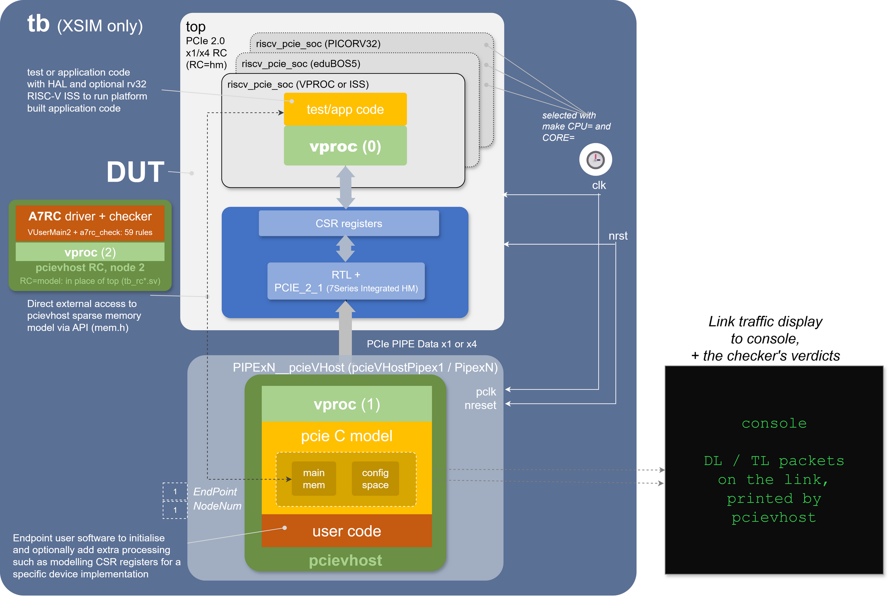

  

**openPCIE is an open-source PCIE Root Complex (RC) for the Artix-7 FPGA**, driven by a soft RISC-V SoC. It wraps the Xilinx Series-7 PCIE and GTP hard macros in open RTL, adds a bare-metal driver with a demo app, full HW/SW co-simulation, and an open backplane PCB to plug it all into. Gen2 link up on hardware; builds with Vivado or the fully open openXC7 toolchain.

Open PCIE peripherals for Artix-7 exist, but they are always controlled by a proprietary RC: a PC, or a Raspberry Pi. openPCIE lets makers drive PCIE peripherals from their own soft RISC-V SoC. It answers the call for open critical IP in _"Recommendations and Roadmap for European Sovereignty in open source HW, SW and RISC-V Technologies (2021)"_. Looking for an open soft PCIE EndPoint (EP)? See [openCologne-PCIE](https://github.com/chili-chips-ba/openCologne-PCIE).

| Where | What |
|---|---|
| [1.pcb](1.pcb) | openBackplane PCB (KiCad) |
| [2.rtl](2.rtl/README.md) | open RC RTL: [RC-direct](2.rtl/2.RC-direct.opensource/README.md), [RC-switched](2.rtl/3.Bonus--RC-switched.opensource/README.md), [eduBOS5 CPU](2.rtl/0.common.opensource/src/CPU.eduBOS5/README.md) |
| [3.sw](3.sw/README.md) | bare-metal PCIE driver and demo app |
| [4.build](4.build/README.md) | CSR, firmware and bitstream builds ([openXC7](4.build/hw_build.openXC7/README.md)) |
| [5.sim](5.sim/README.md) | HW/SW co-simulation with the pcieVHost VIP |
| [2.amd-rtl-with-Vivado-build](2.amd-rtl-with-Vivado-build/README.md) | AMD/Vivado-IP reference designs |

Long-term goal: a full open PCIE stack, phasing out the Xilinx hard macros, mixed-signal SerDes and PLLs included. This first phase builds on the Series-7 PCIE hard macro, the GTPs and their low-jitter PLL.

#### References
- [PCIE Primer](http://www.anita-simulators.org.uk/wyvernsemi/articles/pci_express.pdf) by Simon Southwell

--------------------

# HW Architecture

Our openPCIE Backplane, SQRL Acorn CLE-215+ FPGA modules and PCIE adapters form the test platform.

 

--------------------
### openBackplane PCB

    
    

Details: [1.pcb](1.pcb). KiCad library: [1.pcb/KiCad-library](1.pcb/KiCad-library/README.md). Plain-text versions of the PDF and slide documents: [0.doc/1.pcb](0.doc/1.pcb/README.md).

### FPGA Carrier

The **SQRL Acorn CLE-215+**, a former crypto-accelerator, is two boards:

*  **M.2 FPGA module (Acorn CLE-215+):** the **Xilinx Artix-7 XC7A200T** in an M.2 M-key form factor.

<table align="center" style="border: none; border-collapse: collapse;">
  <tr style="border: none;">
    <td align="center" style="border: none;">
      
    </td>
    <td align="center" style="border: none;">
      
    </td>
  </tr>
  <tr style="border: none;">
    <td align="center" style="border: none;"><b>M.2 FPGA Module (Top View)</b></td>
    <td align="center" style="border: none;"><b>M.2 FPGA Module (Bottom View)</b></td>
  </tr>
</table>

*  **PCIE adapter board (Acorn Baseboard Mini):** adapts M.2 to a **PCIE x4 edge connector**, for a regular motherboard slot.

<table align="center" style="border: none; border-collapse: collapse;">
  <tr style="border: none;">
    <td align="center" style="border: none;">
      
    </td>
    <td align="center" style="border: none;">
      
    </td>
  </tr>
  <tr style="border: none;">
    <td align="center" style="border: none;"><b>PCIE Adapter Board (Top View)</b></td>
    <td align="center" style="border: none;"><b>PCIE Adapter Board (Bottom View)</b></td>
  </tr>
</table>

  
   
  <b>The fully assembled Acorn CLE-215+ development board, ready for use in a PCIE slot.</b>

The Acorn CLE-215+ is a NiteFury with 1 GB of DDR3 instead of 512 MB, so the [NiteFury schematic](https://github.com/chili-chips/openPCIE/blob/main/0.doc/Reference-SCH/Schematic.FPGA-NiteFury.pdf) is an accurate reference. Its **Xilinx Artix-7 XC7A200T-FBG484** hosts the RC, and on the other card the EP:

| Specification | Value |
|---|---|
| Family | Xilinx Artix-7 |
| Speed Grade | -3 |
| Logic Cells (LUT4-Equivalent)¹ | 215,360 |
| LUT6 | 134,600 |
| Flip-Flops | 269,200 |
| Block RAM | 13 Mbit |
| DSP Slices | 740 |
| GTP Transceivers | 4 (up to 6.6 Gbit/s) |
| DDR3 SDRAM (Board) | 1 GB, 16-bit |
| QSPI Flash (Board) | 32 MB |
| User LEDs | 4 |
| General Purpose IOs | 4 |
| LVDS Pairs | 4 |

<small>¹ A Xilinx metric: the physical 6-input LUTs expressed as equivalent 4-input LUTs. The other counts are exact for the XC7A200T.</small>

#### References:
- [Acorn-CLE215+ QuickStart](https://github.com/SMB784/SQRL_quickstart)
- [NiteFury](https://github.com/RHSResearchLLC/NiteFury-and-LiteFury/tree/master)
- [fpgas.online-test-designs](https://github.com/fpgas-online/fpgas.online-test-designs/tree/main/designs/pcie-enumeration) PCIE ENUMERATION by RPI, for Acorn-CLE215+ EP

--------------------

# RTL Architecture

A chain of blocks joined by SystemVerilog interfaces: the RISC-V SoC hands TLPs over AXI-Stream to the PCIE stack, which converts them for the `PCIE_2_1` hard block and drives the GTP transceiver over PIPE.

 

Details: [RTL README](2.rtl/README.md#systemverilog-interfaces). Per design: [common RTL](2.rtl/0.common.opensource/README.md), [EP](2.rtl/1.EP.opensource/README.md), [RC-direct](2.rtl/2.RC-direct.opensource/README.md), [RC-switched](2.rtl/3.Bonus--RC-switched.opensource/README.md). AMD/Vivado-IP references: [2.amd-rtl-with-Vivado-build](2.amd-rtl-with-Vivado-build/README.md) ([EP](2.amd-rtl-with-Vivado-build/1.EP.amd/README.md), [RC-direct](2.amd-rtl-with-Vivado-build/2.RC-direct.amd/README.md), [RC-switched](2.amd-rtl-with-Vivado-build/3.Bonus--RC-switched.amd/README.md)).

#### References:
- [Basic PCIE EP for LiteFury](https://github.com/hdlguy/litefury_pcie)
- [Regymm PCIE](https://github.com/regymm/pcie_7x)
- [LiteX PCIE EP](https://github.com/enjoy-digital/litepcie)
- [PCIE EP DMA - Wupper](https://gitlab.nikhef.nl/franss/wupper)
- [Xilinx UG477 - 7Series Integrated Block PCIe](https://docs.xilinx.com/v/u/en-US/ug477_7Series_IntBlock_PCIe)
- [Xilinx DS821 - 7series_PCIE Datasheet](https://docs.xilinx.com/v/u/en-US/ds821_7series_pcie)
- [Xapp1052 - BusMaster DMA for EP](https://docs.xilinx.com/v/u/en-US/xapp1052)

--------------------

# SW Architecture

The driver runs **bare-metal** on the soft RISC-V SoC and does every enumeration step itself, the job an OS does on a PC.

 

| Layer | Does |
|---|---|
| Application | **Memory Write** of a payload to the EP, **Memory Read** to check it |
| PCIE driver | enumeration: discovers the device, sizes the BARs by read-back, assigns aligned addresses, checks every Completion Status, sets the **Command Register** |
| HAL | register reads and writes at fixed addresses |

The HAL and the CSR RTL are [auto-generated](4.build/README.md#csr-hal-compilation) by [`peakrdl`](https://peakrdl-cheader.readthedocs.io/en/latest/) from one SystemRDL file, [`4.build/csr_build/csr.rdl`](4.build/csr_build/csr.rdl): the register RTL (`csr.sv`, `csr_pkg.sv`, bridged to the CPU bus by [`soc_csr.sv`](2.rtl/0.common.opensource/src/soc_csr.sv)) and the header `csr.h`. The firmware reaches every register through `CSR_REG32()`: a load or store on eduBOS5 or PicoRV32, a *VProc* bus cycle when compiled for the host in co-sim.

Details: [SW README](3.sw/README.md).

--------------------

# Simulation Architecture

### Sim Test Bench

One [test bench](5.sim/README.md), three interchangeable CPUs: the RTL core that goes into the bitstream (eduBOS5 by default, or PicoRV32), or the [_VProc_ virtual processor](https://github.com/wyvernSemi/vproc), which runs the firmware much faster.

* CPU: [`make CPU=rtl|vproc|iss`](5.sim/README.md#the-three-cpu-options), all running the same firmware source and reaching the same result over the same link ([measured](5.sim/README.md#what-they-cost))
  * `vproc`: a [_VProc_](https://github.com/wyvernSemi/vproc)-based [`soc_cpu.VPROC.native`](5.sim/models/README.md#soc_cpuvprocnative), firmware compiled for the host
  * `iss`: RISC-V code on the [rv32 ISS model](5.sim/models/rv32/README.md)
* Link: the [_pcieVHost VIP_](https://github.com/wyvernSemi/pcievhost)
  * x1 or x4 (`make SIM_LANES=4`), always Gen1: pcieVHost models Gen1 only
  * RC-direct, or RC-switched (`make VARIANT=switched`): a switch with two endpoints and two empty slots, walked through in a [hands-on tutorial](5.sim/README.md#pcie-through-a-switch-a-hands-on-tutorial)
* Memory: a C [sparse memory model](https://github.com/wyvernSemi/mem_model), reachable from logic through an [HDL component](5.sim/models/cosim/README.md) and from _pcieVHost_ software through an API

**A first for open source:** to our knowledge, no open-source, rule-based PCIE protocol checker exists at any layer. Our Artix-7 RC model drives the EP and [checks every TLP and DLLP](5.sim/README.md#drive-and-check) against PCIe Base 2.1 rules, failing the run on any violation ([the gap](5.sim/README.md#open-source-pcie-validation-stacks)).

Follow the co-simulation at TLP level in [WaveCrux](https://wavecrux.app), with the [open-source PCIE TLP decoder plugin](https://github.com/Ferrite-Engineering/wavecrux-decoders/tree/main/decoders/pcie-tlp) and a ready-made session. Here the firmware sizes BAR0 by read-back and places it at `0x80000000` ([more](5.sim/README.md#viewing-the-tlps-in-wavecrux)):

One level down, Ferrite's [PCIe PIPE and Data Link Layer decoders](https://github.com/Ferrite-Engineering/wavecrux-decoders) show link training, flow-control credits, and every TLP with its sequence number and Ack ([more](5.sim/README.md#viewing-the-pipe-in-wavecrux)). With all three layers in one view, a TLP spends about 0.4 µs each way inside the hard macro ([more](5.sim/README.md#how-long-a-tlp-spends-in-the-hard-macro)).

#### References
- [pcieVHost](https://github.com/wyvernSemi/pcievhost/blob/master/doc/pcieVHost.pdf)
- [WaveCrux](https://wavecrux.app) waveform viewer, [decoder plugin interface](https://github.com/Ferrite-Engineering/wavecrux/blob/main/include/wavecrux_decoder.h)
- [wavecrux-decoders](https://github.com/Ferrite-Engineering/wavecrux-decoders): Ferrite's open-source PCIE PIPE and Data Link Layer decoders for WaveCrux

--------------------

# Implementation Workflow

 

| Step | Do | Details |
|---|---|---|
| 1. Tools | install an FPGA toolchain (**AMD Vivado** or **openXC7**), a bare-metal **RISC-V GCC** and Python; `source set-env.sh` checks them | [4.build](4.build/README.md#build-environment) |
| 2. Co-sim | run the HW/SW co-simulation: init, register access, link, RC-EP data exchange | [5.sim](5.sim/README.md) |
| 3. SW build | compile the bare-metal driver and test app | [4.build/sw_build](4.build/sw_build/README.md) |
| 4. HW build | synthesize, place, route, make the `.bit` (RC or EP) | [openXC7](4.build/hw_build.openXC7/README.md), [Vivado](4.build/README.md#hw-compilation) |
| 5. Deploy | program RC and EP boards, press reset, check link LED and payload | [below](#bringup-debug-bench-testing-and-demo) |

---

# Bringup, Debug, Bench Testing and Demo

### FPGA Board Setup

The SQRL board needs a custom JTAG cable, external power, and an open desktop chassis.

#### 1. Custom JTAG Cable

The board's JTAG connector does not fit the Xilinx Platform Cable's 14-pin plug.

<table align="center" style="border: none; border-collapse: collapse; width="60%">
  <tr style="border: none;">
    <td align="center" style="border: none;" width="60%">
      
    </td>
    <td align="center" style="border: none;" width="30%">
      
    </td>
  </tr>
  <tr style="border: none;">
    <td align="center" style="border: none;"><b>Custom JTAG Cable connecting the Xilinx Programmer to the board</b></td>
    <td align="center" style="border: none;"><b>JTAG Connector Pinout on the Board</b></td>
  </tr>
</table>

The board has a **Molex Pico-Lock 1.50 mm pitch male header**; DuPont cables do not fit. Buy **[Molex 0369200603 on Digi-Key](https://www.digikey.com/en/products/detail/molex/0369200603/10233020)** (female on both ends), cut it in half, and splice one end onto the Xilinx programmer's wires per this diagram:

  
   <em>JTAG Connection Guide: Physical Pinout and Wiring Diagram.</em>

#### 2. External 12V Power Supply

Slot power is not enough to program or run the board. Feed 12 V through a 6-pin PCIE connector from an ATX supply.

  
   <em>External 12V power connection.</em>

#### 3. Final Assembly

  
   <em>The complete FPGA system mounted in a PCIE slot.</em>

#### 4. JTAG Connectivity Test

**Vivado Hardware Manager** must detect the programmer and the `xc7a200t_0` FPGA:

  
   <em>Successful device detection in Vivado Hardware Manager.</em>

### Test Jig
- **PCB:** **openPCIE Backplane** ([1.pcb](1.pcb/)), with slots for RC, EP and the switch, on external 12 V.
- **FPGA boards:** two **SQRL Acorn CLE-215+**, one RC, one EP.
- **JTAG:** two **Xilinx Platform Cable USB**, each with the custom adapter.

  
   
  <em>The complete hardware validation environment for the Direct connection test.</em>

#### The "Dual-PC" JTAG Approach
**PC 1** drives the RC's JTAG, **PC 2** the EP's. No cable swapping, no flashing per iteration, and two **Vivado Hardware Manager** ILAs triggering at once show a transaction from both sides of the link.

### Test Procedure

1. Insert both FPGA cards into the **openPCIE Backplane** and connect **12 V**.
2. Program the RC from **PC 1** and the EP from **PC 2** (Vivado Hardware Manager).
3. Press and release the backplane's **reset button**: the RC enumerates and links with the EP. Each press re-initializes the link, no re-programming needed.

**Goal:** the RC enumerates, writes a payload to the EP, the EP stores it in its BRAM, and the RC reads it back (**Memory Write** and **Memory Read**).

### Bench Validation Steps

1. **LEDs:** the RC's **4 user LEDs** show **link status**; the EP's show the received data.
2. **ILA:** Vivado's Integrated Logic Analyzer on both PCs shows the data sent and received, its timing, and the transaction details.

### Bench Validation Results

**Verified on hardware, x1 Gen2:** link up and payload transfer, RC to EP.

- RC board: LED **A3** lit = PCIE link up.
- EP board: the LEDs show the payload. The RC sent decimal **6**, binary **`0110`**, and the LEDs match.

<table align="center" style="border: none; border-collapse: collapse;">
  <tr style="border: none;">
    <td align="center" style="border: none;">
       
    </td>
    <td align="center" style="border: none;">
       
    </td>
  </tr>
  <tr style="border: none;">
    <td align="center" style="border: none;"><b>RC-LED-Link-Up</b></td>
    <td align="center" style="border: none;"><b>EP-LED-Data-Payload</b></td>
  </tr>
</table>

#### Primary References
- [PCIE Utils](https://mj.ucw.cz/sw/pciutils)
- [Debug PCIE issues using 'lspci' and 'setpci'](https://adaptivesupport.amd.com/s/article/1148199?language=en_US)
- Using [busybox (devmem)](0.doc/using-busybox-devmem-for-reg-access.txt) for register access

#### Secondary References
PCIE Protocol Analyzers
- [PCIE Sniffing](https://ctf.re/pcie/experiment/linux/keysight/protocol-analyzer/2024/03/26/pcie-experiment-1)
- [Stark 75T Card](https://www.ebay.com/itm/396313189094?var=664969332633)
- [ngscopeclient](http://www.ngscopeclient.org/protocol-analysis)
- [PCI Leech](https://github.com/ufrisk/pcileech)
- [PCI Leech/ZDMA](https://github.com/ufrisk/pcileech-fpga/tree/master/ZDMA)
- [LiteX PCIE Screamer](https://github.com/enjoy-digital/pcie_screamer)
- [LiteX PCIE Analyzer](https://github.com/enjoy-digital/pcie_analyzer)
- [Wireshark PCIe Dissector](https://github.com/antmicro/wireshark-pcie-dissector)
- [PCIe Tool Hunt](https://scolton.blogspot.com/2023/05/pcie-deep-dive-part-1-tool-hunt.html)
- [PCIe network simulator](https://github.com/antmicro/warp-pipe)
- [An interesting PCIE tidbit: Peer-to-Peer communication](https://xilinx.github.io/XRT/2025.1/html/p2p.html). Also see [this](https://xillybus.com/tutorials/pci-express-tlp-pcie-primer-tutorial-guide-1)
- [NetTLP - An invasive method for intercepting PCIE TLPs](https://haeena.dev/nettlp)
- [PCIe on STM32MP257 with ngscopeclient](https://www.youtube.com/watch?v=qxdK3mjHNBM)
- [opensource PCIE Controller](https://www.mdpi.com/2076-3417/16/7/3409)

--------------------

# Project Status

All six parts of the plan are done.

#### `PART 1. Mini PCIE Backplane PCB`

Consumer RCs are soldered onto the motherboard, and FPGA boards are built as EPs: they expect clock, reset and sideband signals from the slot. Only professional systems (VPX, VITA 46.4) put RC and EP on add-on cards. No suitable ready-made backplane existed, so we built one: a mini backplane that gives the PCIE context of a motherboard, minus the soldered-down RC. **[Envox.eu](https://www.envox.eu)** developed the PCB.

 - ✅ Requirements document.
 - ✅ Components, schematic and PCB layout.
 - ✅ Review and iteration for 5 GT/s (PCIE Gen2), high-speed traces simulated with openEMS.
 - ✅ Prototype manufactured, brought up, Signal Integrity checked with AMD's on-chip IBERT.
 - ✅ Second batch with all improvements; design files released with full documentation.

#### `PART 2. Project setup and preparatory activities`
 - ✅ FPGA boards and PCIE accessories procured.
 - ✅ Prototype system brought up with proprietary RTL IP, SW driver, TestApp and Vivado.

#### `PART 3. Initial HW/SW implementation`
 - ✅ Open RTL that mimics the proprietary PCIE RC.
 - ✅ Open bare-metal driver for the RC, on the RISC-V SoC, no Linux ([SW Architecture](#sw-architecture)).
 - ✅ RISC-V SoC with the PCIE RC as its main peripheral.

#### `PART 4. HW/SW co-simulation using full PCIE EP model`

Planned as a simple EP BFM; grown, after NLnet's questions, into a full SoC co-simulation with **[wyvernSemi](https://github.com/wyvernSemi/pcievhost)** onboard. Their VProc models the RISC-V CPU and its SW, and their PCIE model provides an EP with a configurable configuration space, paired with our RC RTL.

 - ✅ PCIE model extended for more configurable EP capabilities.
 - ✅ Testbench built; testcases run and debugged.
 - ✅ EP model, TB and sim environment documented for reuse in other projects.

#### `PART 5. Integration, testing and iterative design refinements`
 - ✅ Proprietary elements of the PART 2 prototype replaced one by one with ours (except Vivado and TestApp), tested along the way.

#### `PART 6. Prepare Demo and port it to openXC7`

 - ✅ Open PIO TestApp and demo.
 - ✅ Design built with _openXC7_; issues reported and worked with the developers.

_ScalePNR_ was planned as a fallback for _nextpnr-xilinx_'s timing shortcomings; it was not needed. The _nextpnr-xilinx_ bitstream brings the link up at **Gen2** on hardware, as Vivado does. That took six fixes: one latent RTL bug and five workarounds for openXC7 defects, documented with the filed issues in [4.build/hw_build.openXC7](4.build/hw_build.openXC7/README.md).

The design now builds with [_openXC7_ 1.0.0](https://lnkd.in/p/gsDArjSt), what _"ScalePNR"_ evolved into: _Yosys 0.69_ with integrated _**Slang**_, _**nextpnr-himbaechel**_ and _**fpga-as**_. Slang makes the sv2v prep step unnecessary; sv2v stays as a cross-check option. We assemble with _fasm2frames_ and _xc7frames2bit_, as _fpga-as_ writes one GTP setting wrong ([#41](https://github.com/chili-chips-ba/openPCIE/issues/41)). The 1.0.0 bitstreams are not tested on hardware yet; the Gen2 result is from the earlier flow.

--------------------

### Beyond the plan

- **x4 and Gen2.** The RC builds as x4 Gen1 (default), x4 Gen2 or x1 Gen2, with the user clock scaled to the link (62.5, 125 or 250 MHz). Vivado meets timing on all three, and the x4 co-simulation passes. On hardware, the x4 link trained before the user-clock fix; x4 TLP traffic is not re-tested yet ([2.rtl](2.rtl/README.md#link-width-speed-and-user-clock)).
- **eduBOS5, our own RISC-V core.** It replaces PicoRV32 as the default CPU, with twice its IPC: the firmware finishes in 390.2 µs instead of 667.2 µs. Its 3-stage form is the only core here that closes x4 Gen2's 250 MHz. Checked against the ISA with riscv-formal, and its multicycle paths proven formally ([eduBOS5](2.rtl/0.common.opensource/src/CPU.eduBOS5/README.md)).
- **RC-switched in simulation.** A switch model behind the link (two endpoints, two empty ports) runs the RC-switched firmware end to end, enumeration through memory traffic ([5.sim](5.sim/README.md#rc-switched-a-switch-behind-the-link)).
- **A PCIE TLP decoder in WaveCrux.** Our experimental TLP decoder is now Ferrite's official `pcie-tlp` decoder in [wavecrux-decoders](https://github.com/Ferrite-Engineering/wavecrux-decoders/tree/main/decoders/pcie-tlp): every TLP of the co-simulation, named and paired, in the waveform viewer ([5.sim](5.sim/README.md#wavecrux-decoders)).

--------------------

### Academia Outreach
openPCIE is the basis of several Master's theses at the Faculty of Electrical Engineering, University of Sarajevo (ETF Sarajevo), among them those of Anes Vrce and [Aladin Brdar](https://www.linkedin.com/posts/abrdar1_proud-to-share-that-i-have-successfully-share-7512945056492904448-Ugtq/), shown here presenting his work on its hardware, software and simulation.

 

--------------------

### Acknowledgements
We are grateful to **NLnet Foundation** for their sponsorship of this development activity.

   
   

This project was funded through the NGI0 Core Fund, a fund established by NLnet with financial support from the European Commission's Next Generation Internet programme, under the aegis of DG Communications Networks, Content and Technology under grant agreement No 101092990.

The **wyvernSemi**'s wisdom and contribution made a great deal of difference -- Thank you, we are honored to have you on the project.

 

The **Envox**, our next-door buddy, is responsible for the birth of our backplane, which we like to call BB (not to be mistaken for their gorgeous blue beauty [BB3](https://www.envox.eu/eez-bb3))

  

  

**KiCad** turns electrical idea into a manufacturable board. **openXC7**, with **Yosys** at its core, turns RTL into a loadable FPGA bitfile. **PeakRDL** turns our SystemRDL file into CSR RTL+headers+RegMap docs. **WaveCrux** greatly facilitates waveform decoding and viewing. But, that's not everything that made this project possible -- Thank you all for these wonderful opensource tools :sparkles:.

  
  

  
  

  
  

  
  

  
  
  
  
  
  
  
  
  
  
  

### Crowd Supply Campaign
 - [Info Page](https://www.chili-chips.xyz/openpcie-backplane-put-your-fpga-in-control), [Intro Video](https://www.canva.com/design/DAHXSTcjxEc/odZj_VbgU20EEeZ1zuJlJA/watch?utm_content=DAHXSTcjxEc&utm_campaign=designshare&utm_medium=link2&utm_source=uniquelinks&utlId=h8306e0024f)
 - [Hackster](https://www.hackster.io/chili-chips-ba/openpcie-backplane-76fdb0)
 - [Elecrow](https://www.hackster.io/ElecrowOfficial/projects)

  
  

  
  
  

### Community Outreach:
- [2026-11-01, LinkedIn](https://lnkd.in/p/g3Qi_uvv)
- [2026-10-25, LinkedIn](https://lnkd.in/p/gNncVdNv)
- [2026-10-20, LinkedIn (Ferrite)](https://lnkd.in/p/g-yGBEU8)
- [2026-10-20, Hacker News](https://news.ycombinator.com/item?id=50162122)
- [2026-10-20, Mastodon](https://mastodon.social/@chili_chips/117472074410775767)
- [2026-10-19, daily.dev](https://daily.dev/posts/openpcie-fpga-root-complex-openbackplane-edubos5-risc-v-co-sim-cxzgaujjr)
- [2026-10-10](https://www.linkedin.com/feed/update/urn:li:activity:7509048253993242624?commentUrn=urn%3Ali%3Acomment%3A%28activity%3A7509048253993242624%2C7514858764861104128%29&dashCommentUrn=urn%3Ali%3Afsd_comment%3A%287514858764861104128%2Curn%3Ali%3Aactivity%3A7509048253993242624%29)
- [2026-10-05](https://lnkd.in/p/gVDkcKni)
- [2026-09-15](https://www.linkedin.com/posts/chili-chips_opensource-pcie-activity-7505034443674251264-eed-?utm_source=share&utm_medium=member_desktop&rcm=ACoAAAJv-TcBSi_5ff0VNMrInrT-xg44YF3jnyU)
- [2026-06-23](https://www.linkedin.com/posts/andrew-e-wilson_its-fun-bringing-all-the-fpga-vendors-together-share-7475267075234607104-j50-)
- [2026-01-26](https://www.linkedin.com/posts/chili-chips_fpga-pcie-riscv-activity-7421756737285734400-Lzlv?utm_source=share&utm_medium=member_desktop&rcm=ACoAAAJv-TcBSi_5ff0VNMrInrT-xg44YF3jnyU)
- [2025-12-19](https://www.linkedin.com/posts/chili-chips_opensource-fpga-gatemate-activity-7407180369269223424-laCE?utm_source=share&utm_medium=member_desktop&rcm=ACoAAAJv-TcBSi_5ff0VNMrInrT-xg44YF3jnyU)
- [2025-08-17](https://www.linkedin.com/pulse/pcie-model-c-simon-southwell-m2fve/?trackingId=CA4nW3if5DVRR%2BXN%2FIkQoQ%3D%3D)
- [2025-07-22](https://www.linkedin.com/posts/simon-southwell-7684482_pcie-vhdl-nvc-activity-7354160318052220929-K0Ku?utm_source=share&utm_medium=member_desktop&rcm=ACoAAAJv-TcBSi_5ff0VNMrInrT-xg44YF3jnyU)
- [2025-04-03](https://www.linkedin.com/feed/update/urn:li:activity:7313386031125303296?commentUrn=urn%3Ali%3Acomment%3A%28activity%3A7313386031125303296%2C7313594045216223236%29&dashCommentUrn=urn%3Ali%3Afsd_comment%3A%287313594045216223236%2Curn%3Ali%3Aactivity%3A7313386031125303296%29)

### Community Involvement

Want to help the open PCIE community grow? See [Contributions](CONTRIBUTING.md).

**Independent verification.** [openpcie-uvm](https://github.com/Sandeep-bhardwaj/openpcie-uvm) by Sandeep-bhardwaj (MIT, Oct 2026) is a UVM environment for our `riscv_pcie_soc` on Vivado xsim: the AXI4-Stream TLP port under backpressure, the bridge registers, completion capture, reset in mid-traffic. It tests openPCIE at `6e48e11` (July 2026), above the hard block; PCIE protocol is out of its scope. Its three findings, and where they stand on `main`:

| Finding | On `main` |
|---|---|
| RTL-SIM-001: `ram` written by both `$readmemh` and an `always_ff` (VCS refuses it) | fixed: a plain `always` |
| TX-PROTO-004: the TX state machine tests `tready` a cycle early; a stalling sink loses the TLP header | TX state machine rewritten in `2d810aa` to hold each beat until `tvalid && tready`; not re-run with its tests |
| REG-004: register writes ignore address bit 5 | the registers are now generated from SystemRDL (`soc_csr.sv`); not re-checked |

Questions are welcome ===> .

--------------------

### Future outlook

Next: **openPCIE3**, a 24-lane Gen3 backplane with Optical Copper Link (OCuLink), around the Diodes PI7C9X3G1224GP switch (PCIE 3.1, 24 lanes, 12 ports). It links one or two PCs, each over an x4 OCuLink cable, to four x4 EP connectors (two slots, two M.2).

Main use: a PC I/O extender for compute, storage or I/O cards, e.g. for open-source AI servers. The PC drives REFCLK and reset over the cable, so the board needs no local clock or reset generator. Design input is welcome in [#9](https://github.com/chili-chips-ba/openPCIE/issues/9) and [#13](https://github.com/chili-chips-ba/openPCIE/issues/13).

--------------------

### GenAI

Our repo may contain elements of work facilitated by the modern GenAI tools , used under strict guidance and tight supervision of the blood-and-flesh developers, and solely as suggestions.

In the end, it is us, the human devs, who are fully responsible for any shortfalls you may uncover while tapping into repo resources.

--------------------
#### End-of-Document
